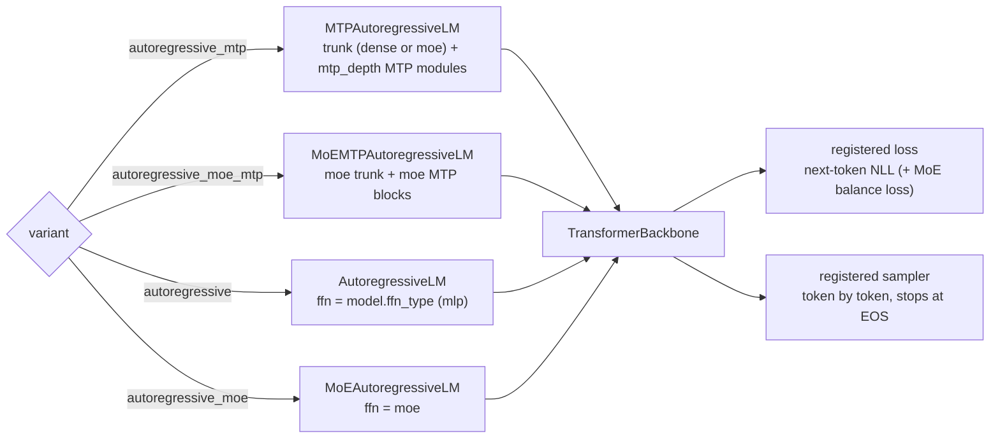
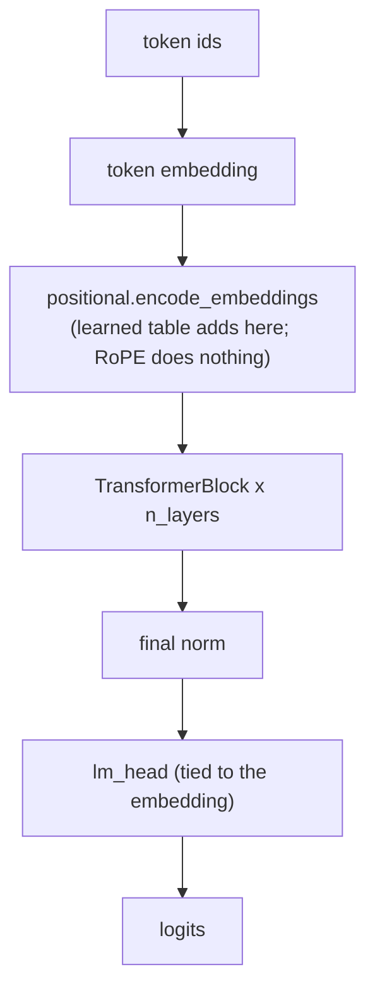
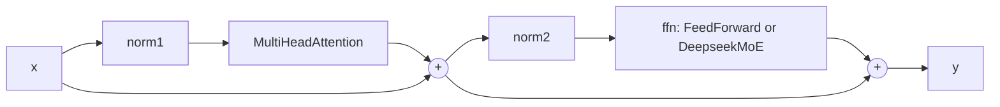
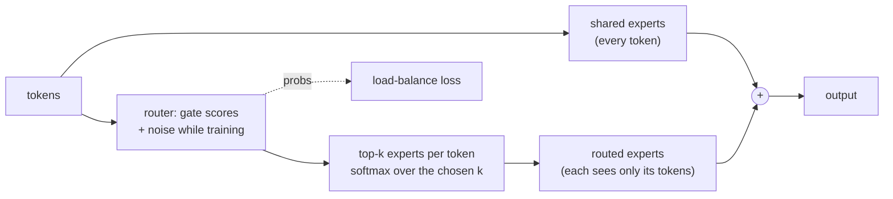

# Architecture

One decoder-only transformer, in four flavours: a dense feed-forward network, a DeepSeek-style
mixture of experts, or either of them with DeepSeek-V3 style multi-token prediction on top
([mtp.md](mtp.md)). All are model *variants* chosen by `variant:` in the YAML.

## The backbone

`TransformerBackbone` (`nn/backbones/`) owns the embedding, the positional encoding, the list of blocks
(`layers`, built by `build_blocks` in `nn/blocks/`), the final `norm` and the output head. `encode()` returns the hidden
states and `forward()` adds the head. The positional encoding and the norm are looked up by name (`model.pos_encoding`, `model.norm_type`), the feed-forward by `model.ffn_type`; each lookup is a
registry, so a new choice is one decorated class.

## One block

**Attention.** `MultiHeadAttention` holds `n_heads` `HeadAttention` modules. Each head projects the
input to a query, key and value of width `d_model / n_heads`, applies the positional hook (RoPE
rotates queries and keys), attends with a causal mask and scales the scores by
`1 / sqrt(head_size)`. The outputs are concatenated and mixed by one projection. The fused
`scaled_dot_product_attention` kernel does the work; `return_attn_weights=True` on a head switches to
an explicit softmax so the weights can be inspected.

## Mixture of experts

* `Router` scores every expert, keeps the top `k` and softmaxes over them. `BestKRouter` uses the plain
  gate; `NoisyBestKRouter` adds noise scaled by a learned amount while training.
* `Expert` is SwiGLU (`w2(silu(w1 x) * w3 x)`) or plain GELU.
* `DeepseekMoE` adds the shared experts' output to the weighted routed outputs. Each routed expert runs
  only on the tokens that picked it.
* While training, the layer computes a Switch-style balance loss `n_experts * sum(fraction_i * mean_prob_i)`
  (1.0 when tokens are spread evenly). The loss function adds it with weight `model.moe_aux_loss_coef`.

## Package layout

| Package | Holds |
|---|---|
| `nn/attention`, `nn/blocks`, `nn/moe`, `nn/backbones` | Heads, blocks, experts and routers, the backbone |
| `nn/positional`, `nn/norm` | RoPE (with scaling) and learned positions; LayerNorm and RMSNorm |
| `models/models_autoregressive` | The two variants: model, loss, sampler, collate |
| `registry` | `NamedRegistry`, `VariantRegistry`, and the model / loss / sampler / metric decorators |
| `runtime` | `CheckpointStore`, tensor helpers, the parameter summary |
| `optim` | `adam`, `adamw` (LLM recipe), `sgd`, `muon`, `dion` |
| `tokenizer`, `dataloader` | Trained SuperBPE / BPE tokenizer, context-window packing |
| `training`, `inference`, `chat`, `cli` | Lean trainer and TorchTitan launcher, sessions, chat, commands |

## Adding a model variant

1. A folder `models/models_<name>/` with a model class (`@register_variant`), a loss (`@register_loss`),
   a sampler (`@register_sampler`) and a collate function (`@register_collate`), all under the same name.
2. One import in `models/__init__.py`.
3. A YAML under `configs/`.
