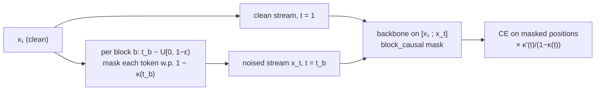

# Block flow matching (`variant: block_flow_matching`)

Block flow matching relates to `flow_matching` the way `block_diffusion` relates to `diffusion`.
It generates **autoregressively across blocks** and uses **discrete flow matching inside each
block**. The code is in
[`src/hale_llm/models/models_block_flow_matching/`](../src/hale_llm/models/models_block_flow_matching/).

| File | Content |
|---|---|
| `path.py` | `MaskingPath`: the `κ(t)` schedule, the rate `κ'/(1-κ)` and the exact Euler reveal probability; `corrupt_blocks` draws one `t` per block |
| `model.py` | `BlockFlowMatchingLM` (`@register_variant`) and its batch collator |
| `loss.py` | `@register_loss`: masked-token cross-entropy weighted by `κ'(t)/(1-κ(t))` |
| `sample.py` | `@register_sampler`: generates one block at a time, integrating the flow from `t: 0 → 1` inside each block |
| `metrics.py` | `masked_accuracy` |

## Probability path

A token is data with probability `κ(t)` and the mask token otherwise:

```
p_t(x | x₁) = κ(t) δ(x₁) + (1 − κ(t)) δ([MASK]),   κ(0) = 0, κ(1) = 1
```

There are two schedules, set with `model.fm_schedule`:

- `linear`: `κ = t`;
- `cosine`: `κ = 1 − cos(πt/2)`. It reveals few tokens early and most of them near `t = 1`.

The rate `κ'(t)/(1 − κ(t))` plays two roles. It is the weight of the cross-entropy at time `t`
(`1/(1 − t)` on the linear path, as in `flow_matching`). It also sets how fast masked tokens
are revealed while sampling.

## Training



The training sequence has two streams:

- The backbone reads `[x_clean ; x_t]`, which doubles the length.
- With the `block_causal` mask, noised block `b` sees the clean blocks before it and itself.
  The clean stream sits at the end of the flow (`t = 1`).
- Every block gets its own `t`, so one forward pass trains all blocks in parallel, each on its
  clean prefix.

## Sampling

The sampler fills blocks from left to right; blocks made only of prompt tokens are skipped. Each
block starts fully masked at `t = 0`. At each of the `sample.sampling_steps` Euler steps from `t`
to `t'`:

1. The model predicts `x₁` for every position in the block.
2. Each masked position takes its prediction with probability
   `(κ(t') − κ(t)) / (1 − κ(t))`. This is exact on the path for any step size.

A final greedy pass fills any token still masked at `t = 1`.

The output covers the blocks up to `prompt + max_new_tokens`. Its length is bounded by
`max_length`, as in `block_diffusion`. History frames carry `{block, num_blocks, block_size}`,
so the training GIFs highlight the active block.

## Config

```yaml
variant: block_flow_matching
model:
  attn_type: block_causal   # required
  use_time_cond: true       # required
  block_size: 16            # divides max_length
  fm_schedule: linear       # linear | cosine
sample:
  sampling_steps: 16        # Euler steps per block
  eps: 0.001                # t is kept below 1 − eps
```

There are two configs: `configs/block_flow_matching/small.yaml` (LGT, linear path) and
`configs/block_flow_matching/nano.yaml` (cosine path). Any `arch` works, including `looped`.

```bash
hale-llm-train --config configs/block_flow_matching/small.yaml --viz
hale-llm-sample --config configs/block_flow_matching/small.yaml --prompt "The meaning of life is"
```

## How it compares

| | `flow_matching` | `block_diffusion` | `block_flow_matching` |
|---|---|---|---|
| Across positions | all at once | autoregressive over blocks | autoregressive over blocks |
| Inside a block | masking flow `t: 0 → 1` | absorbing diffusion `t: 1 → 0` | masking flow `t: 0 → 1` |
| Loss weight | `1/(1 − t)` | `1/t` | `κ'(t)/(1 − κ(t))` |
| Variable length | no (fixed canvas) | yes (blocks) | yes (blocks) |

## References

- Campbell et al., *Generative Flows on Discrete State-Spaces*, ICML 2024, arXiv:2402.04997.
- Gat et al., *Discrete Flow Matching*, NeurIPS 2024, arXiv:2407.15595.
- Arriola et al., *Block Diffusion: Interpolating Between Autoregressive and Diffusion Language
  Models*, ICLR 2025, arXiv:2503.09573.
