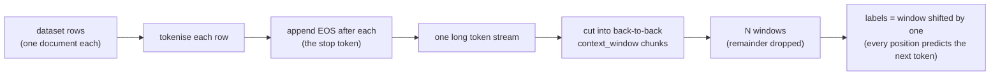

# Configuration reference

Every run is a YAML file under `configs/`. A config **inherits** another with `inherits:` (any depth) and overrides only what it needs. Unknown keys are rejected (`extra: forbid` in the Pydantic schema).

```yaml
inherits: ../autoregressive/nano.yaml
variant: autoregressive_moe
model:
  d_ff: 384
  moe_top_k: 2
```

Schema lives in [`src/hale_llm/config/sections/`](../src/hale_llm/config/sections/) (one file per YAML block). [`RunConfig`](../src/hale_llm/config/run.py) composes them; [`load_config`](../src/hale_llm/config/load.py) handles YAML inheritance.

```bash
uv run hale-llm-train --config configs/autoregressive/small.yaml --no-resume
```

CLI flags (`--epochs`, `--steps`, `--resume`, `--prompt`, `--experiment`) override YAML after load.

---

## Inheritance

1. Load the file you pass (`--config`).
2. If it has `inherits:`, load that parent first, and its parent, to any depth. Cycles are rejected.
3. Deep-merge: nested dicts merge; scalars in the child **replace** the parent.

`inherits` is not a `RunConfig` field; it is stripped during merge.

---

## Top-level

| Key | Type | Default | How to use |
|---|---|---|---|
| `variant` | string, **required** | none | Which registered model, loss and sampler to use: `autoregressive` (dense) or `autoregressive_moe` (mixture of experts). Must match a `@register_variant` name. |
| `model` | object | see below | Architecture. |
| `train` | object | see below | Optimizer, schedule, backend. |
| `data` | object | see below | Dataset and context windows. |
| `tokenizer` | object | see below | Trained tokenizer settings. |
| `sample` | object | see below | Generation defaults. |
| `eval` | object | see below | Metrics. |
| `logging` | object | see below | Log level, log file, TensorBoard. |
| `experiment` | object | see below | Run folders. |
| `device` | string \| `null` | auto | `cuda`, `mps` or `cpu`. |

---

## `model`

One decoder-only transformer. The blocks are pre-norm: `x + attention(norm(x))`, then `x + ffn(norm(x))`.

| Key | Type | Default | How to use |
|---|---|---|---|
| `d_model` | int | `128` | Width. Must be divisible by `n_heads`. |
| `n_heads` | int | `4` | Attention heads of width `d_model / n_heads`. |
| `n_layers` | int | `4` | Blocks. |
| `d_ff` | int | `512` | Hidden width of the dense MLP, and of each MoE expert unless `moe_hidden_dim` is set. |
| `dropout` | float | `0.0` | Attention-weight, projection and FFN dropout. |
| `max_length` | int | from `data.context_window` | Derived. Set `data.context_window` instead. |
| `tie_embeddings` | bool | `true` | Share the token embedding with the output head. |
| `pos_encoding` | `rope` \| `learned` | `rope` | Registered in `hale_llm.nn.positional`. Logged when the model is built. |
| `norm_type` | `layer` \| `rms` | `layer` | Registered in `hale_llm.nn.norm`. |
| `rope_theta` | float | `10000` | RoPE base frequency. |
| `rope_scaling` / `rope_scaling_factor` / `rope_original_length` | | `none` / `1.0` / `4096` | `none`, `linear` or `yarn`; see [context_length.md](context_length.md). |

### Feed-forward and mixture of experts

| Key | Type | Default | How to use |
|---|---|---|---|
| `ffn_type` | `mlp` \| `moe` | `mlp` | `mlp` = Linear-GELU-Linear. `moe` = DeepSeek-style experts. `variant: autoregressive_moe` sets this to `moe` when the config loads. |
| `moe_num_experts` | int | `4` | Routed experts per layer. |
| `moe_top_k` | int | `2` | Routed experts each token uses. At most `moe_num_experts`. |
| `moe_num_shared` | int | `1` | Shared experts every token passes through. |
| `moe_hidden_dim` | int \| `null` | `null` | Expert hidden width; `null` = `d_ff`. |
| `moe_router` | string | `noisy_topk` | `topk` or `noisy_topk` (Gaussian noise while training). Registry: `hale_llm.nn.moe`. |
| `moe_activation` | `swiglu` \| `gelu` | `swiglu` | Expert activation. SwiGLU has a third gate matrix. |
| `moe_aux_loss_coef` | float | `0.01` | Weight of the load-balancing loss added to the training loss (training only). |
| `mtp_depth` | int | `1` | `autoregressive_mtp` only: number of multi-token-prediction depths D. Tokens predicted per position = 1 (main head) + D. See `docs/mtp.md`. |
| `mtp_loss_weight` | float | `0.3` | `autoregressive_mtp` only: lambda in `next_token + lambda * (1/D) * sum(depth losses)` for the first part of training (training only). |
| `mtp_loss_weight_final` | float \| `null` | `0.1` | Lambda after the switch (DeepSeek-V3's step schedule). `null` = keep `mtp_loss_weight` for the whole run. |
| `mtp_switch_fraction` | float | `0.68` | Where the switch happens, as a fraction of the training steps (V3: 10 / 14.8). |
| `mtp_n_layers` | int | `1` | Transformer blocks per MTP depth. |
| `mtp_d_ff` | int \| `null` | `null` | Feed-forward (or expert) width of the MTP blocks; `null` = `d_ff`. |
| `mtp_ffn_type` | `mlp` \| `moe` \| `null` | `null` | Feed-forward type of the MTP blocks; `null` = `ffn_type`. |

---

## `train`

| Key | Type | Default (schema / `base.yaml`) | How to use |
|---|---|---|---|
| `epochs` | int \| `null` | `null` / `2000` | Full passes over the loader. If set, **wins** over `steps`. CLI: `--epochs`. |
| `steps` | int \| `null` | `300` / `null` | Optimizer steps if `epochs` is `null`. CLI: `--steps` (ignored when `--epochs` is set). |
| `lr` | float | `1e-3` / `3e-4` | AdamW learning rate. |
| `batch_size` | int | `8` / `32` | Sequences per step. `drop_last=True`; if the split is smaller than this, the loader is empty. |
| `weight_decay` | float | `0` / `0.01` | AdamW decay. |
| `log_every` | int | `50` / `100` | Log loss / lr / grad every N steps. |
| `grad_clip` | float | `1.0` | Global grad-norm clip. `0` or very large disables in practice if you change code; keep `1.0`. |
| `seed` | int | `0` | `torch.manual_seed`. |
| `checkpoint_path` | string | `checkpoints/last.pt` | Overwritten by the experiment layout to `.../checkpoints/last.pt`. |
| `resume` | bool | `true` / `false` | Continue an interrupted run: attach to the `latest` run folder (or `experiment.name`) and load its `resume.pt` if there is one; otherwise start from step 0. CLI `--resume` / `--no-resume`. See `docs/training.md`. |
| `loss_type` | `ce` \| `focal` \| `label_smoothing` | `ce` | Registered token loss. Add more with `@register_token_loss`. |
| `focal_gamma` | float | `2.0` | Focal focusing (`loss_type: focal`). |
| `focal_alpha` | float | `1.0` | Focal class weight. |
| `trainer` | `lean` \| `torchtitan` | `lean` | Training backend; see [training.md](training.md). `lean.*` and `titan.*` hold each backend's settings. |
| `optimizer_type` | `adamw` \| `adam` \| `sgd` \| `muon` | `adamw` | Default `adamw` is the LLM recipe: betas `(adam_beta1, adam_beta2)` = (0.9, 0.95), weight decay only on weight matrices (not norms, biases, embeddings).  `muon` uses Muon on the 2-D hidden weights and AdamW (at `lr`) on embeddings, the output head, norms and biases. |
| `adam_beta1` / `adam_beta2` | float | `0.9` / `0.95` | AdamW betas. |
| `muon_lr` | float | `0.02` | Learning rate of the Muon group. |
| `muon_momentum` | float | `0.95` | Muon momentum. |
| `label_smoothing` | float | `0.1` | Smoothing when `loss_type: label_smoothing`. |

**Schedule:** `epochs: 2000` and `steps: null` → 2000 epochs. `epochs: null` and `steps: 1000` → enough epochs to cover 1000 steps.

---

## `data`

`null` on sizes means **use the entire Hugging Face split**, not “no data.”

| Key | Type | Default | How to use |
|---|---|---|---|
| `source` | `huggingface` \| `overfit` | `huggingface` | Hub corpus vs repeated overfit string. `overfit_text` set also enables overfit. |
| `dataset` | string | `roneneldan/TinyStories` | Hub id: `load_dataset(dataset, subset, split=...)`. |
| `subset` | string \| `null` | `null` | Config name. `null` if the dataset has no configs (TinyStories has none). WikiText-2: `Salesforce/wikitext` + `wikitext-2-raw-v1`. |
| `train_split` | string | `train` | Split name on the Hub. |
| `val_split` | string | `validation` | Some datasets use `test` or `valid`. |
| `text_field` | string | `text` | Column with raw text. |
| `cache_dir` | string \| `null` | `null` | Hugging Face cache. `null` → default `~/.cache/huggingface`. |
| `tokenizer_name` | string | `gpt2` | Only used when `tokenizer.source: pretrained`. |
| `train_size` | int \| `null` | `100000` | Keep the first N Hub **rows** (not windows). `null` = all. TinyStories has 2.1M stories, so the default caps it; WikiText-2 is small enough for `null`. |
| `val_size` | int \| `null` | `1000` | Same for validation. |
| `context_window` | int | `128` | Tokens per training example **and the model's context length**. Rows are tokenised, an EOS token is appended after each, the stream is cut into back-to-back windows of this size (no overlap, no padding, remainder dropped). The log prints how many windows result. |
| `overfit_text` | string \| `null` | `null` | If set (or `source: overfit`), skip the Hub and pack this string. |
| `n_overfit_copies` | int | `64` | Repeated copies so `batch_size` and `drop_last` still work. |
| `add_special_tokens` | bool | `false` | Reserved for tokenizer encode; packed windows are encoded without special tokens (EOS is added between documents). |

### Recipes

TinyStories, 100k stories (current default):

```yaml
data:
  source: huggingface
  dataset: roneneldan/TinyStories
  subset: null
  train_size: 100000
  val_size: 1000
  context_window: 128
```

Full WikiText-2:

```yaml
data:
  dataset: Salesforce/wikitext
  subset: wikitext-2-raw-v1
  train_size: null
  val_size: null
```

Subset for debugging:

```yaml
data:
  train_size: 512
  val_size: 128
  context_window: 64
```

WikiText-103:

```yaml
data:
  subset: wikitext-103-raw-v1
```

Overfit:

```yaml
data:
  source: overfit
  overfit_text: "hello world this is a tiny overfit sentence"
  n_overfit_copies: 64
```

---

## `sample`

Used by `hale-llm-sample`, `hale-llm-infer` and `hale-llm-chat`.

| Key | Type | Default | How to use |
|---|---|---|---|
| `max_new_tokens` | int | `32` / `64` | Tokens to generate; generation also stops at EOS. |
| `temperature` | float | `1.0` | Softmax temperature. Lower = steadier text. |
| `prompt` | string | `"hello"` | Default prompt. CLI `--prompt` overrides. |
| `speculative` | bool | `true` | `autoregressive_mtp` only: draft with the MTP depths and verify with the trunk (exact); `false` = plain sampling. |

---

## `eval`

| Key | Type | Default | How to use |
|---|---|---|---|
| `metrics` | list of strings | `loss`, `perplexity`, `bits_per_token`, `token_accuracy` | Names from the metric registry (`topk_accuracy` is optional). Unknown names error. CLI `hale-llm-eval --metrics loss,perplexity`. |
| `every_n_epochs` | int \| `null` | `1` | Kept for configs; the lean trainer validates every `train.lean.eval_every` steps. |
| `max_batches` | int \| `null` | `null` | Cap validation batches. |

---

## `logging`

| Key | Type | Default | How to use |
|---|---|---|---|
| `level` | `DEBUG` \| `INFO` \| `WARNING` \| `ERROR` | `INFO` | Loguru level. CLI `--log-level`. |
| `log_file` | string \| `null` | `logs/hale_llm.log` | Redirected to `.../logs/train.log` under the experiment. `null` = stderr only. |
| `tensorboard` | bool | `true` | Write scalars. |
| `tensorboard_dir` | string | `runs` | Redirected to the run `tb/`. `tensorboard --logdir data/experiments`. |

The lean trainer writes TensorBoard logs to `<run>/tb/` (`tensorboard --logdir data/experiments`):

| Group | Tags | When |
|---|---|---|
| `train/` | `loss` (optimised), `ce_loss` (next-token loss alone), `perplexity`, `bits_per_token`, `grad_norm`, `grad_clipped`, `lr` (`lr_group1` for Muon), `lr_scale`, `tokens_seen`, `tokens_per_sec`, `step_seconds`, `epoch` | every optimizer step |
| `train/` | `moe_balance_loss` (mean over layers; 1.0 = perfectly even routing) | every step, MoE only |
| `val/` | `loss`, `perplexity`, `bits_per_token` | at step 0, every `train.lean.eval_every` steps, and the last step |
| `moe/` | `expert_share_max`, `expert_share_min`, and the same per layer (`layerN/...`) | every `train.log_every` steps, MoE only |
| `model/`, `system/` | `parameters`, `weight_norm`, `gpu_memory_gb` (CUDA) | `parameters` once, the rest every `log_every` steps |
| `context/` | `window` | every step |

The full resolved config is stored as text under `run/config`. `moe/expert_share_*` is the fraction of routing
decisions an expert received: with `E` experts an even split is `1/E`, so a max far above that or a min near 0
means the router is collapsing. `hale-llm-eval` writes `eval/*` scalars.

## `experiment`

| Key | Type | Default | How to use |
|---|---|---|---|
| `enabled` | bool | `true` | If `true`, checkpoints/logs/tb live under `root`. Tests set `false`. |
| `root` | string | `data/experiments` | Parent directory. |
| `name` | string \| `null` | `null` | Folder name. `null` → `<variant>_<YYYYMMDD_HHMMSS>`. CLI `--experiment NAME` reuses a folder. |
| `source_yaml` | string \| `null` | set at load | Path of the YAML you passed; do not set by hand. |

Layout:

```
data/experiments/<variant>/<variant>_<stamp>/
  config.yaml
  configs/
  checkpoints/last.pt
  logs/train.log
  tb/
latest -> <that folder>
```

---

## CLI vs YAML

| Command | Required | Useful flags |
|---|---|---|
| `hale-llm-train` | `--config` | `--no-resume` new run; `--experiment NAME`; `--epochs` / `--steps`; `--trainer`; `--dry-run` |
| `hale-llm-sample` | `--config` | `--experiment`, `--prompt`, `--checkpoint` |
| `hale-llm-eval` | `--config` | `--experiment`, `--metrics a,b` |
| `hale-llm-infer` / `hale-llm-chat` | `--config` | `--experiment`, `--checkpoint`, `--max-new-tokens`, `--temperature` |

Sample / eval attach to `latest` unless `--experiment` is set. They do not create a new run folder.

### Tokenizer, context stages, RoPE scaling

| Key | Default | Notes |
|---|---|---|
| `tokenizer.source` | `trained` | `trained` learns a byte-level tokenizer from the training split each run; `pretrained` uses `data.tokenizer_name`. See [tokenizer.md](tokenizer.md). |
| `tokenizer.kind` | `superbpe` | `superbpe` or `bpe` (registry). |
| `tokenizer.vocab_size` | `null` | `null` = chosen from the model size (32,768 under 500M parameters). |
| `tokenizer.vocab_policy` | `by_model_size` | Registry of sizing rules. |
| `tokenizer.transition_fraction` / `stage2_max_tokens` / `min_frequency` | `0.8` / `2000000` / `2` | SuperBPE stage split and limits. |
| `tokenizer.path` | `data/tokenizer` | Leave it at the default and every run gets its own `<run>/tokenizer`. Set it (as `configs/base.yaml` does: `data/tokenizers/tinystories_superbpe_shared`) and all runs share that one tokenizer: trained by the first run, reused by the rest. See [tokenizer.md](tokenizer.md). |
| `data.long_doc_fraction` / `long_doc_min_tokens` | `0` / `null` | Share of windows from naturally long documents. |
| `train.context_stages` | `[]` | Context-extension schedule; see [context_length.md](context_length.md). |
| `model.rope_scaling` / `rope_scaling_factor` / `rope_original_length` | `none` / `1.0` / `4096` | `none`, `linear` or `yarn`. |

### How text becomes training windows



Why non-overlapping: one forward pass over a window already gives a next-token prediction at
every position, so overlapping windows would only repeat tokens (more compute, no new data).
Overlap (a stride smaller than the window) is useful for *evaluating* perplexity, not for training.

**Stop token.** `<|endoftext|>` (id 0 in a trained tokenizer, 50256 in GPT-2) is the document separator and the stop token:
autoregressive generation ends when it is produced, and every generator cuts its text at the first
one. No start token is added. For reference, gpt-oss (`o200k_harmony` tokenizer) also does not
prepend a start token when generating; `gpt_oss/generate.py` encodes the prompt as-is and stops on
`<|endoftext|>` (id 199999). The tokenizer has no pad token: windows are always full, and reusing
EOS as padding would make the model ignore the stop token.

**Context length.** `data.context_window` is the only place to set it. gpt-oss similarly keeps the
model's native context in its config (`initial_context_length: 4096`, used for RoPE scaling) and
takes the runtime context from `--context-length`.
