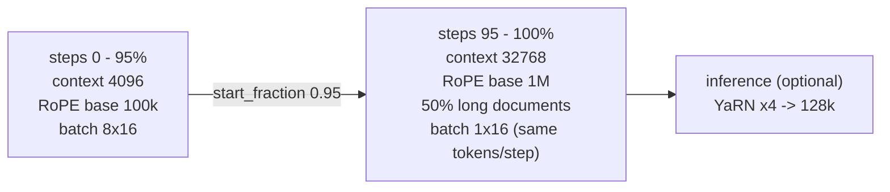

# Context length

Follows the usual recipe for pretraining at a modest length and extending late:

1. **Pretrain at 4k** (8k if the data is code-heavy) for about 90 to 95% of the tokens, RoPE base
   between 10k and 500k.
2. **Extend to 32k** for the last 2 to 5% of the tokens: raise the RoPE base to 1M to 5M and train on
   naturally long documents (books, papers, whole code files) *mixed with* normal data so short-context
   quality does not regress.
3. **Optionally go beyond** (64k to 128k) with YaRN scaling at inference on the 32k-trained model.
4. Post-training data should be at the target length too, or the model accepts 32k tokens but does not
   follow instructions at that length. (Post-training is not part of this repo.)



`data.context_window` is where the starting length is set; `model.max_length` is derived from it.
Stages live under `train.context_stages` and are supported by the lean trainer on RoPE transformers
(`pos_encoding: rope`); a learned position table has a fixed length, so stages need RoPE.

```yaml
data:
  context_window: 4096
model:
  rope_theta: 100000
train:
  context_stages:
    - name: extend_32k
      start_fraction: 0.95        # last 5% of the steps
      context_window: 32768
      rope_theta: 1000000
      long_doc_fraction: 0.5      # half the windows from long documents
      long_doc_min_tokens: null   # null = half the stage's window
```

A complete ~300M-parameter recipe is `configs/long_context/300m_4k_to_32k.yaml`
(tokens per step = 8 x 16 x 4096 = 524,288, so 20,000 steps is about 10B tokens). The repo's small
laptop configs stay at 128 tokens; this recipe has not been run here, only exercised at toy scale in
tests.

## What happens at a stage boundary

1. The model's length limit and RoPE base are updated (RoPE has no position table to resize).
2. New loaders are built with the stage's window, a smaller batch (`batch x old_window / new_window`,
   so tokens per step stay about constant) and the long-document mix.
3. `cfg` is updated, so the checkpoint records the **final** stage. Loading a checkpoint
   (`hale-llm-chat`, `-sample`, `-eval`) adopts the trained window and RoPE base instead of the YAML's.

## Long-document mixing

`data.long_doc_fraction` of the windows come from documents with at least `long_doc_min_tokens` tokens,
packed on their own so a window is mostly one document; the rest are the normal windows, and the total
number of windows is unchanged. If there are not enough long documents the log says so and uses all of
them. (TinyStories has no long documents; real long-context data does.)

## Running longer than the trained length: YaRN

```yaml
model:
  rope_scaling: yarn          # none | linear | yarn  (registry: hale_llm.nn.positional.scaling)
  rope_scaling_factor: 4.0    # target length / trained length
  rope_original_length: 32768 # the length the weights were trained at
data:
  context_window: 131072      # run at 128k
```

YaRN leaves fast-rotating channels alone, divides slow ones by the factor, blends in between, and
rescales attention by `0.1 ln(factor) + 1`. The formulas match gpt-oss's `RotaryEmbedding`
(`ext_pkgs/gpt-oss/gpt_oss/torch/model.py`). Quality at the extended length is not verified here.
