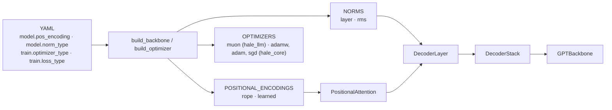

# Core library

`hale_llm.core` is a reusable decoder toolkit. Language-model training (losses, samplers, variants) lives beside it; **stacks and components do not depend on those**.

```
core/
  components/     attention, FFN, RMSNorm, TransformerLayer, DiTBlock
  transformers/   GPTStack, LGTStack, DiTStack   — hidden states (B, S, D)
  backbones/      GPT / LGT / DiT token LMs      — ids → logits
  registry.py     variant/loss/sampler plugins (this repo)
```

## VLM or world model

Supply your own embeddings (image patches, latents, text). Run a stack:

```python
from hale_llm.core.transformers import LGTStack, GPTStack, DiTStack

stack = LGTStack(d_model=512, n_heads=8, n_layers=12, d_ff=2048, use_time_cond=False)
hidden = stack(tokens, attn_mask=mask, positions=positions)  # (B, S, D)
```

`GPTStack` is a plain pre-norm decoder. `LGTStack` is local/global + dual RoPE. `DiTStack` is AdaLN-Zero (pass `t_emb`).

## Token language model

```python
from hale_llm.core.backbones import build_backbone, GPTBackbone, LGTBackbone, DiTBackbone

model = build_backbone(vocab_size, cfg.model)          # arch from YAML
logits = model(token_ids, t=t, attention_mask=mask)    # (B, S, V)
```

Register another stack with `@register_backbone("my_arch")` in `core/backbones/factory.py` (open/closed).

## Components

```python
from hale_llm.core.components import (
    build_attention, build_ffn, TransformerLayer, DiTBlock, RMSNorm,
)
```

## Registered building blocks (`hale_llm.nn`, `hale_llm.optim`)

Each switch in the YAML is a name looked up in a registry, so adding an option is one
decorated class and no edit to the code that uses it.



Add a scheme: `@register_positional_encoding("alibi")`, `@register_norm("scale")` or
`@register_optimizer("lion")`, then import the module once. `lgt` and `dit` backbones come
from hale_core and keep their own fixed RoPE/RMSNorm; the switches apply to `arch: transformer`.
