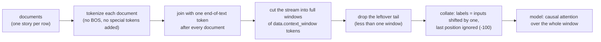

# How data is cut, padded and tagged: this repo and open models

## What this repo does

* The unit of cutting is **tokens, not paragraphs or sentences**: a window can start or end in the middle of a document, and
  several short documents share one window (about 5 TinyStories per 1024 tokens).
* **No padding** in pretraining: every window is full, and the tokenizer has no pad token (reusing end-of-text as padding would make
  the model ignore the very stop token it must learn). `pad_token_id: None` means "nothing is padding".
* Documents are separated by `<|endoftext|>` only. **Attention is not masked across documents**, and positions do not restart.
* One special token exists, `<|endoftext|>` (id 0): the document separator and the generation stop token.

## What the open models say

| | gpt-oss | Llama 3 | DeepSeek-V3 | this repo |
|---|---|---|---|---|
| Tokenizer | BPE `o200k_harmony`, 201,088 tokens | 128K: 100K tiktoken + 28K non-English | byte-level BPE, 128K | byte-level BPE / SuperBPE, 32,768 |
| How text is cut for pretraining | not stated | documents packed into sequences; lines repeated more than 6 times per bucket removed | document packing (after Ding et al., 2024), sequence length 4K | documents joined, cut into full windows |
| Attention across documents | not stated | **masked** ("limited impact" in standard pretraining, "important" for very long sequences) | **not masked** in pre-training (masked in SFT) | not masked |
| Padding | not stated | not mentioned in the paper | not mentioned for pre-training | none |
| Special tokens | harmony chat tokens + `<|endoftext|>` + reserved | see note | FIM tokens + EOS | `<|endoftext|>` |
| Fill-in-the-middle | not stated | not stated | rate 0.1, prefix-suffix-middle | none |
| Training length | not stated (128K via YaRN after) | 8K (up to 128K later) | 4K, then 32K, 128K | `data.context_window` |

How each row was checked: **gpt-oss** from the model card (arXiv 2508.10925: o200k_harmony, 201,088 tokens, "trillions of tokens",
nothing on packing or padding) and from the repo in `ext_pkgs/gpt-oss/gpt_oss/tokenizer.py`, which lists the special tokens:
`<|startoftext|>` 199998, `<|endoftext|>` 199999, `<|return|>`, `<|constrain|>`, `<|channel|>`, `<|start|>`, `<|end|>`, `<|message|>`,
`<|call|>` (ids 200002 to 200012) and `<|reserved_N|>` up to 201087. **Llama 3** from the paper (arXiv 2407.21783): vocabulary
and compression (3.94 characters per token on English), the document attention mask, line-level and MinHash deduplication, 8K
sequences. **DeepSeek-V3** from the report (arXiv 2412.19437, HTML version): packing without cross-sample masking, FIM at 0.1 with
`<|fim_begin|>`, `<|fim_hole|>`, `<|fim_end|>`, byte-level BPE, 128K vocabulary, 4K length, and the token-boundary fix
(randomly splitting tokens that combine punctuation and line breaks; the paper does not give the rate).

Not verified here, from tokenizer configs copied on the Hugging Face Hub, so treat them as likely but unchecked against Meta's and
Qwen's own repositories: Llama 3 chat control tokens `<|begin_of_text|>`, `<|end_of_text|>`, `<|start_header_id|>`,
`<|end_header_id|>`, `<|eot_id|>`, `<|python_tag|>` and a `<|finetune_right_pad_id|>` used as padding when fine-tuning; Qwen2.5 `<|endoftext|>`
(id 151643), `<|im_start|>`, `<|im_end|>`. Nothing was found for OLMo 2's packing. The papers do not describe cutting at paragraphs
or sentences for pretraining; what they describe is document-level filtering and deduplication, then token packing. Padding appears
around post-training and batching, not pretraining.

## What SmolLM3 says (Hugging Face blog, July 2025)

Read from the blog post (https://huggingface.co/blog/smollm3). The separate *Smol Training Playbook* page could not be read (its text is
rendered in the browser), so nothing below is taken from it.

* **Document masking: used.** "We use attention masking to ensure tokens from different documents in the same training sequence don't attend to
  each other" (citing arXiv 2402.13991), "similar to Llama 3", for faster and more stable long-context training while keeping short-context
  quality. The blog gives no number for it: only that every change was validated in ablations on a 3B model with 100B FineWeb-Edu tokens.
* **Tokenizer:** the comments say the Llama 3.2 tokenizer "as is (except for removing bos_token)", so no start token, like this repo. The post body does
  not name it.
* **Same recipe pieces as this repo:** tied embeddings, AdamW with betas 0.9/0.95, weight decay 0.1, gradient clip 1, a warmup / flat /
  linear-decay schedule (WSD: decay over the last 10%), no weight decay on the embeddings (this repo already leaves them out).
* **Not here:** GQA, NoPE (rotary positions removed from every 4th layer), packing choices after pretraining ("wrapped packing" for reasoning
  mid-training, best-fit-decreasing packing for SFT).

## Gaps and options for this repo

* **Cross-document attention.** Llama 3 masks it, DeepSeek-V3 does not; Llama reports little effect at standard lengths. Here short stories share
  windows, so a block-diagonal document mask is the cheapest thing to try if you want to test the effect.
* **Special tokens.** Pretraining needs only the end-of-text token. Chat or tool use would need role/turn tokens (gpt-oss, Llama, Qwen all add
  them for post-training), a separate pad token for batched fine-tuning, and reserved slots to add later without resizing the embedding.
* **Token-boundary bias.** SuperBPE merges across spaces and line breaks, so the model sees a boundary that moves with the text; DeepSeek-V3 randomises
  merged punctuation-and-newline tokens for this reason. Not done here.
* **Literal special-token text.** A document containing the string `<|endoftext|>` is tokenized to the end-of-text id (standard behaviour);
  TinyStories does not contain it.

## Document masking flag

`model.document_masking: true` (default `false`) makes a token attend only to earlier tokens of its own document.
Document numbers come from the end-of-text positions in each window (`dataloader/document_ids.py`), travel in the
batch as `document_ids`, become a `[B, S, S]` mask (`nn/attention/document_mask.py`) and reach every attention
block, including the MTP depths. With the flag off the batch has no `document_ids` and nothing changes (parameter
and logit fingerprints are bit-identical to before). Costs a `[B, S, S]` bool mask per step and uses the fused
kernel with an explicit mask instead of `is_causal`.
