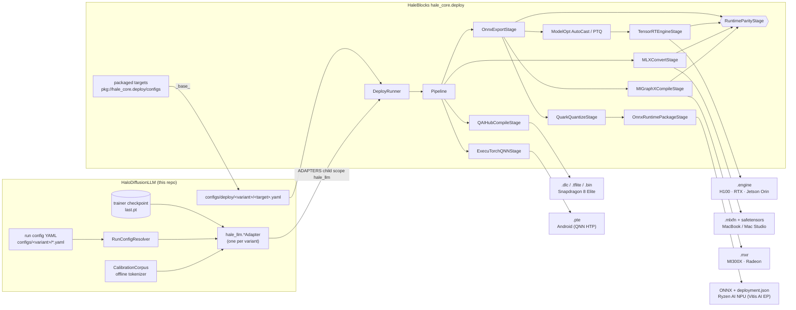
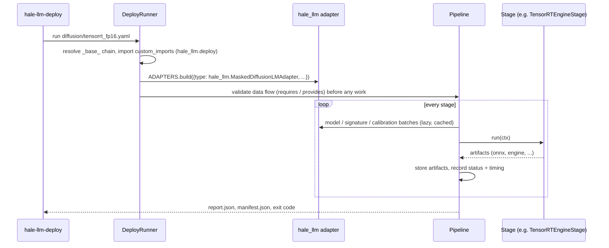

# Deploying HaloDiffusionLLM models

Every registered variant can be exported to NVIDIA (TensorRT 10/11, Jetson, TensorRT-RTX),
Apple Silicon (MLX), AMD (MIGraphX on Instinct/Radeon, Ryzen AI NPU through Quark + Vitis AI)
and Qualcomm (Snapdragon NPU through AI Hub or ExecuTorch QNN). The heavy lifting lives in
HaleBlocks' `hale_core.deploy` framework (stages, registries, config inheritance, parity
checks, the torch → MLX bridge); this repository contributes one **adapter per variant** and
the configs that bind variants to targets.

```bash
pip install -e ".[deploy]"            # + deploy-nvidia | deploy-apple | deploy-amd | deploy-qualcomm
hale-llm-deploy env                   # which backends this machine can run
hale-llm-deploy list                  # stages, runtimes, and the hale_llm.* adapters
hale-llm-deploy run configs/deploy/diffusion/tensorrt_fp16.yaml \
    --cfg-options adapter.checkpoint=data/checkpoints/last.pt
```

Artifacts land in `work_dirs/deploy/<name>/<stage>/` together with `config.yaml` (the merged
config), `manifest.json` (every artifact with size and sha256) and `report.json`.

## Architecture





## Variants and their export contracts

All token inputs are `int64` ids in `[0, vocab)`; `vocab = 50258` for the GPT-2 tokenizer plus
the `[MASK]` token (read from the checkpoint when one is given). `batch ∈ [1, max_batch]`.

| variant | adapter (`hale_llm.`…) | inputs | outputs | seq | what the app runs |
|---|---|---|---|---|---|
| autoregressive | `AutoregressiveLMAdapter` | `input_ids [B,T]` | `logits [B,T,V]` | dynamic `[1, max_length]` | prefill per generated token |
| looped | `LoopedLMAdapter` | `input_ids` | `logits` | dynamic | loop unrolled `n_loops` times |
| mtp | `MultiTokenPredictionLMAdapter` | `input_ids` | `logits`, `draft_logits_1..K-1` | dynamic | self-speculative decoding, one model |
| diffusion | `MaskedDiffusionLMAdapter` | `x_t [B,T]`, `t [B]` | `logits` | static `max_length` | `sampling_steps` denoiser calls |
| flow_matching | `FlowMatchingLMAdapter` | `x_t`, `t [B]` | `logits` | static | Euler steps `t: 0 → 1` |
| block_diffusion | `BlockDiffusionLMAdapter` | `x_clean`, `x_noised`, `t_noised [B,T]` | `logits` | static | per-block denoising |
| block_flow_matching | `BlockFlowMatchingLMAdapter` | `x_clean`, `x_t`, `t [B,T]` | `logits` | static | per-block Euler steps |

The samplers (unmasking schedules, Euler steps, speculative verification) stay in the
application: the exported artifact is the network, called by the same loop as
`hale_llm.inference`.

### Targets per variant

Every variant has the nine target configs below (`configs/deploy/<variant>/`), each inheriting a
packaged HaleBlocks target:

| target | vendor / hardware | pipeline |
|---|---|---|
| `tensorrt_fp16` | NVIDIA H100/H200/B200/L40S | ONNX → ORT parity → ModelOpt AutoCast (TRT 11) → engine → engine parity |
| `tensorrt_int8_modelopt` | NVIDIA | ONNX → ModelOpt INT8 Q/DQ (real-text calibration) → strongly typed engine |
| `jetson_orin_dla_fp16` | Jetson Orin (JetPack 6, TRT 10) | ONNX → engine with DLA core 0 + GPU fallback (build on the device) |
| `mlx_fp16` / `mlx_int4` | MacBook / Mac Studio | torch.export → ATen→MLX bridge → `.mlxfn` + safetensors → MLX parity |
| `migraphx_fp16` | AMD MI300X / Radeon (ROCm 7) | ONNX → MIGraphX `.mxr` (AOT) → parity |
| `ryzen_ai_npu_a16w8` | Ryzen AI 300 NPU | ONNX → Quark A16W8 → ORT + VitisAI EP bundle |
| `aihub_qnn_dlc_w8a16` | Snapdragon 8 Elite (Galaxy S25) | AI Hub compile (QNN DLC, W8A16) + profile + on-device parity |
| `executorch_qnn_16a8w` | Snapdragon 8 Gen 3 | ExecuTorch + QNN HTP delegate, PT2E 16a8w → `.pte` |

### Verified on this repo (Apple Silicon, tiny CI models)

`configs/deploy/ci/` runs every variant end to end (`tests/integration/test_deploy_pipelines.py`):

* ONNX (dynamo exporter, TorchScript fallback) → ONNX Runtime: all 7 variants pass at the
  min / opt / max shapes (max abs error < 1e-3, fp32).
* MLX fp32 through the ATen → MLX bridge: all 7 variants pass (max abs error < 1e-4).

TensorRT, MIGraphX, Quark, AI Hub and ExecuTorch QNN need their SDK / hardware; their configs
are validated (they build valid pipelines) and the stages are unit-tested in HaleBlocks against
SDK fakes.

### Not supported (and why)

* **TensorRT-LLM / mlx-lm / mlx-vlm** - they serve Hugging Face architectures; Hale variants are
  custom (bidirectional denoisers, block-causal two-stream inputs, MTP heads), so the adapters
  return no HF checkpoint. The ONNX / MLX graph paths above are the deployment route.
* **ACT halting (looped)** - per-token early exit is data-dependent control flow; exporters
  trace a fixed graph. Deploy with `halting: none` (the adapter rejects ACT configs explicitly).
* **Dynamic sequence length for LGT-based diffusion configs** - the LGT backbone guards
  positions with a Python `min(seq, max_length)` that `torch.export` cannot prove for a
  symbolic length. The diffusion-family samplers use a fixed canvas, so these adapters export a
  static `max_length` (set `dynamic_seq: true` for `arch: transformer` models).
* **KV cache** - exported causal graphs recompute the prefix; an incremental-decoding graph
  would need an explicit cache-in / cache-out signature (future work).

## Calibration

Quantizing targets use `AdapterCalibrationSource`: each adapter tokenizes a small built-in
corpus with the run's tokenizer (`local_files_only` - a deployment job never downloads) and
applies the variant's own corruption (masking with a sampled `t`, per-block times), so the
quantizer sees the activations the model sees in production. Without a cached tokenizer the
pipeline falls back to random ids.

## Research notes (October 2026)

* **TensorRT 11** is strongly typed only: `kFP16/kINT8/...` builder flags and the INT8 calibrator
  are removed; precision comes from the ONNX graph via **ModelOpt AutoCast** (mixed precision)
  or ModelOpt Q/DQ quantization
  ([migration guide](https://docs.nvidia.com/deeplearning/tensorrt/latest/api/migration/tensorrt-10x-to-11x-c-api-patterns.html),
  [ModelOpt](https://nvidia.github.io/Model-Optimizer/reference/0_changelog.html)). The stage
  feature-detects TensorRT 10 vs 11.
* **TensorRT-LLM 1.2** removed the TensorRT engine backend and `trtllm-build`; the PyTorch backend
  is the only one ([release notes](https://nvidia.github.io/TensorRT-LLM/release-notes.html)).
* **MLX** exports traced functions to `.mlxfn` with `mx.export_function` / `mx.exporter`
  (several shapes per file), importable from Python, C++ and Swift
  ([export guide](https://www.mintlify.com/ml-explore/mlx/guides/export)).
* **ROCm 7.1+** drops ONNX Runtime's ROCm EP; MIGraphX (directly or as the MIGraphX EP) is the
  AMD GPU path ([ORT ROCm EP](https://onnxruntime.ai/docs/execution-providers/ROCm-ExecutionProvider.html)).
* **Ryzen AI** NPUs run INT8 / BF16 ONNX through the Vitis AI EP; **Quark** A16W8 is the
  recommended transformer preset ([Vitis AI EP](https://onnxruntime.ai/docs/execution-providers/Vitis-AI-ExecutionProvider.html),
  [Quark A16W8](https://quark.docs.amd.com/release-0.11/supported_accelerators/ryzenai/tutorial_a8w8_and_a16w8_quantize.html)).
* **Qualcomm AI Hub** deprecated `qnn_context_binary` (Mar 2026) and `precompiled_qnn_onnx`
  (May 2026) as compile targets; context binaries come from `submit_compile_and_link_jobs`
  ([release notes](https://workbench.aihub.qualcomm.com/docs/hub/release_notes.html),
  [API](https://workbench.aihub.qualcomm.com/docs/hub/api.html)).
* **ExecuTorch QNN**: `to_edge_transform_and_lower_to_qnn` + `QnnQuantizer` (PT2E), QNN SDK 2.37
  recommended ([backend docs](https://docs.pytorch.org/executorch/1.2/_sources/backends-qualcomm.md.txt)).

## Vendored SDK sources

`ext_pkgs/` holds shallow git submodules of the vendor SDKs (TensorRT, TensorRT-LLM,
Model-Optimizer, Torch-TensorRT, MLX, MIGraphX, Quark, Ryzen AI SW, AI Hub models, ExecuTorch)
for reading samples and pinning versions; see `ext_pkgs/README.md`. Fetch them with
`git submodule update --init --depth 1 ext_pkgs/<name>` (do not recurse).
