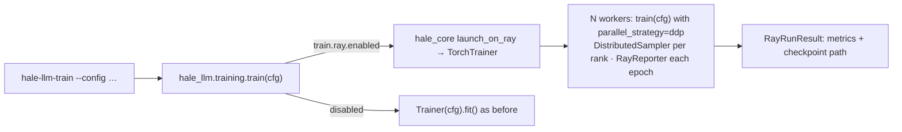

# Ray Train and WebDataset

Both features come from HaleBlocks (`hale_core.distributed.ray`, `hale_core.data.webdataset`;
design and internals in HaleBlocks' `docs/distributed_training.md`). This page covers what
`hale-llm` adds. Install the extras with `uv sync --extra distributed`, or `--extra ray` /
`--extra webdataset` for one of them.

## Ray Train: `train.ray`

* `hale_llm.training.train` checks `cfg.train.ray.enabled`. On the driver it launches the same
  function on `num_workers` Ray workers. Each worker trains with DDP: Ray creates the process
  group, which `setup_distributed` picks up.
* Each rank reads its own shard of the token windows (`DistributedSampler`, reshuffled every
  epoch with `set_epoch`).
* At the end of every epoch all ranks report `epoch`, `global_step`, `train/epoch_loss` and any
  `eval/*` metrics, and rank 0 attaches the checkpoint directory. After a worker failure Ray
  restarts the group and the checkpoint is restored into `train.checkpoint_path`, so
  `train.resume: true` continues from it. `max_failures` sets how many times this can happen.
* On the driver `train()` returns a `RayRunResult` (`metrics`, `checkpoint_path`) instead of
  `(model, tokenizer, losses)`.

| key | default | meaning |
|---|---|---|
| `enabled` | `false` | launch through Ray Train |
| `address` | `null` | `null` = local Ray instance, `"auto"` / `"ray://host:10001"` = join a cluster |
| `num_workers` | `1` | data-parallel replicas |
| `use_gpu` / `resources_per_worker` | `false` / `{}` | GPU per worker / e.g. `{CPU: 8, GPU: 1}` |
| `storage_path` | `ray_results` | where reported checkpoints and results are stored |
| `max_failures` / `num_to_keep` | `0` / `2` | fault tolerance / checkpoints kept |
| `backend` | `auto` | NCCL with GPUs, Gloo on CPU |

## WebDataset: `data.webdataset`

With `enabled: true`, `make_dataloader` builds the `HuggingFaceTextDataset` (download +
tokenisation into windows) **only if** no valid shards exist. It writes the windows to
`<root>/<dataset>-<subset>-<split>-<fingerprint>/shard-*.tar` and then streams them. The
fingerprint hashes everything that changes the windows: dataset, subset, split, size, text
field, tokenizer, `max_length`, `stride_words` and `add_special_tokens`. Changing any of these
writes a new shard set, and the old ones are kept. Batches are identical to the non-WebDataset
loader (tested). Overfit mode (`data.overfit_text`) is a debugging path and is not converted.

| key | default | meaning |
|---|---|---|
| `enabled` | `false` | convert + stream |
| `root` | `data/webdataset` | shard root |
| `samples_per_shard` | `1000` | windows per tar file (write ≥ ranks × loader workers shards) |
| `convert_workers` | `0` | parallel reads while converting |
| `shuffle_buffer` | `1000` | in-memory sample shuffle for training |
| `resample` | `auto` | equal-length epochs on every rank when several ranks train |
| `overwrite` | `false` | force re-conversion |
