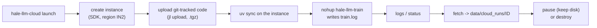

# Training on Jarvislabs (India GPUs)

`hale-llm-cloud` rents a [Jarvislabs](https://jarvislabs.ai) GPU, ships this repo to it, starts
`hale-llm-train` in the background, and lets you follow the log and download the results.



## One-time setup

1. Create an account, add wallet credit, and create an API key at <https://jarvislabs.ai/settings/api-keys>.
2. Install the client and store the key (the key is saved on your machine, never in the repo):

   ```bash
   uv sync --extra cloud
   uv run jl setup            # or: export JL_API_KEY=...
   ```

## Run a training

```bash
# Check the config on your own machine first (3 steps, reports params, loss, memory).
uv run hale-llm-train --config configs/autoregressive_moe/nano.yaml --dry-run

# Rent a GPU, upload the code, start training. Flags after the config go to hale-llm-train.
uv run hale-llm-cloud launch --config configs/autoregressive_moe/nano.yaml --steps 2000
```

Add `--auto-pause` to `launch` and it stays connected: when training ends (or crashes) it downloads the
results and **pauses the instance**, so billing stops without you. If the download fails it still pauses
(the disk is kept). Your terminal must stay open and the laptop awake; if you disconnect, reattach with
`hale-llm-cloud finish <machine_id>` (the same wait, download and pause).

`launch` prints a `machine_id`. Use it for everything else:

```bash
uv run hale-llm-cloud status  <machine_id>          # Running / Paused, cost, is training alive
uv run hale-llm-cloud logs    <machine_id> --tail 60
uv run hale-llm-cloud finish  <machine_id>          # wait for the end, download, pause
uv run hale-llm-cloud fetch   <machine_id> --pause  # download results, then stop compute billing
uv run hale-llm-cloud destroy <machine_id> --yes    # delete the instance and its disk
```

Results land in `data/cloud_runs/<machine_id>/` (checkpoints, `tb/` TensorBoard logs, tokenizer copy),
so nothing under `data/experiments/` is overwritten. View curves with
`uv run tensorboard --logdir data/cloud_runs/<machine_id>`.

Reuse a paused or running instance (skips renting; re-uploads the code):
`hale-llm-cloud launch --config ... --machine-id <machine_id>`.

## Settings

`configs/cloud/jarvislabs.yaml` (pass another file with `--cloud`):

| Key | Meaning |
|---|---|
| `gpu_type` | A30, L4, A100, A100-80GB, H100, H200, RTX-PRO6000 |
| `num_gpus` | GPUs on the instance (the lean trainer uses one) |
| `region` | `IN2` (L4, A30, A100, A100-80GB, H100, H200) or `IN1` (RTX-PRO6000); `null` lets Jarvislabs pick |
| `storage_gb` | Disk size |
| `remote_dir` | Where the code is unpacked on the instance |

## What gets uploaded

Only git-tracked files, with your working-tree edits (so commit new files or `git add` them first).
`ext_pkgs/` and `assets/` are skipped. The shared tokenizer under `data/tokenizers/` is tracked, so the
instance uses the same token ids as your machine.

## Costs and cautions

* A running instance bills per hour. **`pause` stops compute billing but keeps a small storage charge;
  `destroy` deletes everything.** Pausing needs your Jarvislabs API key, which stays on your machine, so
  the instance cannot pause itself. Use `launch --auto-pause` or `finish`, or run `fetch --pause` yourself.
  If your laptop sleeps before training ends, the instance keeps billing.
* Check prices with `uv run jl gpus`.
* `uv sync` on the instance installs the locked PyTorch build, which is a large download on first launch.
* The lean trainer is single-GPU. TorchTitan multi-GPU runs are not wired into this command.
* The log is `<remote_dir>/train.log` on the instance; `logs` reads it. The training exit code is written to
  `train.exit` next to it, which is how the tool knows training has ended.

## Not verified

The code is unit-tested against a fake SDK and a fake `jl`. It has **not** been run against a real
Jarvislabs account here, so the first `launch` is the real test. Watch the first `logs` output.

## Code map

| Piece | File |
|---|---|
| Instance settings | `cloud/jarvislabs/settings.py` |
| Create / pause / destroy (SDK) | `cloud/jarvislabs/instance_manager.py` |
| `jl` exec / upload / download | `cloud/jarvislabs/jl_cli.py` |
| Tracked-files tarball | `cloud/jarvislabs/project_archive.py` |
| Deploy, start, logs, fetch | `cloud/jarvislabs/remote_training_job.py` |
| Command line | `cli/cloud.py` |
