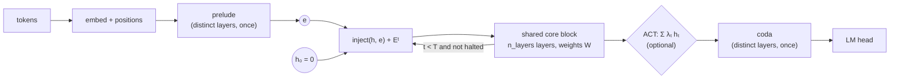
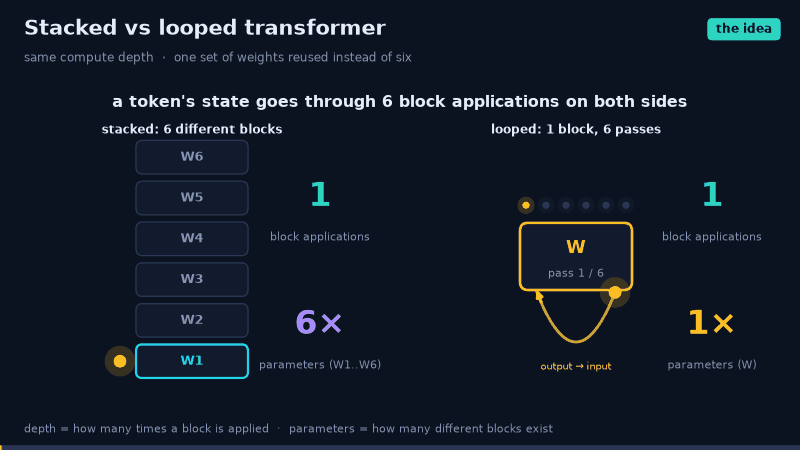
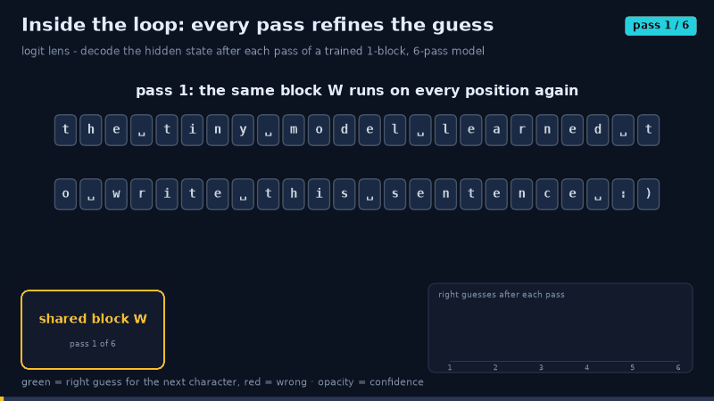
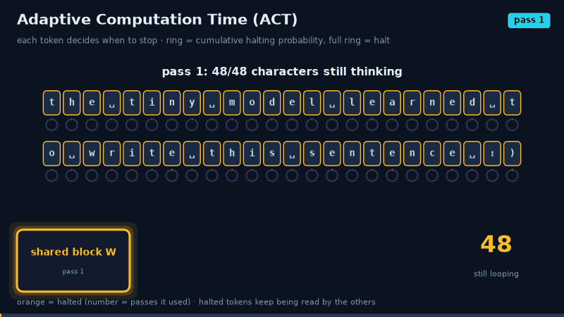
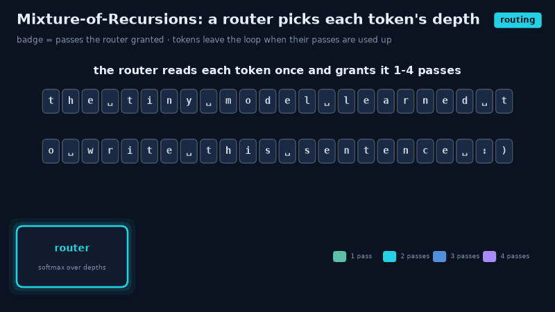
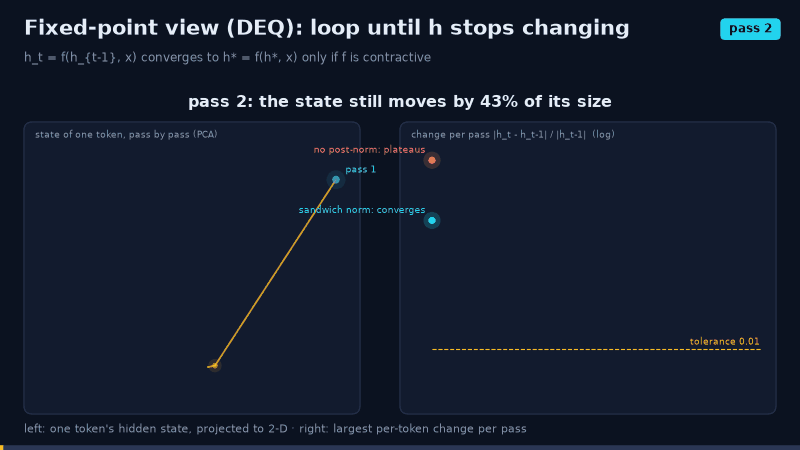
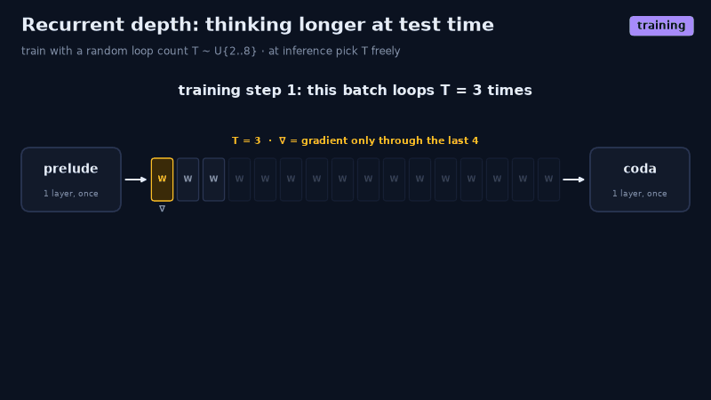
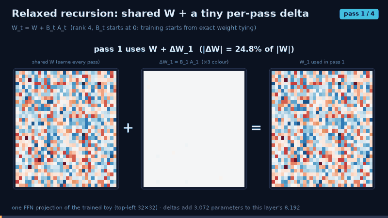
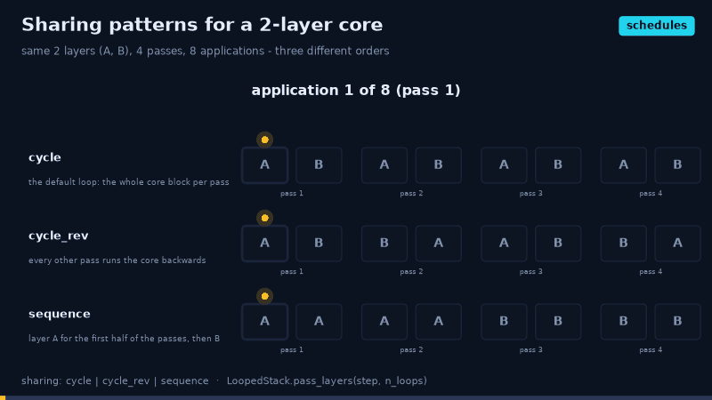
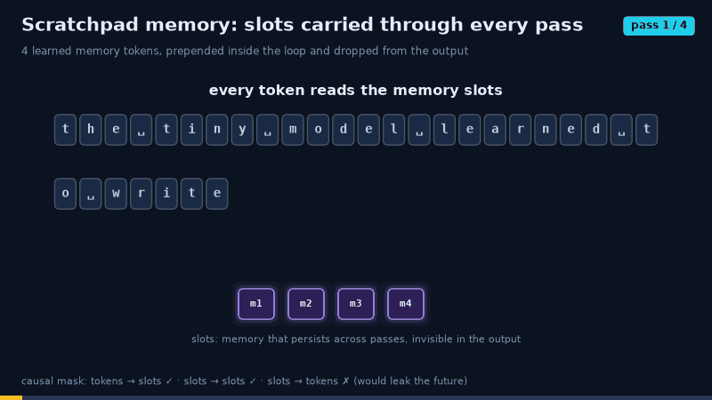

# Looped transformers (`arch: looped`)

A looped transformer reuses **one block of weights** for many passes. Depth becomes an iteration
count: `h_t = f_W(h_{t-1})`. Parameters scale with the block; compute scales with the number of
loops, which can change between training and inference.

Looped transformers come in two forms:

- **`variant: looped`** is a model package,
  [`src/hale_llm/models/models_looped/`](../src/hale_llm/models/models_looped/). It is a causal
  next-token LM on the looped backbone, laid out like every other paradigm:

  | File | Registers | What it holds |
  |---|---|---|
  | `model.py` | `LoopedLM` (`@register_variant("looped")`) and its collate | `forward_with_loops(batch, n)` and `last_loop_stats` |
  | `loss.py` | `@register_loss("looped")` | next-token NLL; the trainer adds the ACT ponder cost |
  | `sample.py` | `@register_sampler("looped")` | left-to-right decoding under a loop budget; `model.loops_per_token` records the passes per token |
  | `metrics.py` | `loop_scaling`, `ponder_histogram` | loss at `T ∈ {1, T/2, T, 2T}`; the ACT passes-per-token distribution |

- **`arch: looped`** is a backbone. You can put it under any other `variant`, including masked
  diffusion, block diffusion, flow matching and MTP, with any `attn_type` and with diffusion time
  conditioning. Examples: `configs/looped/diffusion_nano.yaml` and `block_diffusion_nano.yaml`.

The building blocks live in HaleBlocks (`hale_core.nn.stacks.looped`, `hale_core.nn.layers.loop`),
so every Hale repo shares them.



## The model

| Piece | Config | What it does |
|---|---|---|
| Shared core | `model.n_layers` | The block that is looped; its parameters are the only ones that grow with depth. |
| Loop count `T` | `loop.n_loops` | Number of passes. The compute depth is `prelude + T · n_layers + coda`. |
| Depth embedding `Eᵗ` | `loop.depth_embedding` | `sinusoidal` (default, defined for any `t`), `learned` (one row per step) or `none`. This is the Universal Transformer's step coordinate, so the block can tell pass 1 from pass 5. |
| Input injection | `loop.input_injection` | `add`: `f(h + e)`; `concat`: `f(W[h; e])`, initialised to `h + e`; `none`: `h₀ = e` and nothing re-enters. Injection keeps the input visible across long loops. |
| Prelude / coda | `loop.prelude_layers`, `loop.coda_layers` | Distinct layers before and after the loop, which map tokens into and out of the latent space. This is the recurrent-depth layout. |
| Sandwich norm | `loop.sandwich_norm` | Adds post-norms inside the core layers. It keeps `h_t` bounded, so the loop Jacobian `∏(I + J_f)` stays well conditioned. |

## Variants

### Fixed-T (Universal Transformer)

```yaml
model: {arch: looped, n_layers: 2, loop: {n_loops: 4}}
```

The simplest form: the same block runs `T` times, with depth embeddings. See
[`configs/looped/nano.yaml`](../configs/looped/nano.yaml). It has
the compute depth of `autoregressive/nano.yaml` with ¼ of its transformer parameters.

### Adaptive Computation Time

```yaml
loop: {n_loops: 8, halting: act, act_threshold: 0.99, ponder_weight: 0.01}
```

**Halting.** Each token outputs a halting probability on every pass:

```
pᵗᵢ = σ(w·hᵗᵢ + b)
```

A token halts as soon as `Σ p` would exceed `act_threshold`. Its output is `Σₜ λₜ hₜ`, where
`λₜ = pₜ` before the halting step and the remainder `R = 1 − Σ p` at it. Halted tokens are still
transformed, because other tokens attend to them, but their own output no longer changes. The
loop stops once every real token has halted. Padding and scratch tokens never vote.

**Ponder loss.** The trainer adds this to the variant's loss:

```
τ · mean(N(i) + R(i))
```

`τ` is `ponder_weight`, and larger values mean fewer passes. The trainer logs the terms as
`train/task_loss`, `train/ponder_loss`, `train/loop/mean_updates` and `train/loop/loops`. Each
variant's own loss function is unchanged.

**Initial bias.** `act_init_bias` is the initial halting logit. A negative value makes tokens
start by pondering longer. See
[`configs/looped/act.yaml`](../configs/looped/act.yaml).

### Recurrent depth and test-time compute

```yaml
loop:
  n_loops: 8
  min_loops: 2
  bptt_loops: 4
  prelude_layers: 1
  coda_layers: 1
  input_injection: concat
  exit_tolerance: 0.001
sample: {num_loops: 16}
```

**Training.** Two options make the model work at any loop count:

- `min_loops` samples `T ~ U{min_loops … n_loops}` for every step.
- `bptt_loops: k` backpropagates through the last `k` passes only. Earlier passes run without
  autograd, so activation memory is `O(k)` instead of `O(T)`. This is the one-step "phantom
  gradient" view of a DEQ.

**Inference.** The loop count is set per call:

- `sample.num_loops`, `hale-llm-sample --num-loops N` or
  `hale-llm-eval --num-loops N`;
- in Python, `hale_core.nn.stacks.loop_budget(model, n)`.

**Early exit.** `exit_tolerance` stops a pass once the largest per-token relative change satisfies
`|h_t − h_{t-1}| / |h_{t-1}| < tol`. This is fixed-point iteration: the loop runs until
`h* = f_W(h*)`, as in a DEQ. It is used at inference only.

Learned depth embeddings cannot run past `n_loops`; sinusoidal ones can. See
[`configs/looped/recurrent_depth.yaml`](../configs/looped/recurrent_depth.yaml).

### Scratchpad tokens

```yaml
loop: {scratch_tokens: 4}
```

These are learned memory slots, prepended for the stack only and dropped before the LM head. They
are carried and rewritten across loops as explicit working memory.

- **Causal or block-causal masks:** every token reads the slots, but the slots read only each
  other, so no future token leaks.
- **Bidirectional attention** (diffusion): the slots read and are read by the whole sequence.

See [`configs/looped/diffusion_nano.yaml`](../configs/looped/diffusion_nano.yaml).

## Presets: ten published variants

Every recipe below is a named preset in HaleBlocks (`hale_core.nn.stacks.LOOP_PRESETS`). It is selected
with one YAML line, and explicit fields override it:

```yaml
model:
  arch: looped
  loop: {preset: mixture_of_recursions, n_loops: 6}
```

There is one config per preset in [`configs/looped/variants/`](../configs/looped/variants/). Each inherits
`nano.yaml` and replaces its loop section (`_delete_: true`).

| preset | idea | key options | reference |
|---|---|---|---|
| `universal_transformer` | one block applied `T` times, with a depth embedding | `n_loops 6`, no injection | Dehghani et al. 2019 |
| `universal_transformer_act` | + Adaptive Computation Time: each token halts on its own | `halting: act`, `ponder_weight 0.001` | + Graves 2016 |
| `input_injection` | re-add the embedded input before every pass | `input_injection: add` | Yang et al. 2024 |
| `recurrent_depth` | prelude → core × `T` → coda, random `T`, truncated BPTT: a test-time compute knob | `min_loops 2`, `bptt_loops 4`, `concat`, no depth embedding | Geiping et al. 2025 |
| `deq_fixed_point` | loop until `h` stops changing, one-step (phantom) gradient | `exit_tolerance 0.01`, `bptt_loops 1`, sandwich norm | Bai et al. 2019 |
| `scratchpad` | learned memory slots ride along every pass | `scratch_tokens 4` | memory tokens |
| `mixture_of_recursions` | a causal router grants each token its own depth | `halting: mor`, prelude/coda 1 | Bae et al. 2025 |
| `relaxed_recursive` | shared `W` plus a per-pass LoRA delta `B_t A_t` | `lora_rank 4` | Bae et al. 2024 |
| `sequence_sharing` | multi-layer core used `AA..BB` instead of `AB AB` | `sharing: sequence` | Takase & Kiyono 2021 |
| `cycle_rev_sharing` | multi-layer core used `AB BA AB BA` | `sharing: cycle_rev` | Takase & Kiyono 2021 |

### New `LoopSpec` options

| option | values | what it does |
|---|---|---|
| `halting` | `none` \| `act` \| `mor` | `mor`: `RecursionRouter` picks each token's depth from its loop input (token-choice, so causal). Its gated updates train the router, and `mor_balance_weight · balance` is added by the trainer as an auxiliary loss. |
| `lora_rank` | `0`, `r` | every core `nn.Linear` becomes a `LoopLoRALinear`: `W + B_t A_t`, with `B_t = 0` at init. Passes beyond training reuse the last delta. |
| `sharing` | `cycle` \| `cycle_rev` \| `sequence` | the order of a multi-layer core over the passes (`LoopedStack.pass_layers`) |
| `preset` | a `LOOP_PRESETS` name | fills in the recipe; explicit fields win |

`LoopedStack.record_passes()` is a context manager that collects the state after every pass, which is what the
notebooks and animations use to look inside the loop.

### What we measured while building them

These come from tiny models on CPU: character LMs on the library's own docstrings, or the four-sentence toy
corpus. Treat them as behaviour checks, not benchmarks.

- **Input injection.** Naive `add` piles copies of the input into the residual stream: one looped block
  scored 4.11 held-out bits/char, worse than the same block used once (3.33). With `none` it scored 3.14;
  with `concat` it scored 2.93, beating 4 stacked blocks (3.00) with about a third of the parameters.
- **Depth embedding vs test-time scaling.** With a sinusoidal step embedding, `recurrent_depth` degrades as
  soon as it loops past its trained range (2.68 → 3.05 bits/char at 12 passes). Without one, it stays flat
  up to 24 passes, so the preset drops it.
- **Fixed points need contraction.** Without post-norms the DEQ loop's per-pass change plateaus near 0.7.
  With `sandwich_norm` it shrinks geometrically to below 0.01, so the preset enables it.
- **ACT's `τ` sets the budget.** At `τ = 0.01` nearly every token halts after 2 passes. At `τ = 0.001` the
  depths spread over 2–8 per character.

### All presets on the same text

A character LM was trained for each preset on the library's docstrings (1200 steps, width 64, seed 0,
CPU), in two identical runs; the run is `notebooks/looped/02`. Scores are held-out bits per character,
lower is better. CPU kernels are not bit-deterministic, and the spread between runs is shown.

| | params | run 1 | run 2 |
|---|---|---|---|
| `recurrent_depth` | 119k | **2.87** | **2.85** |
| stacked 4 layers | 144k | 3.08 | 2.89 |
| `sequence_sharing` | 77k | 2.92 | 2.92 |
| `mixture_of_recursions` | 111k | 2.95 | 2.95 |
| `cycle_rev_sharing` | 77k | 3.10 | 3.10 |
| `universal_transformer_act` / `universal_transformer` | 44k | 3.37 / 3.38 | 3.38 / 3.40 |
| `deq_fixed_point` / `scratchpad` / `relaxed_recursive` | 44-52k | 3.40 / 3.45 / 3.46 | 3.41 / 3.46 / 3.49 |
| stacked 1 layer | 44k | 3.75 | 3.74 |
| `input_injection` (plain `add`) | 44k | 4.13 | 4.14 |

Robust in both runs:

- Every looped variant except plain `add` injection beats the single stacked layer with equal parameters.
- `recurrent_depth` is best.
- `sequence` sharing beats `cycle_rev` by ~0.18 bits.

`sequence_sharing` and `mixture_of_recursions` tie with 4 stacked layers within run-to-run noise.

### Animations and notebooks

`hale-llm-loop-films` (`hale_llm.visualization.looped_films`) renders one GIF per concept into
[`assets/looped/`](../assets/looped/). The behavioural films are drawn from toy models trained by `LoopLab`.

| film | |
|---|---|
|  | stacked vs looped: same compute, 1/6 of the parameters |
|  | logit lens: next-character guesses sharpen pass by pass |
|  | ACT: per-token halting |
|  | Mixture-of-Recursions: routed depths, tokens exiting |
|  | fixed point: a state spiralling into `h*`, with vs without post-norms |
|  | random-`T` training and test-time loop scaling |
|  | relaxed recursion: `W + ΔW_t` per pass |
|  | cycle / cycle_rev / sequence schedules |
|  | scratchpad slots under a causal mask |

Notebooks:

- [`notebooks/looped/01_looped_transformers_step_by_step.ipynb`](../notebooks/looped/01_looped_transformers_step_by_step.ipynb)
  is a beginner walkthrough. It builds the model from scratch, proves it equals `LoopedBackbone`, and covers
  weight tying, the depth embedding, injection, BPTT, the logit lens and test-time compute.
- [`notebooks/looped/02_looped_transformer_variants.ipynb`](../notebooks/looped/02_looped_transformer_variants.ipynb)
  covers every preset hands-on, then compares them all on the same text.

## Training and evaluation

| Where | What |
|---|---|
| Trainer | `loss = task_loss + Σ auxiliary` (`hale_llm.losses.with_auxiliary_losses`); loop statistics are logged under `train/loop/*`. Gradient clipping (`train.grad_clip`) matters more than usual: backprop runs through `T` tied passes. |
| Eval metrics | `loop_depth` (any looped backbone) reports the mean `loops`, `mean_updates` and `ponder_cost`. With `variant: looped`, `loop_scaling` adds `loss@T1`, `loss@T{T/2}`, `loss@T{T}` and `loss@T{2T}`, the test-time scaling curve, and `ponder_histogram` adds the ACT `ponder_frac@k`, `ponder_mean`, `ponder_min` and `ponder_max`. |
| Sampling | Every registered sampler runs under the loop budget. |
| Checkpoints | The `model.loop` section is saved with the run config. `hale-looped` in HaleBlocks' LLM registry rebuilds a `variant: looped` checkpoint as a Hale-VLM / Hale-VLA language backbone. |

## Configs

| File | Paradigm | Loop |
|---|---|---|
| `configs/looped/nano.yaml` | looped | 2 layers × 4 loops, add injection, sinusoidal depth |
| `configs/looped/small.yaml` | looped | 4 layers × 4 loops (`d_model` 384): the compute depth of `autoregressive/small.yaml` |
| `configs/looped/act.yaml` | looped | ACT, up to 8 loops, `τ = 0.01` |
| `configs/looped/recurrent_depth.yaml` | looped | prelude 1 + 2 × U{2..8} + coda 1, BPTT through 4, 16 loops at inference, fixed-point exit |
| `configs/looped/diffusion_nano.yaml` | masked diffusion | 2 × 4 loops + 4 scratch tokens |
| `configs/looped/block_diffusion_nano.yaml` | block diffusion | 2 × 4 loops, block-causal |

```bash
hale-llm-train --config configs/looped/act.yaml
hale-llm-sample --config configs/looped/recurrent_depth.yaml --num-loops 32
hale-llm-eval --config configs/looped/act.yaml --metrics loss,perplexity,loop_scaling,ponder_histogram
```

## Python

```python
from hale_core.nn.backbones import build_backbone
from hale_core.nn.stacks import loop_aux_loss, loop_budget, loop_stats

lm = build_backbone(32000, arch="looped", d_model=512, n_heads=8, n_layers=2,
                    loop={"n_loops": 6, "halting": "act"})
logits = lm(ids)
loss = task_loss(logits) + loop_aux_loss(lm)      # ponder cost
print(loop_stats(lm))                             # {'loop/loops': 3.0, 'loop/mean_updates': 2.4, ...}
with loop_budget(lm.eval(), 12):                  # think longer at inference
    logits = lm(ids)
```

The stack alone, `LoopedStack`, runs on `(batch, seq, d_model)` hidden states, for a VLM or a
world model that brings its own embeddings.

## Trade-offs

| | Stacked transformer | Looped transformer |
|---|---|---|
| Parameters | `O(L · d²)` | `O(d²)`: one block |
| Backprop depth | `L` distinct layers | `T` tied passes (BPTT); `bptt_loops` bounds the memory |
| Compute per token | fixed | fixed (`T`), adaptive (ACT) or until convergence (`exit_tolerance`) |
| Gradients | separate per layer | every pass updates the same `W`; clip them |
| Latency | layers can be split across devices | passes are sequential |

## References

- Dehghani et al., *Universal Transformers*, ICLR 2019, arXiv:1807.03819.
- Graves, *Adaptive Computation Time for Recurrent Neural Networks*, arXiv:1603.08983.
- Bai, Kolter, Koltun, *Deep Equilibrium Models*, NeurIPS 2019, arXiv:1909.01377.
- Giannou et al., *Looped Transformers as Programmable Computers*, ICML 2023, arXiv:2301.13196.
- Yang et al., *Looped Transformers are Better at Learning Learning Algorithms*, ICLR 2024,
  arXiv:2311.12424.
- Geiping et al., *Scaling up Test-Time Compute with Latent Reasoning: A Recurrent Depth
  Approach*, 2025, arXiv:2502.05171.
