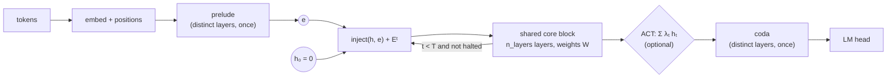

# Looped transformers (`arch: looped`)

A looped transformer reuses **one block of weights** for many passes. Depth becomes an iteration
count: `h_t = f_W(h_{t-1})`. Parameters scale with the block; compute scales with the number of
loops, which can change between training and inference.

`arch: looped` is a backbone, not a paradigm. It works with every `variant` that predicts tokens:
`autoregressive`, `mtp`, `diffusion`, `block_diffusion` and `flow_matching`, with any `attn_type`
and with diffusion time conditioning. The implementation lives in HaleBlocks
(`hale_core.nn.stacks.looped`, `hale_core.nn.layers.loop`). Every looped module is shared by all
the Hale repos.



## The model

| Piece | Config | What it does |
|---|---|---|
| Shared core | `model.n_layers` | The block that is looped; its parameters are the only ones that grow with depth. |
| Loop count `T` | `loop.n_loops` | Number of passes. The compute depth is `prelude + T · n_layers + coda`. |
| Depth embedding `Eᵗ` | `loop.depth_embedding` | `sinusoidal` (default, defined for any `t`), `learned` (one row per step) or `none`. This is the Universal Transformer's step coordinate, so the block can tell pass 1 from pass 5. |
| Input injection | `loop.input_injection` | `add`: `f(h + e)`; `concat`: `f(W[h; e])`, initialised to `h + e`; `none`: `h₀ = e` and nothing re-enters. Injection keeps the input visible across long loops. |
| Prelude / coda | `loop.prelude_layers`, `loop.coda_layers` | Distinct layers before and after the loop, which map tokens into and out of the latent space. This is the recurrent-depth layout. |
| Sandwich norm | `loop.sandwich_norm` | Adds post-norms inside the core layers. It keeps `h_t` bounded, so the loop Jacobian `∏(I + J_f)` stays well conditioned. |

## Variants

### Fixed-T (Universal Transformer)

```yaml
model: {arch: looped, n_layers: 2, loop: {n_loops: 4}}
```

The simplest form: the same block runs `T` times, with depth embeddings. See
[`configs/looped/autoregressive_nano.yaml`](../configs/looped/autoregressive_nano.yaml). It has
the compute depth of `autoregressive/nano.yaml` with ¼ of its transformer parameters.

### Adaptive Computation Time

```yaml
loop: {n_loops: 8, halting: act, act_threshold: 0.99, ponder_weight: 0.01}
```

**Halting.** Each token outputs a halting probability on every pass:

```
pᵗᵢ = σ(w·hᵗᵢ + b)
```

A token halts as soon as `Σ p` would exceed `act_threshold`. Its output is `Σₜ λₜ hₜ`, where
`λₜ = pₜ` before the halting step and the remainder `R = 1 − Σ p` at it. Halted tokens are still
transformed, because other tokens attend to them, but their own output no longer changes. The
loop stops once every real token has halted. Padding and scratch tokens never vote.

**Ponder loss.** The trainer adds this to the variant's loss:

```
τ · mean(N(i) + R(i))
```

`τ` is `ponder_weight`, and larger values mean fewer passes. The trainer logs the terms as
`train/task_loss`, `train/ponder_loss`, `train/loop/mean_updates` and `train/loop/loops`. Each
variant's own loss function is unchanged.

**Initial bias.** `act_init_bias` is the initial halting logit. A negative value makes tokens
start by pondering longer. See
[`configs/looped/autoregressive_act.yaml`](../configs/looped/autoregressive_act.yaml).

### Recurrent depth and test-time compute

```yaml
loop:
  n_loops: 8
  min_loops: 2
  bptt_loops: 4
  prelude_layers: 1
  coda_layers: 1
  input_injection: concat
  exit_tolerance: 0.001
sample: {num_loops: 16}
```

**Training.** Two options make the model work at any loop count:

- `min_loops` samples `T ~ U{min_loops … n_loops}` for every step.
- `bptt_loops: k` backpropagates through the last `k` passes only. Earlier passes run without
  autograd, so activation memory is `O(k)` instead of `O(T)`. This is the one-step "phantom
  gradient" view of a DEQ.

**Inference.** The loop count is set per call:

- `sample.num_loops`, `hale-llm-sample --num-loops N` or
  `hale-llm-eval --num-loops N`;
- in Python, `hale_core.nn.stacks.loop_budget(model, n)`.

**Early exit.** `exit_tolerance` stops a pass once the largest per-token relative change satisfies
`|h_t − h_{t-1}| / |h_{t-1}| < tol`. This is fixed-point iteration: the loop runs until
`h* = f_W(h*)`, as in a DEQ. It is used at inference only.

Learned depth embeddings cannot run past `n_loops`; sinusoidal ones can. See
[`configs/looped/recurrent_depth.yaml`](../configs/looped/recurrent_depth.yaml).

### Scratchpad tokens

```yaml
loop: {scratch_tokens: 4}
```

These are learned memory slots, prepended for the stack only and dropped before the LM head. They
are carried and rewritten across loops as explicit working memory.

- **Causal or block-causal masks:** every token reads the slots, but the slots read only each
  other, so no future token leaks.
- **Bidirectional attention** (diffusion): the slots read and are read by the whole sequence.

See [`configs/looped/diffusion_nano.yaml`](../configs/looped/diffusion_nano.yaml).

## Training and evaluation

| Where | What |
|---|---|
| Trainer | `loss = task_loss + Σ auxiliary` (`hale_llm.losses.with_auxiliary_losses`); loop statistics are logged under `train/loop/*`. Gradient clipping (`train.grad_clip`) matters more than usual: backprop runs through `T` tied passes. |
| Eval metric | `loop_depth` reports the mean `loops`, `mean_updates` and `ponder_cost` over the eval batches. |
| Sampling | Every registered sampler runs under the loop budget. |
| Checkpoints | The `model.loop` section is saved with the run config, so `hale-autoregressive` / `hale-mtp` in HaleBlocks' LLM registry rebuild a looped checkpoint as a Hale-VLM / Hale-VLA language backbone. |

## Configs

| File | Paradigm | Loop |
|---|---|---|
| `configs/looped/autoregressive_nano.yaml` | autoregressive | 2 layers × 4 loops, add injection, sinusoidal depth |
| `configs/looped/autoregressive_act.yaml` | autoregressive | ACT, up to 8 loops, `τ = 0.01` |
| `configs/looped/recurrent_depth.yaml` | autoregressive | prelude 1 + 2 × U{2..8} + coda 1, BPTT through 4, 16 loops at inference, fixed-point exit |
| `configs/looped/diffusion_nano.yaml` | masked diffusion | 2 × 4 loops + 4 scratch tokens |
| `configs/looped/block_diffusion_nano.yaml` | block diffusion | 2 × 4 loops, block-causal |

```bash
hale-llm-train --config configs/looped/autoregressive_act.yaml
hale-llm-sample --config configs/looped/recurrent_depth.yaml --num-loops 32
hale-llm-eval --config configs/looped/autoregressive_act.yaml --metrics loss,perplexity,loop_depth
```

## Python

```python
from hale_core.nn.backbones import build_backbone
from hale_core.nn.stacks import loop_aux_loss, loop_budget, loop_stats

lm = build_backbone(32000, arch="looped", d_model=512, n_heads=8, n_layers=2,
                    loop={"n_loops": 6, "halting": "act"})
logits = lm(ids)
loss = task_loss(logits) + loop_aux_loss(lm)      # ponder cost
print(loop_stats(lm))                             # {'loop/loops': 3.0, 'loop/mean_updates': 2.4, ...}
with loop_budget(lm.eval(), 12):                  # think longer at inference
    logits = lm(ids)
```

The stack alone, `LoopedStack`, runs on `(batch, seq, d_model)` hidden states, for a VLM or a
world model that brings its own embeddings.

## Trade-offs

| | Stacked transformer | Looped transformer |
|---|---|---|
| Parameters | `O(L · d²)` | `O(d²)`: one block |
| Backprop depth | `L` distinct layers | `T` tied passes (BPTT); `bptt_loops` bounds the memory |
| Compute per token | fixed | fixed (`T`), adaptive (ACT) or until convergence (`exit_tolerance`) |
| Gradients | separate per layer | every pass updates the same `W`; clip them |
| Latency | layers can be split across devices | passes are sequential |

## References

- Dehghani et al., *Universal Transformers*, ICLR 2019, arXiv:1807.03819.
- Graves, *Adaptive Computation Time for Recurrent Neural Networks*, arXiv:1603.08983.
- Bai, Kolter, Koltun, *Deep Equilibrium Models*, NeurIPS 2019, arXiv:1909.01377.
- Giannou et al., *Looped Transformers as Programmable Computers*, ICML 2023, arXiv:2301.13196.
- Yang et al., *Looped Transformers are Better at Learning Learning Algorithms*, ICLR 2024,
  arXiv:2311.12424.
- Geiping et al., *Scaling up Test-Time Compute with Latent Reasoning: A Recurrent Depth
  Approach*, 2025, arXiv:2502.05171.
