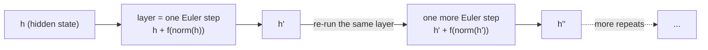
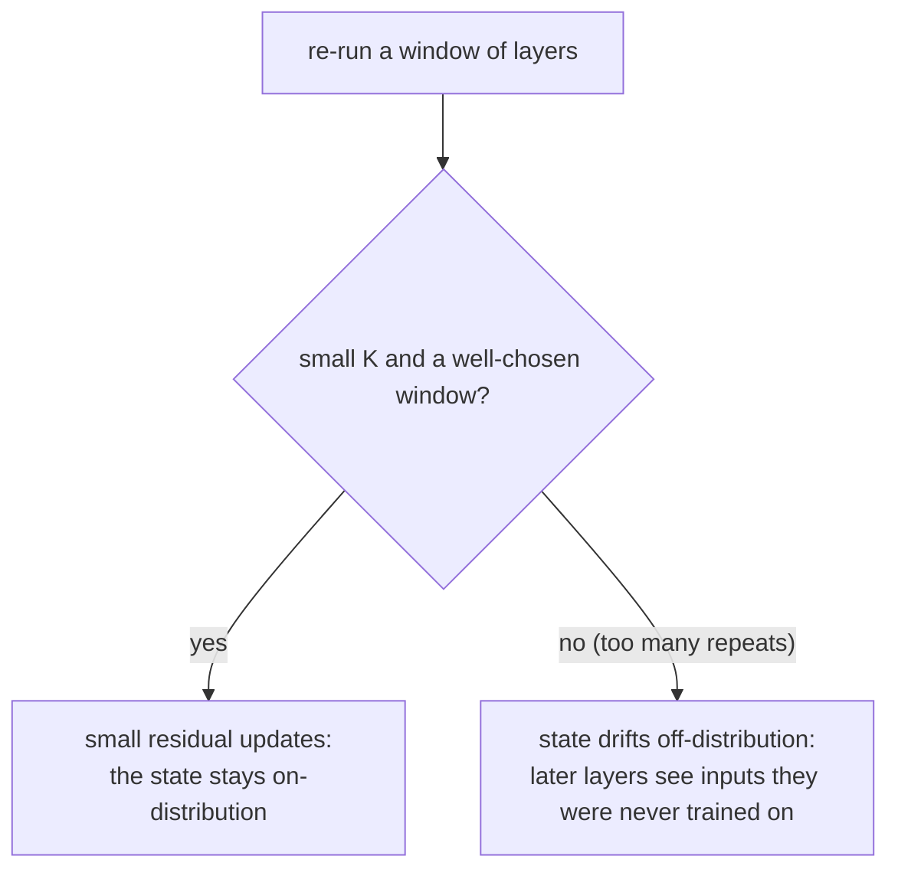
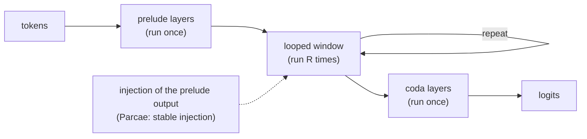
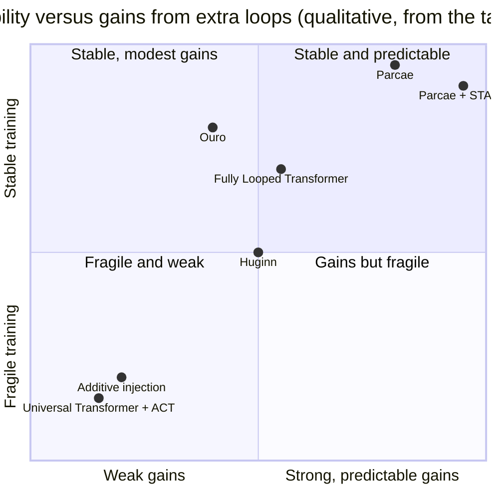
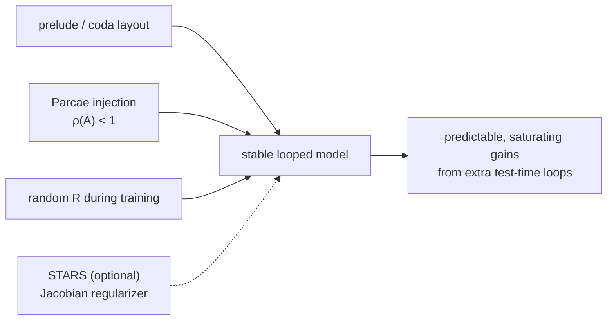
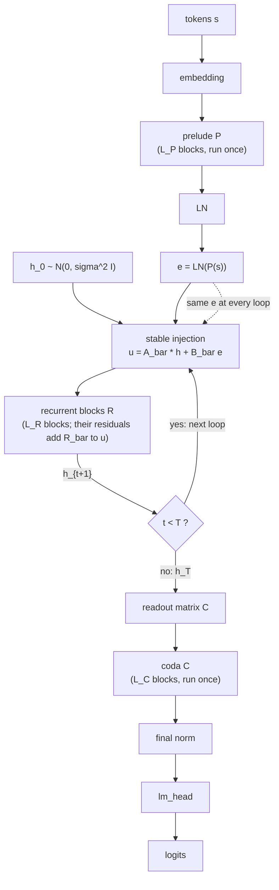

# Looped transformers: why re-running layers works, and how to keep it stable

Notes for the `feature/looped_layer` branch. A looped transformer re-runs a block (or a window of layers) several times
instead of stacking new layers, so the model gets more depth without more parameters.

## Why re-running a block works

It works because the middle layers of a pre-norm model make small residual updates. Each pre-norm transformer layer is
exactly one forward Euler step with step size `h = 1`:

```
h_next = h + f(norm(h))        # one Euler step of  dh/dt = f(norm(h))
```

Re-running a block is therefore roughly like taking more integration steps along the same path.



The catch is stability. It is limited to a small number of repeats `K` and a well-chosen window of layers. Nothing in a
normally trained model was trained to be contractive, so too many repeats push the hidden state off the distribution the
later layers expect.



## The prelude / loop / coda layout

The stable layout keeps the first and last layers out of the loop. The prelude turns tokens into a hidden state, a window
of middle layers is repeated `R` times, and the coda turns the state into logits. This is the layout the notes call the
"prelude/coda layout from section 2".



## Stability at a glance

| Variant | Training stability | Gains from extra test-time loops |
|---|---|---|
| Universal Transformer + ACT | Fragile (halting) | Weak |
| Additive injection | Collapses at high R | Weak |
| Huginn (concat + sandwich norm + random R) | OK with care | Moderate |
| Ouro (learned exit) | Good at scale | Drops past trained depth |
| Fully Looped Transformer | Good up to about 12 loops | Gains within trained range; unpredictable beyond |
| **Parcae** (ρ(Ā) < 1) | **Best (by design)** | Predictable, saturating |
| Any of these + **STARS** (Jacobian regularizer) | Good | **Best extrapolation** |
| TRM | Good at small scale | Good on puzzles |
| Relaxed sharing / shared MoE | Same as their injection rule | Same as their injection rule |
| Training-free retrofit | Not trained | Small K only |



The positions in the chart are a rough reading of the table's words, not measurements.

## The recommended combination for this code base

The stable combination is:

1. the prelude / loop / coda layout from section 2,
2. Parcae injection from section 3 (the spectral radius of the injection matrix `Ā` stays below 1, so the loop is
   contractive by design),
3. a random number of loops `R` during training,
4. optionally STARS, a Jacobian regularizer that gives the best extrapolation to more loops than were trained.



The `StableInjection` snippet from the earlier answer is meant to drop straight into the loop's `step()`.

## Gaps in these notes

The notes refer to material that was not part of the text they were written from, so it is not reproduced here: "section 2"
(the prelude/coda layout details), "section 3" (the Parcae injection) and the `StableInjection` snippet. Nothing in this
repository implements looping yet; the roadmap items are in [roadmap.md](roadmap.md) (looped transformers, adaptive
variants, using them for the middle layers only, and keeping loops and MTP depth to 8 at most, 4 being safer).

---

# The Parcae variant in this repo (`autoregressive_moe_looped`)

Implements the model of *Parcae: Scaling Laws For Stable Looped Language Models* (Prairie, Novack, Berg-Kirkpatrick, Fu;
[arXiv 2604.12946](https://arxiv.org/abs/2604.12946)) as the variant `autoregressive_moe_looped`, with the loops in the middle
layers. Try it with `uv run hale-llm-train --config configs/autoregressive_moe_looped/nano.yaml`.

Code: `nn/looped/stable_injection.py` (the injection), `nn/looped/recurrence_sampler.py` (per-sequence depths),
`nn/looped/looped_backbone.py` (the model and Algorithm 2), `models/models_looped/` (variant, loss, sampler).

## The algorithm, step by step



| Step | In the paper | In the code |
|---|---|---|
| 1. Prelude | `e = LN(P(s))` (Eq. 3) | `LoopedBackbone.encode`: embedding, `prelude` blocks, `prelude_norm` |
| 2. Initial state | `h_0 ~ N(0, sigma^2 I)` (Sec. 2.1, Alg. 1) | `_initial_state`: fresh noise in training, a fixed table in evaluation |
| 3. Parameters | `A = Diag(-exp(log_A))`, `A_bar = exp(Delta A)`, `B_bar = Delta B` (Sec. 4.1) | `StableInjection.state_decay()` and `input_gain()` |
| 4. One loop | `h_{t+1} = A_bar h_t + B_bar e + R_bar(h_t, e)` (Eq. 1, 3) | `_recurrent_step`: `R(A_bar h + B_bar e)`, where R's residual connections return the input and add `R_bar` |
| 5. Depth | `T ~ Lambda(mu_rec)` **per sequence** (Sec. 4.2) | `RecurrenceSampler.sample`: Poisson(`loop_mean_recurrence`) per sequence |
| 6. Truncated backprop | last `mu_bwd = ceil(mu_rec / 2)` loops get a gradient; `Lambda` depends on `mu_rec` alone (Sec. 4.2, Alg. 2 and 4) | `_run_loops`: rounds before `T_max - mu_bwd` run under `no_grad`; sequences with a smaller `T` sit out the first `T_max - T` rounds |
| 7. Output | `p = C(C h_T)` (Eq. 3) | `readout` matrix, then the coda blocks, the final norm and `lm_head` |

Why `R(A_bar h + B_bar e)` is the paper's `A_bar h + B_bar e + R_bar(h, e)`: Appendix C defines `R_bar` as the relative
contribution of the blocks, so a block stack that returns `x + (what it adds)` on the input `x = A_bar h + B_bar e` has
exactly this form.

## Why it is stable

The linearised loop `h_{t+1} = A_bar h_t + B_bar e` is stable only if `rho(A_bar) < 1`. Here `A_bar` is diagonal, so
`rho(A_bar) = max_i exp(-Delta_i exp(log_A_i))`, and `Delta = softplus(delta_raw) > 0` makes every entry lie in (0, 1) for
**any** parameter values. `B` stays unconstrained (the paper normalises its input `e` instead), and `A`, `Delta`, `B` and the
readout matrix are excluded from Muon and from weight decay, as in the paper (Table 20). The tests check the
property after random kicks to every parameter and during real training with a large learning rate.

## What the paper does not say, and what this code chose

These are decisions of this implementation, not statements of the paper:

| Choice | Value here | Why |
|---|---|---|
| Keeping `Delta` positive | `Delta = softplus(delta_raw)` | `rho(A_bar) < 1` needs `Delta > 0`; the paper does not say how it is kept |
| Initial `A`, `Delta` | `log_A = 0` (`A = -1`); `Delta` such that `A_bar = loop_decay_init` (0.5) | not given; 0.5 matches the trained spectral radii of about 0.24 to 0.52 reported for stable Parcae-style models in a follow-up paper (arXiv 2604.11791), which I did not verify |
| Initial `B`, readout | identity | not given; passes `e` and `h_T` through unchanged at the start |
| Loops of a sequence | `T = max(1, Poisson(mu_rec))` | a draw of 0 would skip the recurrent blocks; the paper does not say |
| Std of `h_0` | `sqrt(2 / (5 d))` ("like-init", the weight-init std of Takase et al.) | the paper writes `sigma` and `sigma^2` inconsistently and gives no value |
| `h_0` at evaluation | one fixed noise table `[max_length, d]` shared by the batch | a validation loss must not change between calls, and the logits of a prefix must not change when tokens are appended |
| Layer split | thirds of `model.n_layers` (prelude, recurrent, coda), or set explicitly | the paper's Table 18 loops "the middle third" (6 layers: 2/2/2) |
| Residual init scale | `0.02 / sqrt(2 x effective depth)`, effective depth = prelude + recurrent x `mu_rec` + coda | keeps the residual stream from growing with the number of loops |
| MoE balancing loss | the value of the last loop of each layer | the blocks are re-run, each run overwrites it |

The paper's Algorithm 1 writes `R(h_t, e)` inside the update of `h_t` (a typo for `h_{t-1}`); the code follows Eq. (1).

## Verification against the paper

I read the paper's text, including the appendices (Algorithms 1, 2, 3, 4, Appendix C, P and Q), not only the HTML summary.

| Claim checked | Paper | Result |
|---|---|---|
| `A := Diag(-exp(log_A))`, `A_bar = exp(Delta A)`, `B_bar = Delta B` | Sec. 4.1 | implemented as written |
| `e = LN(P(s))`, input to `B` normalised | Eq. 3, Sec. 3 | `prelude_norm` |
| Per-sequence depth, sit-out rounds, no-grad then grad rounds | Algorithm 2 | `_run_loops`; a test runs each row alone and compares |
| `mu_bwd = ceil(mu_rec / 2)`, truncation after sampling `T` | Sec. 4.2, Algorithm 4 | `RecurrenceSampler`; a test compares the gradient with an explicit `detach()` reference |
| `A, Delta, B` and `C` on AdamW, not Muon | Table 20 | `parameter_groups.py` |
| Prelude / recurrent / coda, `h_0` random | Sec. 2.1, 4.1, Table 17/18 | `LoopedBackbone` |
| Gradient clipping 1.0, AdamW betas (0.9, 0.95), no weight decay on these parameters | Appendix Q | repo defaults; the injection and readout are excluded from decay |

Tests (`claude_tests/unit/test_looped_parcae.py`, 57 tests) also compare the whole eval forward pass with a hand-written loop
from the equations, check causality for every number of loops, prefix consistency for generation, document and padding masks,
that the parameter count does not grow with the loops, and train through the real trainer with AdamW and Muon. Fifteen
deliberately injected bugs (a positive `A`, an unconstrained `Delta`, no truncation, wrong sit-out rule, no prelude norm,
and others) are all caught.

Limits of this check: the scaling-law part of the paper (Section 5.2 and 5.3: how the best number of loops and the amount of
data grow with compute, and the saturating exponential in the test-time loops) is not implemented here; only the model and its
training algorithm are. Results of the paper (for example the 6.2 percent lower validation perplexity than a Huginn-style
model) are not reproduced by this code.
