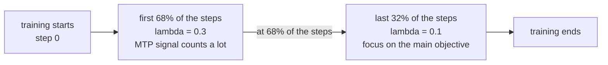
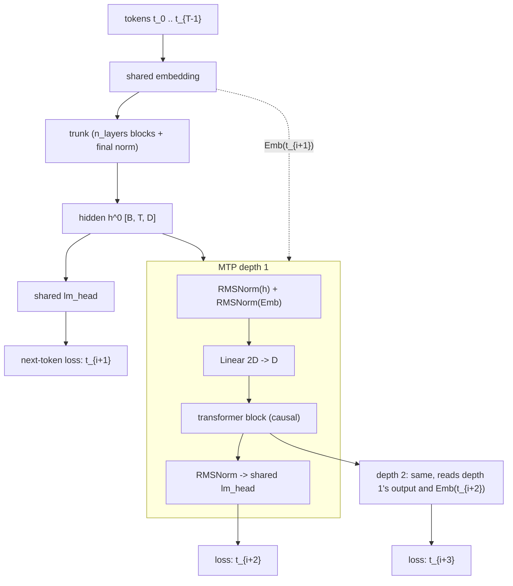
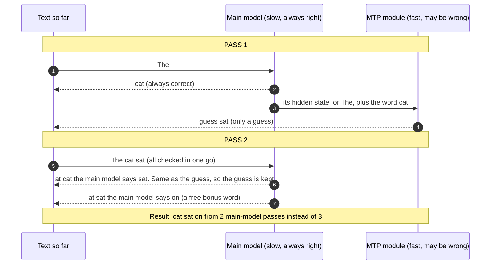
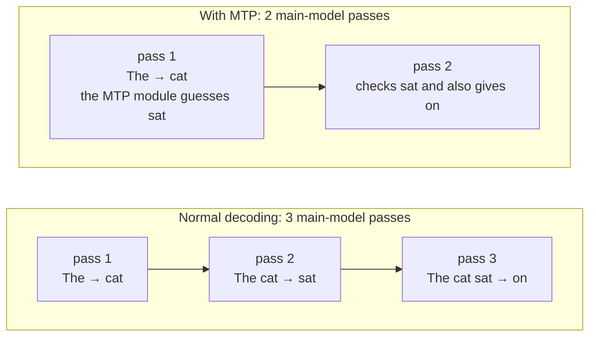
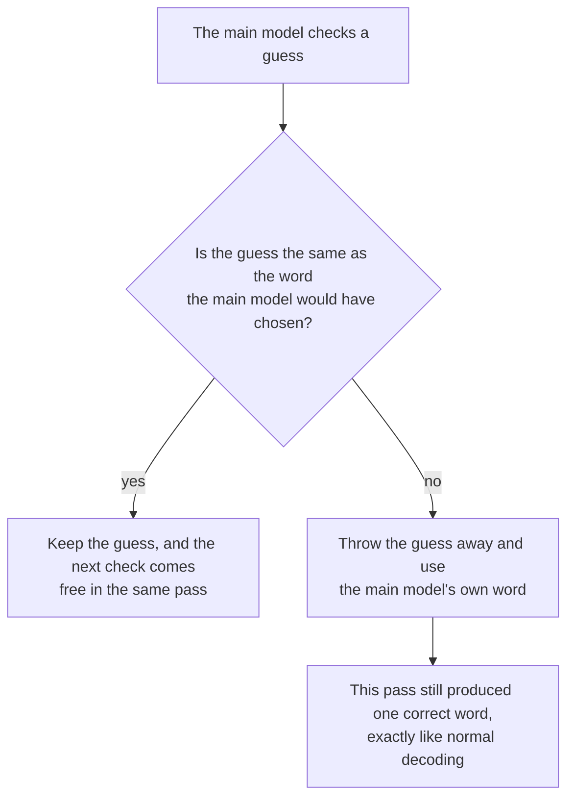
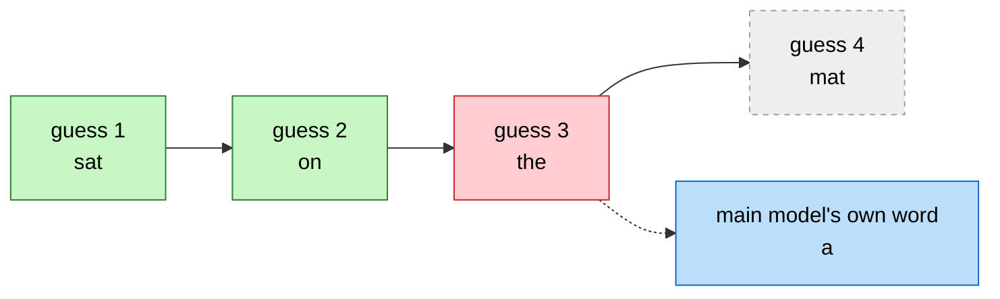
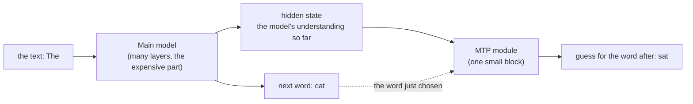
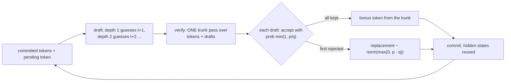
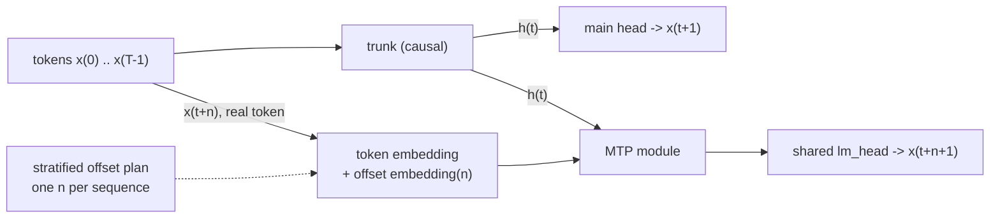

# Multi-token prediction

This page covers two ways of training with multi-token prediction (MTP): the DeepSeek-V3 style, and an offset-conditioned
variant that is off by default. Both work with a dense or a mixture-of-experts trunk.

The `autoregressive_mtp` and `autoregressive_moe_mtp` variants train the normal transformer plus `mtp_depth` small modules
that predict tokens further ahead. In the DeepSeek style, the module at depth `k` predicts the token `k + 1` steps ahead of
each position. The extra loss gives the model a denser training signal, and the same modules can draft tokens for
speculative decoding at inference time.

```bash
# mixture-of-experts trunk and MTP blocks (autoregressive_moe_mtp)
uv run hale-llm-train --config configs/autoregressive_mtp/nano.yaml --no-resume
uv run hale-llm-sample --config configs/autoregressive_mtp/nano.yaml --prompt "Once upon a time" --temperature 0
# dense trunk (autoregressive_mtp), with the documented default settings
uv run hale-llm-train --config configs/autoregressive_mtp/dense_nano.yaml --no-resume
```

`autoregressive_moe_mtp` forces `model.ffn_type: moe`, the same way `autoregressive_moe` does. `autoregressive_mtp` takes the
feed-forward type from the config.

## Configuration

```yaml
variant: autoregressive_mtp
model:
  mtp_depth: 1                # D: number of MTP depths. Tokens predicted per position: 1 (main head) + 1 = 2
  mtp_loss_weight: 0.3        # lambda for the first part of training ...
  mtp_loss_weight_final: 0.1  # ... and after the switch (null = keep 0.3 for the whole run)
  mtp_switch_fraction: 0.68   # the switch, as a fraction of the training steps (DeepSeek-V3: 10T of 14.8T tokens)
  mtp_n_layers: 1             # transformer blocks per MTP depth
  # mtp_d_ff: 768             # feed-forward width of the MTP blocks (default: the trunk's)
  # mtp_ffn_type: mlp         # mlp or moe for the MTP blocks (default: the trunk's)
sample:
  speculative: true           # generate with the MTP depth(s) as the draft model (exact); false = plain sampling
```

### How many tokens are predicted

At every position `i` the main head predicts `t_{i+1}`, and MTP depth `k` predicts `t_{i+k+1}`. With the default
`mtp_depth: 1` that is 2 tokens per position, `t+1` from the main head and `t+2` from depth 1. This is what DeepSeek-V3 uses.
With `mtp_depth: 4` it is 5 tokens: `t+1`, then `t+2`, `t+3`, `t+4` and `t+5` from depths 1 to 4.

Each depth is `mtp_n_layers` extra transformer blocks, so training costs more compute and parameters. The extra depths are
not needed to run the model.

### The lambda schedule

The DeepSeek-style loss is `next_token + lambda * (1 / D) * sum_k loss_k`. Lambda decides how much the extra MTP signal
counts next to the main loss. By default it follows DeepSeek-V3's step schedule: 0.3 for the first part of training and 0.1
after that. V3 switched after 10T of its 14.8T tokens, which is about 68% of the way (10 / 14.8), so `mtp_switch_fraction`
is 0.68.



* The schedule depends on progress (`step / total_steps`), so every depth sees the same value, and a resumed run lands on
  exactly the value an uninterrupted run would have. V3 counts tokens; here every step sees about the same number of them.
* The `1 / D` factor keeps the total MTP weight comparable across depths. Without it, `D = 3` would carry three times the
  auxiliary weight of `D = 1`, and you would be comparing weights instead of depths. When you compare runs, keep the
  schedule, seed, data order and learning-rate schedule identical.
* TensorBoard shows the value in use as `train/mtp_weight`.
* One plausible reason to lower lambda late (the paper does not say): the MTP loss helps most early, as a denser signal, and
  later the model should concentrate on the main objective. 0.3 and 0.1 are DeepSeek's values at a very large scale and are
  not established for small models. For a small model, try a constant 0.1, a constant 0.3 (`mtp_loss_weight_final: null`)
  and 0.3 then 0.1 at `D = 1` first.

### The MTP blocks

Each depth holds `mtp_n_layers` transformer blocks (DeepSeek-V3 uses one). The width and number of heads are the trunk's,
because a depth reads the trunk's hidden states and shares its rotary positions. The feed-forward width (`mtp_d_ff`, or the
expert width for a mixture of experts) and type (`mtp_ffn_type`) default to the trunk's and can be set separately, for
example a dense trunk with mixture-of-experts MTP blocks. A mixture-of-experts MTP block adds its balancing loss to the
training loss. `mtp_n_layers` and the other block settings are saved in the checkpoint.

### What each setting means

| Setting | What it controls | When it matters |
|---|---|---|
| `mtp_depth` | How far ahead the model is trained to look. DeepSeek style: it is the number of chained MTP modules. Offset style: it is `N`, the largest offset. | Training. It sets the size of the model and of the loss. |
| `mtp_draft_tokens` | How many tokens the MTP module guesses in one speculative-decoding round. It must be between 1 and `mtp_depth`. | Inference only. It never changes the text, only the number of trunk passes. |
| `mtp_n_layers` | How many transformer blocks sit inside each MTP module. DeepSeek-V3 uses 1. More blocks make a guess better but cost more compute and parameters. | Training and inference. |
| `mtp_switch_fraction` | The point where lambda drops from `mtp_loss_weight` to `mtp_loss_weight_final`, as a fraction of the total steps. With 0.68 and 1000 steps, lambda is 0.3 for steps 0 to 679 and 0.1 after that. | Training. |
| `mtp_offsets_per_sequence` | Offset mode only. How many offsets each sequence trains in a step (`K`, from 1 to `mtp_depth`). With 1 (default) a sequence trains one offset. With 2 of 4 it trains a pair such as 1 and 3, so the module runs twice per sequence. | Training. Cost grows with `K`. |
| `mtp_offset_stratified` | Offset mode only. `true` (default): the offsets of the whole step are planned together so every offset, and every combination of `K` offsets, is used equally often. `false`: each sequence draws its offsets on its own, which is balanced only on average. | Training. |
| `mtp_offset_remainder` | Offset mode only. When the global batch `G` is not a multiple of `N`, `G mod N` sequences are left over after every offset got its equal share. `balanced` gives them to the offsets that got an extra sequence least often so far. `random` picks the offsets at random every step. | Only when `G` is not a multiple of `N`. With 64 sequences and `N = 4` it does nothing. |

Why two names, `mtp_depth` and `mtp_draft_tokens`? They describe different moments. `mtp_depth` is what the model was
trained to do, so it is fixed once training has started. `mtp_draft_tokens` is a choice made at generation time, and you can
change it without retraining. Drafting fewer tokens than the model can predict is often better: the further ahead a guess
is, the more likely it is wrong, and a wrong guess ends the run of accepted drafts. So you can train with `mtp_depth: 4` and
still draft only 1 or 2 tokens per round.

## The model



* The embedding table and the output head are shared with the trunk, not copied. Each depth owns a projection `2D -> D`,
  two input RMSNorms, `mtp_n_layers` transformer blocks, and an output RMSNorm in front of the shared head. The trunk's head
  only ever sees normalised features, so the output norm gives the MTP block outputs the same scale.
* Depth 1 reads the trunk's final hidden states. Depth `k` reads the output of depth `k - 1`.
* Code: `nn/mtp/mtp_module.py` (one depth), `nn/mtp/multi_token_predictor.py` (the chain) and `models/models_mtp/` (variant,
  loss, sampler).

## The loss in detail

For a window of `T` tokens, depth `k` (counting from 1) works on `T - k` positions. Position `i` combines the previous
depth's hidden state at `i` with the embedding of `t_{i+k}`, and predicts `t_{i+k+1}`:

```
h  = proj_k([ RMSNorm(h_prev[:, :-1]) ; RMSNorm(Emb(t[:, k:])) ])     # [B, T-k, D]
h  = blocks_k(h)                                                       # mtp_n_layers causal blocks within depth k
logits = lm_head(RMSNorm_k(h))                                         # [B, T-k, V]
loss_k = CE(logits[:, :-1], t[:, k+1:])                                # the last position has no target
h_prev = h

loss = next_token_loss + lambda * (1 / mtp_depth) * sum_k loss_k      # lambda: 0.3, then 0.1 (see above)
```

Things to know:

* Evaluation uses the next-token loss only, so `val/loss` stays comparable with the other variants. The MTP terms are
  training-only, which is the same choice the MoE variant makes for its balancing loss.
* A fresh model starts at `ln(vocab) * (1 + 0.3)` (the first-phase lambda). `--dry-run` knows this.
* The loss function is `train.loss_type` (cross-entropy by default), for the main term and the MTP terms alike.
* Targets that are padding are ignored at every depth (`labels == -100`).
* TensorBoard gets `train/ntp_loss`, `train/mtp_loss` and `train/mtp_loss_depth<k>`. `train/ce_loss` is the next-token loss
  alone, not the weighted total.
* The window must have at least `mtp_depth + 2` tokens (checked when the model is built). Each window loses its last `k + 1`
  positions as targets at depth `k`, so a 128-token window with depth 4 trains 123 to 127 targets per depth.

## Inference: speculative decoding

### The idea, with "The cat sat on"

A language model writes one word at a time, and every word needs a full, slow pass through the main model. Speculative
decoding uses the cheap MTP module as a helper. The helper guesses the next word or two, then the main model checks all the
guesses in one go. Right guesses come for free and wrong ones are thrown away. Either way, the text is exactly what the main
model alone would have written.

Starting from the prompt "The", two main-model passes give us "cat sat on":



Counting the passes:



If a guess is wrong, the main model's own word is used and the guess is discarded:



So the text is never worse. A wrong guess costs a little wasted work (the helper's small computation) but never an extra
main-model pass. The saving is real only when guesses are often right.

With several guesses at once, the helper guesses up to `mtp_draft_tokens` words ahead and the main model checks all of them
in the same pass. The first wrong guess ends the run: the guesses before it are kept, the wrong one is replaced by the main
model's word, and the ones after it are dropped because they were built on a wrong word. An illustrative example after the
text "The cat":



Here one pass produced three words: "sat", "on" and the main model's "a". If all four guesses are right, the pass produces
five words (four guesses plus a bonus word).

Why does the MTP module need the main model's hidden state? The hidden state is the main model's understanding of the text so
far, and it was already computed during the pass. Reusing it keeps the helper cheap. It does not have to read the text again,
it only adds one small block on top.



### Is it really the same text?

Yes, and the tests check it:

| Setting | Result |
|---|---|
| Greedy decoding (`temperature: 0`) | Identical words to normal decoding. |
| Sampling (`temperature` above 0) | The same probabilities as normal decoding. A wrong guess is replaced by a draw from the leftover probability, which keeps the distribution exact. |
| Speed | Faster only if enough guesses are right. A model whose MTP modules are still poor can be slower than normal decoding, because it does extra work for guesses that are thrown away. The log line `speculative decoding: ... accepted (per depth: ...)` shows how often guesses are right. Set `sample.speculative: false` to turn the shortcut off. |

The simple story leaves out two details:

* The main model re-reads the whole text in each pass ("The cat sat", not just "cat sat"), because this code base has no KV
  cache. Passes are still saved, and that is where the speed-up comes from.
* The MTP module looks at the main model's hidden states for every position of the text, not only the last one, exactly as it
  does in training. It is the same computation, which is why the guesses are good.

The example above is an executable test, so the documentation cannot drift from the code:
`claude_tests/unit/test_speculative.py::test_the_cat_sat_on_example_takes_two_main_model_passes_instead_of_three`, plus
matching tests for a wrong guess, normal decoding and four guesses. Real output from a small trained model:

```
D = 1 (one guess), 3 new words:
   verify: guesses ['sat'] | main model's own words at those places ['sat'] + bonus word 'on' -> kept 1 guess(es), next word 'on'
   result: The cat sat on
   main-model pass 1 read: The
   main-model pass 2 read: The cat sat
```

### How it works in the code

`forward(batch)` still returns the trunk's next-token logits, so evaluation, metrics and plain sampling work as for any other
variant. With `sample.speculative: true` (the default), the sampler uses the MTP depths to guess ahead and the trunk to check
the guesses. The story above maps onto the code like this:

| In the story | In the code |
|---|---|
| the word the main model gives for free ("cat") | the pending token (`SpeculativeDecoder._round`): chosen by the trunk, always exact |
| the helper's guesses ("sat ...") | `drafts`, from `MultiTokenPredictor.step` for depth 1, 2, ... up to the number of drafted tokens |
| pass 2, "checks all the guesses in one look" | one `backbone.encode` over `tokens + pending + drafts`. Rows `L .. L + D` of its output judge the guesses and give the bonus word |
| keep the guess / use the main model's own word | `_verify`: accept with probability `min(1, p / q)`, else sample from `max(0, p - q)` |
| "The cat sat" already understood | the trunk hidden states of that pass are carried into the next round, so a round costs one trunk pass |



* **Exactness.** The tokens have the same distribution as sampling from the trunk alone (speculative sampling, Leviathan et
  al. 2023). At `temperature: 0` they are identical to plain greedy decoding. This is tested against plain decoding with
  perfect, always-wrong and partly-wrong drafts, and the sampling distribution is checked statistically.
* **Cost.** Each round costs one trunk pass over the text plus `D` MTP-block passes, and yields between 1 and `D + 1` tokens.
  So a round is cheaper per token than plain decoding whenever drafts are accepted at all. The log line
  `speculative decoding: ... N% of drafts accepted (per depth: ...)` shows the acceptance rate overall and per depth (the
  share of drafts at that depth that were kept, among the rounds that reached it). Deeper depths are usually less accurate,
  and a draft only counts if every earlier one was kept. If acceptance is low, rounds cost more than they save and
  `sample.speculative: false` is faster. There is no KV cache, so the saving is in trunk passes, not in cached attention.
* **Limits.** One prompt at a time (several prompts fall back to plain sampling with a warning). Once prompt and output
  together exceed `max_length`, the window slides per round, and exact equality with plain decoding is only guaranteed while
  everything fits in the window. Set `sample.speculative: false` for plain sampling.
* Code: `models/models_mtp/speculative.py` (`SpeculativeDecoder`) and `models/models_mtp/sample.py`.

## Index audit and litmus tests

Off-by-one errors are the classic MTP bug, so the indices are tested three ways. Each test was broken on purpose to confirm
it fails.

* `claude_tests/unit/test_mtp_indices.py` feeds identity tokens (the token value is its position) and spies on every embedding
  lookup, hidden-state hand-off, loss target and verify row, then compares them with hand-written tables. For `T = 9` and
  `D = 3`, depth 2 embeds `[2..8]`, reads depth 1's hidden states at positions `0..6`, and is scored against `t_3..t_8`. The
  test also runs depth `k` the training way and the inference way on the same tokens and requires identical logits.
* `claude_tests/unit/test_mtp_data_litmus.py` runs the real dataset windowing, EOS packing, collate, trainer and checkpoint
  loading on a counting corpus ("5 6 7 ..." mod 20), where the right answer is known by arithmetic. Every head must predict
  the number `k + 1` steps ahead (100% on held-out windows), and decoding from a prompt must continue the count with every
  draft accepted. A one-step error anywhere gives 0% accuracy.
* `claude_tests/unit/test_mtp.py` and `test_speculative.py` (see below).

## 2B baseline

`configs/mtp_2b/` holds a 1.98B-parameter model (`baseline.yaml`) and the same model with 1 MTP depth (`mtp.yaml`, 2.04B: a
depth adds 59M, and 4 depths would add 235M). They are identical in data, seed and batch. Memory and disk estimates are in
`base.yaml`. They fit an 80 GB GPU at micro-batch 2 x 8 accumulation steps, but they are only estimates until a `--dry-run`
has measured them.

```bash
uv run hale-llm-cloud --cloud configs/cloud/jarvislabs_a100_80gb.yaml launch --config configs/mtp_2b/baseline.yaml --dry-run
uv run hale-llm-cloud --cloud configs/cloud/jarvislabs_a100_80gb.yaml launch --config configs/mtp_2b/mtp.yaml --auto-pause
```

TinyStories (about 113M tokens at 1M stories) is small for a 2B model, so expect it to overfit. The pair is for comparing MTP
with no MTP at this scale. Point `data.dataset` at a larger corpus for anything else.

## Tests

* `claude_tests/unit/test_mtp.py` checks the alignment (depth `k` at position `i` sees exactly the tokens up to `t_{i+k}`), the
  loss against a literal transcription of the reference loop, the lambda/D weighting, padding, gradients, MoE blocks, and that
  every depth learns.
* `test_mtp_schedule.py` covers the step schedule, the exact switch step, and the same schedule for every depth.
* `test_mtp_blocks.py` covers configurable blocks: counts, widths, MoE blocks under a dense trunk, and the same index checks
  with several blocks per depth.
* `claude_tests/unit/test_speculative.py` checks exactness at temperature 0, the carried state between rounds, the draft chain
  against the training pass, EOS handling, fallbacks and the sampling distribution.

Deliberately breaking an index in any of those places makes tests fail.

## Offset-conditioned MTP

DeepSeek-V3 stacks `D` MTP modules, and module `k` always predicts `k` tokens beyond the main head. Offset-conditioned MTP
(`model.mtp_offset_conditioning: true`, off by default) uses the same module, but only one copy of it, and makes the offset an
input. In every training step each sequence gets an offset `n` in `1 .. mtp_depth`, assigned in a stratified way over the
global batch (see "Stratified offsets" below), and the losses of the offsets are added up.

For a position `t` of the sequence:

| Head | Reads | Predicts |
|---|---|---|
| main head (unchanged) | `h(t)` | `x(t+1)` |
| MTP module at offset `n` | `h(t)`, the real token `x(t+n)`, and a learned embedding of `n` | `x(t+n+1)` |

Take "the cat sat on the mat", with `t` at "the". Offset `n=1` reads "cat" and predicts "sat" (exactly DeepSeek's depth 1).
Offset `n=2` reads "sat" and predicts "on". Offset `n=3` reads "on" and predicts "the". The loss compares the prediction with
the true `x(t+n+1)`. The input `x(t+n)` is never the target.



### One training step, as an algorithm

```
0.  plan       the offsets of the WHOLE step (all micro-batches, all ranks) are assigned once, stratified (below)
1.  trunk      h = trunk(x)                                  # [B, T, D], as always
2.  main loss  ntp = CE(lm_head(h)[t], x(t+1))
3.  offsets    n_b = this micro-batch's slice of the plan    # one per sequence, values in 1..N
4.  input      u[b, t] = x[b, t + n_b]                       # the real token n_b steps ahead
5.  embed      e[b, t] = Emb(u[b, t]) + OffsetEmb(n_b)       # the offset embedding is added to the token embedding
6.  module     m = RMSNorm(h) ++ RMSNorm(e) -> Linear(2D->D) -> mtp_n_layers causal blocks -> RMSNorm
7.  scores     logits = lm_head(m)                           # the trunk's own head, shared
8.  targets    y[b, t] = x[b, t + n_b + 1], ignored (-100) where it is past the end, padding, or (with
                document_masking) in another document than position t
9.  per seq    l_s = mean CE over the sequence's valid positions
10. per offset L_n = mean of l_s over the sequences of the whole step that got offset n
11. mtp loss   mtp = L_1 + L_2 + ... + L_N                   # ADDED UP, not averaged (mtp_loss_reduction: mean divides by N)
12. total      loss = ntp + lambda * mtp                     # lambda follows the same 0.3 -> 0.1 schedule
```

Evaluation scores the next-token loss only and plans no offsets.

### How the loss is computed: next-token against `t+3`

Both losses are the same cross-entropy against the true text. They differ in what the model reads and which token it has to
guess. Take "the cat sat on the mat", with `t` at "the" and offset `n = 2`:

| Head | Reads | Predicts | Ground truth it is compared with |
|---|---|---|---|
| main head (next-token) | `h(t)` | `x(t+1)` | "cat", the next word of the text |
| offset module, `n = 2` | `h(t)`, the real `x(t+2)` = "sat", and offset embedding row `1` | `x(t+3)` | "on", the word after the input |

The input of the offset module ("sat") is the real token from the data, not something the model predicted (teacher forcing).
It is never the target: "sat" is what the module reads, and "on" is what it must guess. The module at position `t` is not given
`x(t+1)` = "cat". It can only reach it through the previous position, whose input is `x(t-1+2)`.


Every position gets a pair. `labels[i]` is the token after position `i`, so the targets are plain lookups into the labels:

```
sentence:   the   cat   sat   on    the   mat          T = 6
position t:  0     1     2     3     4     5

main head      h(t) -> x(t+1)     the>cat   cat>sat   sat>on    on>the    the>mat    (t = 5: nothing after "mat")
offset n=2     reads x(t+2), predicts x(t+3)
               t=0  reads "sat"  -> GT "on"
               t=1  reads "on"   -> GT "the"
               t=2  reads "the"  -> GT "mat"
               t=3  no x(t+3): ignored      t=4, t=5: ignored
offset n=1     t=0 "cat">"sat"   t=1 "sat">"on"   t=2 "on">"the"   t=3 "the">"mat"      (DeepSeek depth 1)
offset n=3     t=0 "on">"the"    t=1 "the">"mat"  t=2.. ignored
```

For offset `n`, `T - n - 1` positions count. The table is what `OffsetConditionedPredictor.targets` returns.

### The numbers: the offsets add up

Take the global batch of one step, stratified so that every offset has sequences:

```
next-token loss   ntp   = mean over all (b, t) with a next token  of  CE( lm_head(h[b,t]),  x[b, t+1] )
per offset        L_n   = mean, over the sequences s of the step that got offset n, of
                          l_s = mean over s's valid positions of  CE( lm_head(norm(module[s,t])),  x[s, t+n+1] )
offset loss       mtp   = L_1 + L_2 + ... + L_N              <- a SUM over the offsets, not (1/N) of it
total             loss  = ntp + lambda * mtp                 (+ the MoE balancing term for a mixture of experts)
```

For the offsets 1, 2, 3, 4 the loss is `ntp + lambda * (L_1 + L_2 + L_3 + L_4)`. DeepSeek-V3's `1/D` normalisation is not
applied. Each `L_n` is averaged over its own sequences first, so every offset counts equally whatever its token count. That is
what "stratified" means here. It is not an average over all tokens, which would let the offsets with more tokens dominate.

* Both are plain token-level cross-entropy against ground-truth token ids (`train.loss_type` applies to both).
* Scale: a fresh model scores about `ln(vocab)` on every term, so the total starts near `ln(vocab) * (1 + lambda * N)`, which
  is `2.2 * ln(vocab)` for `lambda = 0.3` and `N = 4`. Adding up makes the MTP term `N` times larger than the mean would be.
  For the same weight on the offsets, use a lambda that is `N` times smaller, or set `mtp_loss_reduction: mean` to divide by `N`.
* Example: with `lambda = 0.3`, `ntp = 3.0` and `L_1 = L_2 = L_3 = L_4 = 3.5`, you get `mtp = 14.0` and
  `loss = 3.0 + 0.3 * 14.0 = 7.2`. Only `ntp` is reported as the validation loss.
* Both losses backpropagate into the trunk through the same `h(t)`. The next-token loss trains the trunk, the shared embedding
  and the head. The offset loss trains the module and the offset table, and also the trunk, embedding and head.
* The target of position `t` (`x(t+3)`) is the input of position `t+1` (`x(t+1+2)`). That is allowed because attention is
  causal: position `t` never sees position `t+1`. A test changes `x(t+n+1)` and checks that no logit at a position up to `t` moves.
* An offset that no sequence of the step got has no term (`L_n` does not exist). With fewer sequences per step than offsets,
  the sum therefore has fewer terms in that step. Use at least `N` sequences per step (see below).
* Targets are ignored (`-100`) when they are past the end of the window, padding, or (with `document_masking`) in another
  document.

### Stratified offsets

Drawing each offset independently, or per micro-batch, would make a step's offsets uneven. It would let a micro-batch of 1 see
a single offset, and it would let every data-parallel rank draw on its own. So the offsets are assigned in a stratified way,
for the whole global batch of a step, in one place. The global batch is
`G = micro_batch x accumulation_steps x data-parallel ranks`:

```
1. repeat the list 1..N  floor(G / N)  times        N = 4, G = 10:   1 2 3 4  1 2 3 4
2. add the remainder: G mod N distinct offsets                         + 3 1
3. shuffle the whole list                                             -> 2 3 3 1 4 1 4 2 1 3   (which sequence gets which)
4. micro-batch m of rank r takes slice number (m * ranks + r)
```

* Every offset is used `floor(G / N)` times in every step, plus once more for each of the `G mod N` remainder offsets. When
  `G` is a multiple of `N` (64 sequences with `N = 4` gives 16 of each), every step is exactly equal.
* The remainder is random. `mtp_offset_remainder: balanced` (the default) gives the extra sequence to the offsets that
  received one least often so far, with ties broken at random. The totals over the whole run then also stay within 1 of each
  other. `random` draws a fresh random subset every step. It has no memory, so it is equal only in expectation.
* A micro-batch of 1 works. Each micro-step holds one offset, and the accumulated step sees them all (with `N` micro-steps,
  once each).
* There is one plan, shared by all ranks. It depends only on `(mtp_offset_seed or train.seed, step)`, so every rank computes
  the identical plan without communicating and takes its own slice (`set_data_parallel(rank, world_size)`, or read from
  `torch.distributed`). No rank draws on its own. Slices are ordered micro-batch first, then rank.
* The plan never touches the global random state and depends on nothing but the seed and the step. The position (step,
  micro-batch, remainder counts) is saved in the checkpoint (`mtp.assigner._extra_state`), so a resumed run continues with the
  same offsets.

### Why the loss carries a weight under accumulation

The trainer divides each micro-batch loss by `accum` (and data-parallel averages the ranks), so the micro-batch losses are
averaged. A micro-batch of 1 holds a single offset. Averaged naively, `L_1 + L_2 + L_3 + L_4` would become
`(L_1 + L_2 + L_3 + L_4) / 4`, and the normalisation would sneak back in. To make the offsets add up exactly, sequence `s`
(with offset `n`) contributes

```
(micro_batches in the step / S_n) * l_s        S_n = sequences of the whole step with offset n,  micro_batches = accum x ranks
```

After the trainer's averaging this is `l_s / S_n`, and summed over the step that is exactly `L_1 + ... + L_N`. The result is the
same for a micro-batch of 1, of 64, or split over ranks. Tests compare the loss and every gradient of 4 micro-batches of 1,
2 micro-batches of 2, and 2 ranks x 2 micro-batches against one batch of 4. The logged `train/mtp_loss` is the average of the
micro-batch values, which is the same `L_1 + ... + L_N`. The weights use sequence counts, so with padding or document
boundaries each sequence is weighted equally rather than each token.

### Several offsets per sequence

By default a sequence trains one offset per step. With `mtp_offsets_per_sequence: K` (1 to `mtp_depth`) it trains `K`
distinct offsets, for example `K = 2` with `N = 4`: the pair 1 and 3, or 2 and 4. The module runs once per offset, with the
trunk's hidden states shared, so a sequence costs `K` module passes (DeepSeek's chained depths cost `N`).

Every pass gives its own cross-entropy against its own targets, and the passes are summed. Backpropagation is unchanged: the
gradients of all passes add up in the shared module, the offset table, the embedding and the head, and the trunk receives
the next-token gradient plus the gradient of all `K` passes. The passes never see each other's targets, so the leakage
guarantee holds for each of them.

**Stratification with combinations.** The same recipe is applied to the combinations instead of the single offsets. For
`N = 4`, `K = 2` there are `C = 6` combinations (12, 13, 14, 23, 24, 34), and each offset is in 3 of them:

```
1. repeat the list of all C combinations  floor(G / C)  times       G = 10:  all 6 once
2. add the remainder: G mod C distinct combinations                  + 4 more, picked so that the offsets stay balanced
3. shuffle, and slice per micro-batch and rank as before
```

* When `G` is a multiple of `C`, every combination and every offset is used exactly equally often in a step.
* Otherwise the remainder (`mtp_offset_remainder: balanced`) picks, one at a time, the combination whose offsets have been
  used least so far, then the least used combination, then a random one. Over a run, the offset totals stay within 1 of each
  other and so do the combination totals (this is tested for several `N`, `K` and `G`).
* `K = 1` gives exactly the plans of the single-offset mode (the combinations are the offsets), and `K = N` gives every
  sequence all offsets.
* The loss weight of a pair is `micro_batches / S_n`, where `S_n` now counts the (sequence, offset) pairs of the whole step
  with offset `n`. The sum over the step is still `L_1 + ... + L_N`, whatever the micro-batch size or number of ranks. Tests
  compare the loss and every gradient of micro-batches of 1, 2 and 3 against one batch.
* `mtp_offset_stratified: false` switches the plan to independent draws: each sequence takes `K` distinct offsets at random.
  The plan is still computed once per step and shared by the ranks, but the counts are only equal on average.

### Batch size and offsets

What matters is the number of sequences behind one optimizer step, `G = batch_size x accum_steps x ranks`, not the
micro-batch:

| `G` (N = 4) | What one step sees |
|---|---|
| a multiple of `N` (4, 8, 64; or micro-batch 1 x accum 4; or 2 ranks x 2) | each offset exactly `G / N` times |
| `G > N`, not a multiple | each offset `floor(G / N)` or one more times, and every offset is present |
| `G < N` (1, 2, 3) | only `G` of the 4 offsets are present. The missing ones have no term in that step's sum, so the loss is smaller and noisier |

So a micro-batch of 1 is fine as long as `accum_steps x ranks` is a multiple of `N`, because the step then sees every offset
once. With `G < N` it still trains, but each step's offset loss has fewer terms. Prefer a multiple of `N` (64 is one).

### Speculative decoding

Drafting reuses the same trunk state for every draft. With committed tokens `x_0 .. x_{L-1}` and the pending token `x_L`:

```
for k in 1 .. mtp_draft_tokens:
    run the MTP module at offset k over the whole prefix, reading the trunk's hidden states and
    x_k .. x_{L+k-1}; its last position scores x_{L+k}         # draft k = "x(t+k) with offset k"
    sample/argmax draft_k  and  append it to the known tokens
verify:  ONE trunk pass over the committed tokens, x_L and all the drafts (unchanged from DeepSeek mode)
```

The trunk verifies every draft, so the output is exactly what the trunk alone would produce, whatever `mtp_draft_tokens` is.
At temperature 0 it is identical to plain greedy decoding. The setting only changes how many trunk passes are needed.

### Configuration

```yaml
model:
  mtp_offset_conditioning: true   # false (default): DeepSeek-V3 chained depths
  mtp_depth: 4                    # N: the offsets are 1..N (in the default mode: the number of depths)
  mtp_offset_seed: null           # seed of the offset plan; null = train.seed
  mtp_offsets_per_sequence: 1     # K: offsets per sequence and step, 1..mtp_depth (K module passes per sequence)
  mtp_offset_stratified: true     # false: every sequence draws its offsets independently
  mtp_offset_remainder: balanced  # balanced | random: who gets the extra sequence/combination when G is not a multiple of N (of C)
  mtp_loss_reduction: null        # sum | mean; null = sum for offsets, mean (DeepSeek's 1/D) for the chained depths
  mtp_draft_tokens: 1             # tokens drafted per speculative round, 1..mtp_depth (both modes)
  mtp_loss_weight: 0.3            # lambda, then mtp_loss_weight_final after mtp_switch_fraction of the steps
  mtp_n_layers: 1                 # blocks in the module
train:
  batch_size: 64                  # the global batch is batch_size x lean.accum_steps (x data-parallel ranks)
```

`mtp_draft_tokens` applies to both modes. Before it existed, the decoder drafted every depth. The default is now one draft per
round, so a DeepSeek-mode config with `mtp_depth > 1` must set `mtp_draft_tokens: <depth>` to draft all of them.

`mtp_loss_reduction` also applies to both modes: `sum` lets DeepSeek's depths add up (`L_1 + ... + L_D`) instead of taking
`(1/D) * sum`.

A ready config is `configs/autoregressive_mtp/offset_nano.yaml`.

Other things to know:

* **Document boundaries.** With `model.document_masking: true`, a target in another document than its position is ignored, and
  the module's attention is masked like the trunk's. Without it, the windows are plain packed text (as for the main head), so
  a target may be the first token of the next story after an end-of-text token.
* **Size.** One module plus an `N x d_model` table, instead of `N` modules.
* **Optimizers.** The offset table is a lookup table. Muon and Dion leave it to AdamW, and it gets no weight decay.
* **Logging.** `train/mtp_loss` is the offset loss `L_1 + ... + L_N`, and `train/mtp_offset_mean` is the mean offset of the
  micro-batches.
* **Data parallel.** The repository's trainer is single-process. With several ranks, every rank must run the same number of
  micro-batches per step with the same micro-batch size, call `set_data_parallel(rank, world_size)` (done automatically when
  `torch.distributed` is initialised) and keep the same seed. Data-parallel gradient averaging then gives the summed loss.

## Ablation configs

`configs/mtp_ablation/` has six runs on the same nano dense model, with the same seed, data, lambda schedule and number of MTP
blocks. Only the way the MTP loss is built changes:

| Config | What it tests |
|---|---|
| `ntp.yaml` | Baseline: plain next-token prediction, no MTP (`variant: autoregressive`). |
| `deepseek_d1.yaml` | DeepSeek-V3 MTP with one chained depth (predicts `t+2`). |
| `deepseek_d4.yaml` | DeepSeek-V3 MTP with four chained depths (`t+2` to `t+5`), losses averaged over the depths. |
| `offset_d4_sum.yaml` | Offset-conditioned MTP, offsets 1..4 stratified over the batch, offset losses added up. |
| `offset_d4_k2.yaml` | Offset-conditioned MTP where every sequence trains two of the four offsets per step (see "Several offsets per sequence"). |
| `offset_d4_mean.yaml` | The same, with the offset losses averaged. It has the same MTP strength as `deepseek_d4`, so comparing the two separates the design from the effect of the sum. |

`base.yaml` holds the shared settings. Each run writes to its own experiment folder, `data/experiments/ablation_<name>`.

```bash
for name in ntp deepseek_d1 deepseek_d4 offset_d4_sum offset_d4_k2 offset_d4_mean; do
  uv run hale-llm-train --config configs/mtp_ablation/$name.yaml --no-resume
done
```

Compare the validation loss (`val/loss`, the next-token loss in every run) and, for the MTP runs, the speculative-decoding
acceptance rate. The first training loss differs between the runs because the MTP terms are part of it. A `--dry-run` shows the
expected start for each.
