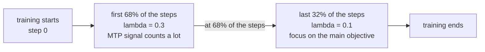
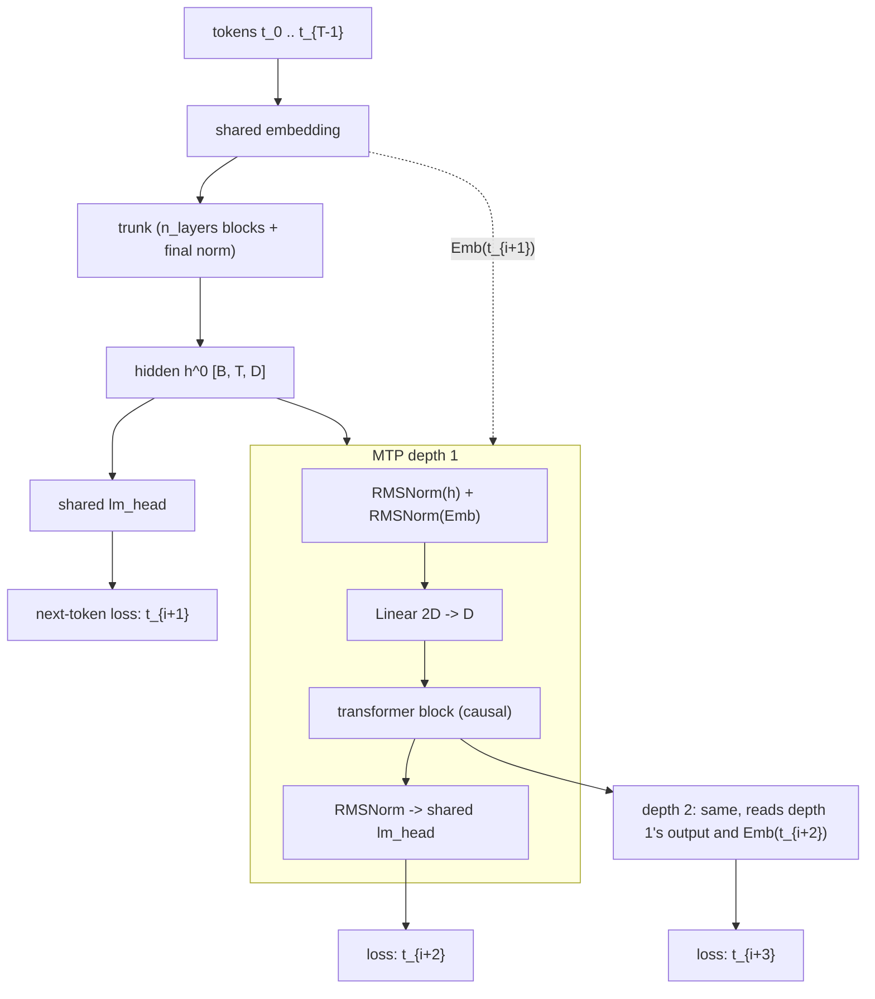
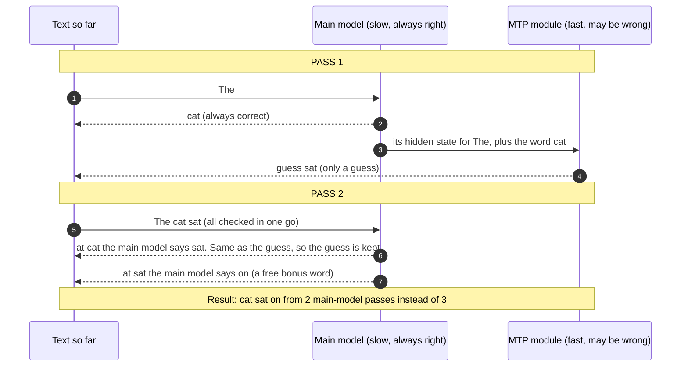
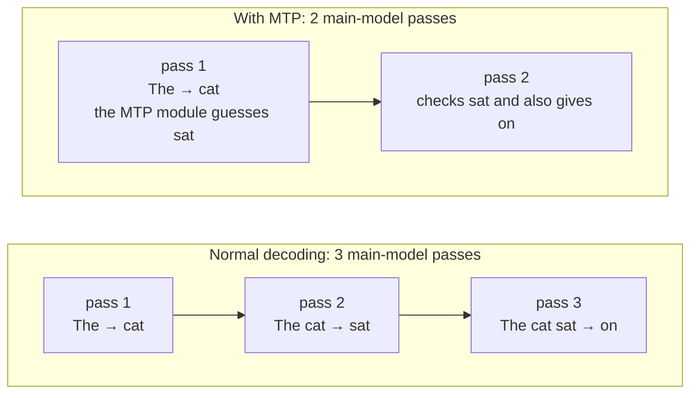
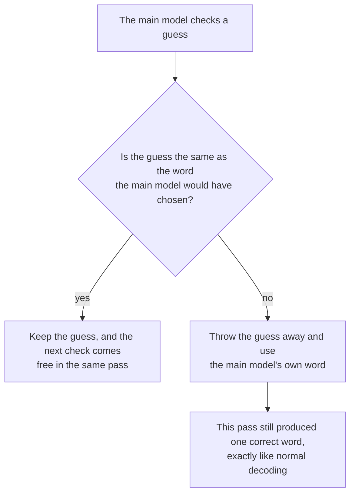
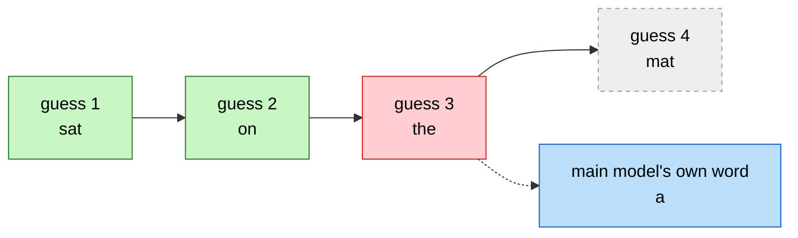
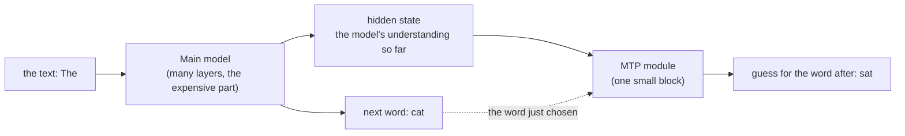
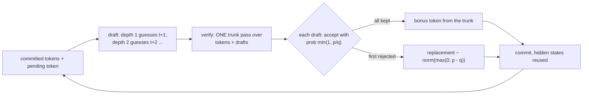
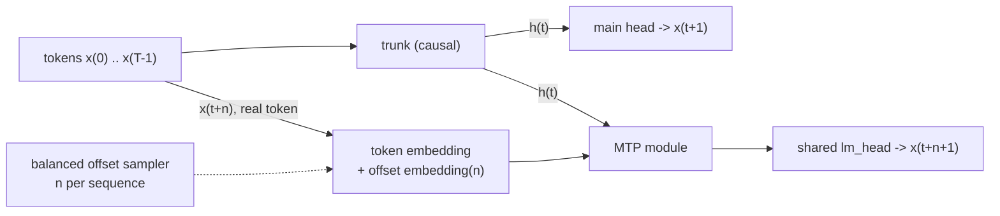
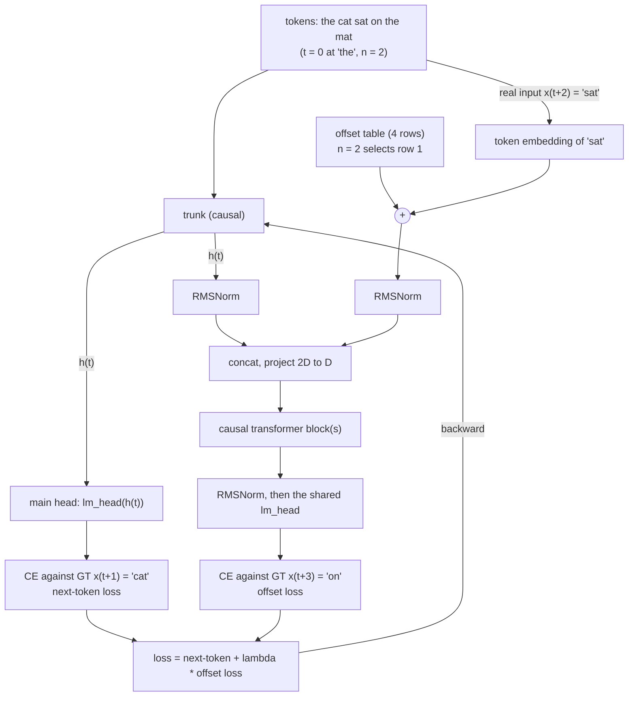

# Multi-token prediction (DeepSeek-V3 style)

The `autoregressive_mtp` and `autoregressive_moe_mtp` variants (dense or mixture-of-experts trunk, the MTP blocks following it) train the normal transformer **and** `mtp_depth` small modules that
predict tokens further ahead. At depth `k` the model predicts the token `k + 1` steps ahead of each
position. This densifies the training signal, and the same modules can draft tokens for
speculative decoding at inference.

```bash
# mixture-of-experts trunk and MTP blocks (autoregressive_moe_mtp)
uv run hale-llm-train --config configs/autoregressive_mtp/nano.yaml --no-resume
uv run hale-llm-sample --config configs/autoregressive_mtp/nano.yaml --prompt "Once upon a time" --temperature 0
# dense trunk (autoregressive_mtp), with the documented default settings
uv run hale-llm-train --config configs/autoregressive_mtp/dense_nano.yaml --no-resume
```

`autoregressive_moe_mtp` forces `model.ffn_type: moe` (as `autoregressive_moe` does); `autoregressive_mtp` takes it from the config.

## Configuration

```yaml
variant: autoregressive_mtp
model:
  mtp_depth: 1                # D: MTP depths. Tokens predicted at once, per position: 1 (main head) + 1 = 2
  mtp_loss_weight: 0.3        # lambda for the first part of training ...
  mtp_loss_weight_final: 0.1  # ... and after the switch (null = keep 0.3 for the whole run)
  mtp_switch_fraction: 0.68   # the switch, as a fraction of the training steps (DeepSeek-V3: 10T of 14.8T tokens)
  mtp_n_layers: 1             # transformer blocks per MTP depth
  # mtp_d_ff: 768             # feed-forward width of the MTP blocks (default: the trunk's)
  # mtp_ffn_type: mlp         # mlp or moe for the MTP blocks (default: the trunk's)
sample:
  speculative: true           # generate with the MTP depth(s) as the draft model (exact); false = plain sampling
```

**Tokens predicted at once.** At every position `i` the main head predicts `t_{i+1}` and MTP depth `k` predicts
`t_{i+k+1}`. With the default `mtp_depth: 1` that is **2 tokens per position**: `t+1` (main head) and `t+2` (depth 1),
which is what DeepSeek-V3 uses. `mtp_depth: 4` would be **5 tokens**: `t+1`, then `t+2`, `t+3`, `t+4`, `t+5` (depths 1 to 4).
Each depth is `mtp_n_layers` extra transformer blocks, so training costs more compute and parameters; the extra depths are
not needed to run the model.

### The lambda schedule

The total loss is `next_token + lambda * (1 / D) * sum_k loss_k`. `lambda` sets how much the extra MTP signal counts next to the
main loss, and by default it follows DeepSeek-V3's **step schedule**: `0.3` for the first part of training, `0.1` after.
V3 switched after 10T of its 14.8T tokens, about 68% of the way (10 / 14.8), so `mtp_switch_fraction` is `0.68`.



* The schedule is a function of progress, `step / total_steps`, so it is **the same for every depth** and a resumed run lands
  on exactly the same value as one that never stopped. (V3 counts tokens; here every step sees about the same number.)
* The `1 / D` factor keeps the *total* MTP weight comparable when you compare depths: without it `D = 3` would carry three
  times the auxiliary weight of `D = 1` and you would be comparing weights, not depths. Keep the schedule, seed, data order and
  learning-rate schedule identical across the runs.
* TensorBoard shows the value being used as `train/mtp_weight`.
* A plausible reason for lowering it (not stated in the paper): the MTP loss helps most early, as a denser training signal,
  and later the model should focus on the main objective. `0.3 / 0.1` are DeepSeek's values at a very large scale and are not
  established for small models; for a small model try constant `0.1`, constant `0.3` (`mtp_loss_weight_final: null`) and
  `0.3 -> 0.1` at `D = 1` first.

### The MTP blocks

Each depth holds `mtp_n_layers` transformer blocks (DeepSeek-V3 uses one). The width and the number of heads are the
trunk's, because a depth reads the trunk's hidden states and shares its rotary positions; the feed-forward width
(`mtp_d_ff`, or the expert width for a mixture of experts) and type (`mtp_ffn_type`) default to the trunk's and can be set
separately, for example a dense trunk with mixture-of-experts MTP blocks. A mixture-of-experts MTP block adds its
balancing loss to the training loss. `mtp_n_layers` and the other block settings are saved in the checkpoint.

## The model



* The embedding table and the output head are **shared** with the trunk (not copied); each depth owns a
  projection `2D -> D`, two input RMSNorms, `mtp_n_layers` transformer block(s), and an output RMSNorm in front of the shared head.
  (The trunk's head only ever sees normalised features; the output norm gives the MTP block outputs the same scale.)
* Depth 1 reads the trunk's final hidden states, depth `k` reads depth `k - 1`'s output.
* Code: `nn/mtp/mtp_module.py` (one depth), `nn/mtp/multi_token_predictor.py` (the chain),
  `models/models_mtp/` (variant, loss, sampler).

## The loss, exactly

For a window of `T` tokens, depth `k` (1-based) works on `T - k` positions. Position `i` combines the
previous depth's hidden state at `i` with the embedding of `t_{i+k}` and predicts `t_{i+k+1}`:

```
h  = proj_k([ RMSNorm(h_prev[:, :-1]) ; RMSNorm(Emb(t[:, k:])) ])     # [B, T-k, D]
h  = blocks_k(h)                                                       # mtp_n_layers causal blocks within depth k
logits = lm_head(RMSNorm_k(h))                                         # [B, T-k, V]
loss_k = CE(logits[:, :-1], t[:, k+1:])                                # the last position has no target
h_prev = h

loss = next_token_loss + lambda * (1 / mtp_depth) * sum_k loss_k      # lambda: 0.3, then 0.1 (see above)
```

Notes on behaviour:

* **Evaluation uses the next-token loss only**, so `val/loss` is comparable with the other variants; the MTP terms
  are training-only (the same choice the MoE variant makes for its balancing loss).
* A fresh model starts at `ln(vocab) * (1 + 0.3)` (the first-phase lambda); `--dry-run` knows this.
* The loss function is `train.loss_type` (cross-entropy by default) for the main and the MTP terms alike.
* Targets that are padding are ignored at every depth (`labels == -100`).
* TensorBoard gets `train/ntp_loss`, `train/mtp_loss`, `train/mtp_loss_depth<k>`; `train/ce_loss` is the
  next-token loss alone, not the weighted total.
* Needs windows of at least `mtp_depth + 2` tokens (checked when the model is built). Each window loses its last
  `k + 1` positions as targets at depth `k`, so a 128-token window with depth 4 trains 123 to 127 targets per depth.

## Inference: speculative decoding

### In plain words: the "The cat sat on" example

A language model writes one word at a time, and every word needs a full, slow pass through the big **main
model**. Speculative decoding is a shortcut that uses the cheap **MTP module** as a helper: a fast helper
*guesses* the next word or two, then the expert *checks all the guesses in a single look*. Right guesses are free
words; wrong guesses are simply thrown away. Either way the text is exactly what the expert alone would have
written.

Starting from the prompt **"The"**, two main-model passes give us *cat sat on*:



Counting the passes:



**What if the guess is wrong?** The main model's own word is used and the guess is discarded:



So the **text is never worse**. A wrong guess costs a little wasted work (the helper's small computation), but never an
extra main-model pass. The saving is real only when guesses are often right.

**With several guesses at once.** With `mtp_depth: 4` the helper guesses up to 4 words ahead (the default `mtp_depth: 1`
guesses one) and the main model checks all of them in the same pass. The first wrong guess ends the run: the guesses before it are kept,
the wrong one is replaced by the main model's word, and the guesses after it are dropped (they were built on a wrong word).
An illustrative example after the text "The cat":



Here one pass produced three words: *sat*, *on* and the main model's *a*. If all four guesses are right the pass produces
five words (four guesses plus a bonus word).

**Why does the MTP module need the main model's hidden state?** The hidden state is the main model's understanding of
the text so far, already computed during the pass. Reusing it makes the helper cheap: it does not have to read and
understand the text again, it only adds one small block on top.



**Is it really the same text?** Yes. This is checked by the tests:

| | |
|---|---|
| Greedy decoding (`temperature: 0`) | Identical words to normal decoding. |
| Sampling (`temperature` above 0) | The same probabilities as normal decoding: a wrong guess is replaced by a draw from the leftover probability, which keeps the distribution exact. |
| Speed | Faster only if enough guesses are right. A model whose MTP modules are still poor can be *slower* than normal decoding, because it does extra work for guesses that are thrown away. The log line `speculative decoding: ... accepted (per depth: ...)` shows how often guesses are right; set `sample.speculative: false` to turn the shortcut off. |

Two details the simple story leaves out, and what the code really does:

* The main model re-reads the **whole** text in each pass ("The cat sat", not just "cat sat"), because this code base
  has no KV cache. Passes are still saved, which is where the speed-up comes from.
* The MTP module looks at the main model's hidden states for **every** position of the text, not only the last one, exactly as
  it does in training. It is the same computation, which is why the guesses are good.

The example above is an executable test, so the documentation cannot drift from the code:
`tests/unit/test_speculative.py::test_the_cat_sat_on_example_takes_two_main_model_passes_instead_of_three`
(and the matching tests for a wrong guess, normal decoding, and four guesses). Real output from a small trained model:

```
D = 1 (one guess), 3 new words:
   verify: guesses ['sat'] | main model's own words at those places ['sat'] + bonus word 'on' -> kept 1 guess(es), next word 'on'
   result: The cat sat on
   main-model pass 1 read: The
   main-model pass 2 read: The cat sat
```

### How it works (technical)

`forward(batch)` still returns the trunk's next-token logits, so evaluation, metrics and plain sampling work as for any other
variant. With `sample.speculative: true` (the default) the sampler uses the MTP depths to guess ahead and the trunk to
check the guesses. The story above maps onto the code like this:

| In the story | In the code |
|---|---|
| the word the main model gives for free ("cat") | the *pending* token (`SpeculativeDecoder._round`): chosen by the trunk, always exact |
| the helper's guesses ("sat ...") | `drafts`, from `MultiTokenPredictor.step` for depth 1, 2, ... `mtp_depth` |
| pass 2, "checks all the guesses in one look" | one `backbone.encode` over `tokens + pending + drafts`; rows `L .. L + D` of its output judge the guesses and give the bonus word |
| keep the guess / use the main model's own word | `_verify`: accept with probability `min(1, p / q)`, else sample from `max(0, p - q)` |
| "The cat sat" already understood | the trunk hidden states of that pass are carried into the next round, so a round costs one trunk pass |



* **Exact.** The tokens have the same distribution as sampling from the trunk alone (speculative sampling,
  Leviathan et al. 2023), and at `temperature: 0` they are **identical** to plain greedy decoding. This is
  tested against plain decoding, with perfect, always-wrong and partly-wrong drafts, and the sampling
  distribution is checked statistically.
* **Cost.** Each round costs one trunk pass over the text plus `D` MTP-block passes and yields between 1 and
  `D + 1` tokens, so a round is cheaper per token than plain decoding whenever drafts are accepted at all.
  The log line `speculative decoding: ... N% of drafts accepted (per depth: ...)` shows the acceptance rate, overall
  and per depth (the share of drafts at that depth that were kept, among rounds that reached it); deeper depths are
  usually less accurate, and a draft only counts if every earlier one was kept. If acceptance is low, rounds cost more than they
  save and `sample.speculative: false` is faster. This code base has no KV
  cache, so the saving is in trunk passes, not in cached attention.
* **Limits.** One prompt at a time (several prompts fall back to plain sampling with a warning). Once prompt and
  output together exceed `max_length` the window slides per round, and exact equality with plain decoding is only
  guaranteed while everything fits in the window. Set `sample.speculative: false` for plain sampling.
* Code: `models/models_mtp/speculative.py` (`SpeculativeDecoder`) and `models/models_mtp/sample.py`.

## Index audit and litmus tests

Off-by-one errors are the classic MTP bug, so the indices are tested three ways, each broken on purpose to confirm it fails:

* `tests/unit/test_mtp_indices.py` feeds **identity tokens** (token value = its position) and spies on every embedding
  lookup, hidden-state hand-off, loss target and verify row, then compares with hand-written tables
  (for `T = 9`, `D = 3`: depth 2 embeds `[2..8]`, reads depth 1's hidden states at positions `0..6`, and is scored against
  `t_3..t_8`). It also runs depth `k` the training way and the inference way on the same tokens and requires identical logits.
* `tests/unit/test_mtp_data_litmus.py` runs the **real** dataset windowing, EOS packing, collate, trainer and checkpoint
  loading on a counting corpus ("5 6 7 ..." mod 20), where the right answer is known by arithmetic: every head must predict
  the number `k + 1` steps ahead (100% on held-out windows), and decoding from a prompt must continue the count with
  every draft accepted. A one-step error anywhere gives 0% accuracy.
* `tests/unit/test_mtp.py` and `test_speculative.py` (see above).

## 2B baseline

`configs/mtp_2b/` holds a 1.98B-parameter model (`baseline.yaml`) and the same model with 1 MTP depth (`mtp.yaml`,
2.04B: a depth adds 59M, and 4 depths would add 235M), identical in data, seed and batch. Memory and disk estimates are in `base.yaml`; they fit an
80 GB GPU at micro-batch 2 x 8 accumulation steps, but they are estimates until a `--dry-run` has measured them.

```bash
uv run hale-llm-cloud --cloud configs/cloud/jarvislabs_a100_80gb.yaml launch --config configs/mtp_2b/baseline.yaml --dry-run
uv run hale-llm-cloud --cloud configs/cloud/jarvislabs_a100_80gb.yaml launch --config configs/mtp_2b/mtp.yaml --auto-pause
```

TinyStories (about 113M tokens at 1M stories) is small for a 2B model, so expect it to overfit; the pair is for comparing MTP
with no MTP at this scale. Point `data.dataset` at a larger corpus for anything else.

## Tests

`tests/unit/test_mtp.py` checks the alignment (depth `k` at position `i` sees exactly the tokens up to `t_{i+k}`),
the loss against a literal transcription of the reference loop, the λ/D weighting, `test_mtp_schedule.py` (the step schedule,
the exact switch step, the same schedule for every depth) and `test_mtp_blocks.py` (configurable blocks: counts, widths,
MoE blocks under a dense trunk, and the same index checks with several blocks per depth), padding, gradients, MoE blocks
and that every depth learns. `tests/unit/test_speculative.py` checks exactness at temperature 0, the carried state
between rounds, the draft chain against the training pass, EOS handling, fallbacks and the sampling distribution.
Deliberately breaking an index in any of those places makes tests fail.


## Offset-conditioned MTP

DeepSeek-V3 stacks `D` MTP modules, and module `k` always predicts `k` tokens beyond the main head. **Offset-conditioned MTP**
(`model.mtp_offset_conditioning: true`, off by default) keeps the same module but uses **one** copy of it and makes the
offset an input: every training step each sequence draws an offset `n` from `1 .. mtp_depth`.

For a position `t` of the sequence:

| | reads | predicts |
|---|---|---|
| main head (unchanged) | `h(t)` | `x(t+1)` |
| MTP module at offset `n` | `h(t)`, the real token `x(t+n)`, and a learned embedding of `n` | `x(t+n+1)` |

On "the cat sat on the mat" with `t` at "the": `n=1` reads "cat" and predicts "sat" (this is exactly DeepSeek's depth 1),
`n=2` reads "sat" and predicts "on", `n=3` reads "on" and predicts "the". The loss compares the prediction with the true
`x(t+n+1)`; the input `x(t+n)` is never the target.



### The algorithm (one training step)

```
1.  trunk      h = trunk(x)                                  # [B, T, D], as always
2.  main loss  ntp = CE(lm_head(h)[t], x(t+1))
3.  offsets    n_b = next B values of the balanced stream    # one per sequence, values in 1..N
4.  input      u[b, t] = x[b, t + n_b]                       # the real token n_b steps ahead
5.  embed      e[b, t] = Emb(u[b, t]) + OffsetEmb(n_b)       # the offset embedding is added to the token embedding
6.  module     m = RMSNorm(h) ++ RMSNorm(e) -> Linear(2D->D) -> mtp_n_layers causal blocks -> RMSNorm
7.  scores     logits = lm_head(m)                           # the trunk's own head, shared
8.  targets    y[b, t] = x[b, t + n_b + 1], ignored (-100) where it is past the end, padding, or (with
                document_masking) in another document than position t
9.  mtp loss   mtp = CE(logits, y), averaged over every target that counts
10. total      loss = ntp + lambda * mtp                     # lambda follows the same 0.3 -> 0.1 schedule
```

Evaluation scores the next-token loss only and draws no offsets.

### How the loss is computed: next-token and `t+3` (offset `n = 2`)

Both losses are the same cross-entropy against the **true text**. They differ in what the model reads and which token it must
guess. Take "the cat sat on the mat" with `t` at "the" and an offset `n = 2`:

| head | reads | predicts | ground truth it is compared with |
|---|---|---|---|
| main head (next-token) | `h(t)` | `x(t+1)` | **"cat"**, the next word of the text |
| offset module, `n = 2` | `h(t)` + the real `x(t+2)` = "sat" + offset embedding row `1` | `x(t+3)` | **"on"**, the word after the input |

The input of the offset module ("sat") is the real token from the data, not something the model predicted (teacher forcing),
and it is never the target: "sat" is what the module *reads*, "on" is what it must *guess*. `x(t+1)` = "cat" is not given to the
module at position `t` (it can only reach it through the previous position, whose input is `x(t-1+2)`).



**Every position gets a pair.** For all positions of the same sequence (`labels[i]` is the token after position `i`, so the
targets are plain lookups into the labels):

```
sentence:   the   cat   sat   on    the   mat          T = 6
position t:  0     1     2     3     4     5

main head      h(t) -> x(t+1)     the>cat   cat>sat   sat>on    on>the    the>mat    (t = 5: nothing after "mat")
offset n=2     reads x(t+2), predicts x(t+3)
               t=0  reads "sat"  -> GT "on"
               t=1  reads "on"   -> GT "the"
               t=2  reads "the"  -> GT "mat"
               t=3  no x(t+3): ignored      t=4, t=5: ignored
offset n=1     t=0 "cat">"sat"   t=1 "sat">"on"   t=2 "on">"the"   t=3 "the">"mat"      (DeepSeek depth 1)
offset n=3     t=0 "on">"the"    t=1 "the">"mat"  t=2.. ignored
```

(`T - n - 1` positions count for offset `n`; the table is what `OffsetConditionedPredictor.targets` returns.)

**The numbers.** With `B` sequences in a batch and offsets `n_b`:

```
next-token loss   ntp = mean over all (b, t) with a next token        of  CE( lm_head(h[b,t]),            x[b, t+1]        )
offset loss       mtp = mean over all (b, t) with a target that counts of  CE( lm_head(norm(module[b,t])), x[b, t+n_b+1]    )
total             loss = ntp + lambda * mtp          (+ the MoE balancing term when the trunk or the module is a mixture of experts)
```

* Both are plain token-level cross-entropy against ground-truth token ids (`train.loss_type` applies to both). A fresh model
  scores about `ln(vocab)` on each, so the total starts near `ln(vocab) * (1 + lambda)`.
* `mtp` is a mean **over tokens**, not over sequences, so a sequence with a small `n` (more valid positions, `T - n - 1`)
  contributes a few more tokens than one with a large `n`. The difference is small for long windows.
* With `lambda = 0.3` and, say, `ntp = 3.0` and `mtp = 3.5`: `loss = 3.0 + 0.3 * 3.5 = 4.05`. Only `ntp` is reported as the
  validation loss; evaluation draws no offsets.
* **Both losses backpropagate into the trunk** through the same `h(t)`. The next-token loss trains the trunk, the shared
  embedding and the head; the offset loss trains the module, the offset table, and also the trunk, embedding and head.
* The target of position `t` (`x(t+3)`) is the *input* of position `t+1` (`x(t+1+2)`). That is allowed because attention is
  causal: position `t` never sees position `t+1`. A test changes `x(t+n+1)` and checks that no logit at a position up to `t` moves.
* Targets are ignored (`-100`) when they are past the end of the window, padding, or (with `document_masking`) in another document.

### Every offset is used equally often

Drawing each offset independently would make the counts only roughly equal. The sampler instead lays out **shuffled decks**:
deck 0 is a random permutation of `1..N`, deck 1 another one, and so on, and the draws are the decks end to end.

```
N = 4:   [3 1 4 2] [2 4 1 3] [1 3 2 4] ...        every aligned block of 4 draws has each offset once
```

* after **any** number of draws the counts of two offsets differ by at most 1 (exactly equal after every multiple of `N`);
* the order inside a deck is random, and `mtp_offset_seed` (default `train.seed`) changes it;
* the stream depends only on `(seed, number of draws so far)`: it does not depend on how the draws are split into batches or
  gradient-accumulation steps, never touches the global random state, and the draw counter is saved in the checkpoint
  (`mtp.sampler._extra_state`), so a resumed run continues the exact same stream;
* offsets are per **sequence**; how many offsets a single step sees depends on the number of sequences per step (next section).

### Batch size and offsets

Offsets are drawn **per sequence**: a batch of `B` sequences takes the next `B` values of the stream, one for each sequence.
The balance guarantee ("counts differ by at most 1") holds over the **run**, for any batch size. What the batch size changes is
how many different offsets one optimizer step sees. What counts is the number of sequences behind one step,
`S = train.batch_size x lean.accum_steps` (every micro-batch draws its own offsets):

| sequences per step `S` (N = 4) | what one step sees |
|---|---|
| `S` a multiple of `N` (4, 8, 64; or batch 2 x accum 2) | **every step has each offset exactly `S / N` times** (batch 64: 16 each) |
| `S >= 2N - 1` (7 or more), not a multiple | every step has every offset at least once; counts differ by at most 2 |
| `S < N` (1, 2, 3) | a step sees only `S` of the 4 offsets (`S = 1`: a single offset); the others come in later steps |

Why it matters: the offset loss of a step is an average over the offsets that step drew. With a few sequences per step it is
noisier (one offset per step is a different loss each time), and the extra gradient noise is the cost; over many steps it is
still balanced, so the training is not biased. Practical advice: pick `batch_size x accum_steps` as a multiple of `mtp_depth`
(your 64 is), or use gradient accumulation to reach one. With `S < N` it still trains correctly, just noisily.

### Speculative decoding

Drafting reuses the same trunk state for every draft. With committed tokens `x_0 .. x_{L-1}` and the pending token `x_L`:

```
for k in 1 .. mtp_draft_tokens:
    run the MTP module at offset k over the whole prefix, reading the trunk's hidden states and
    x_k .. x_{L+k-1}; its last position scores x_{L+k}         # draft k = "x(t+k) with offset k"
    sample/argmax draft_k  and  append it to the known tokens
verify:  ONE trunk pass over the committed tokens, x_L and all the drafts (unchanged from DeepSeek mode)
```

The trunk verifies every draft, so the output is exactly what the trunk alone would produce (at temperature 0 it is identical to
plain greedy decoding) whatever `mtp_draft_tokens` is. It only changes how many trunk passes are needed.

### Configuration

```yaml
model:
  mtp_offset_conditioning: true   # false (default): DeepSeek-V3 chained depths
  mtp_depth: 4                    # N: the offsets are 1..N (in the default mode: the number of depths)
  mtp_offset_seed: null           # seed of the offset order; null = train.seed
  mtp_draft_tokens: 1             # tokens drafted per speculative round, 1..mtp_depth (both modes)
  mtp_loss_weight: 0.3            # lambda, then mtp_loss_weight_final after mtp_switch_fraction of the steps
  mtp_n_layers: 1                 # blocks in the module
```

`mtp_draft_tokens` applies to both modes. Before it existed the decoder drafted every depth; the default is now **one** draft
per round, so a DeepSeek-mode config with `mtp_depth > 1` must set `mtp_draft_tokens: <depth>` to draft all of them.
A ready config is `configs/autoregressive_mtp/offset_nano.yaml`.

Things to know:

* **Document boundaries.** With `model.document_masking: true` a target in another document than its position is ignored, and the
  module's attention is masked like the trunk's. Without it the windows are plain packed text (as for the main head), so a target
  may be the first token of the next story after an end-of-text token.
* **Size.** One module plus an `N x d_model` table, instead of `N` modules.
* **Optimizers.** The offset table is a lookup table: Muon and Dion leave it to AdamW, and it gets no weight decay.
* **Logging.** `train/mtp_loss` is the loss of the sampled offsets and `train/mtp_offset_mean` their mean (about `(N + 1) / 2`).
