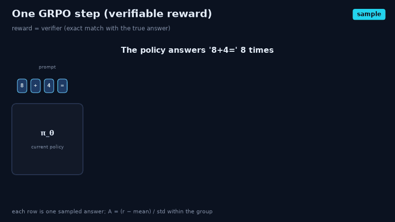
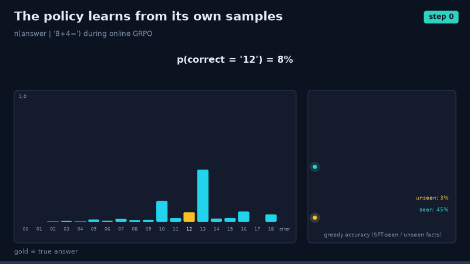
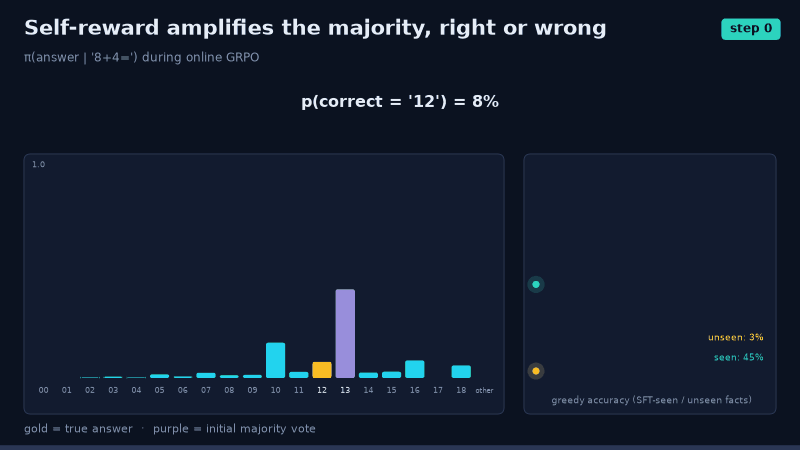
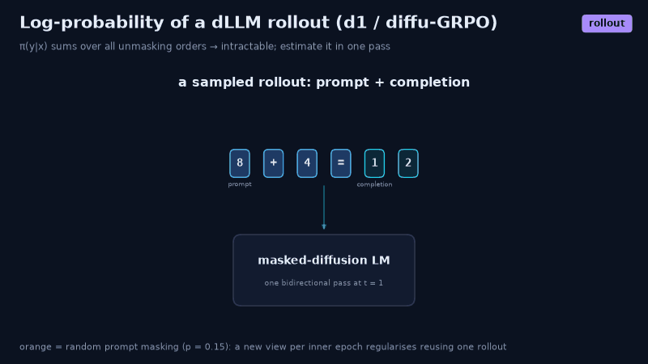
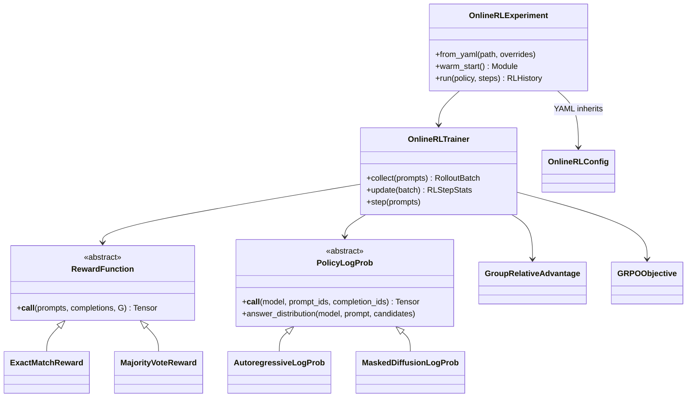

# Online ("self") reinforcement learning

`hale_llm.rl` trains this repo's LLMs with **online GRPO**. The policy samples its own completions,
a reward scores them, rewards are normalised within each prompt's group, and clipped policy-gradient
steps follow. It works for the **autoregressive** and **masked-diffusion** variants and for
**verifiable** or **label-free self** rewards.

The step-by-step explanation, with diagrams, animations and runnable experiments, is in
[`notebooks/rl/01_online_rl.ipynb`](../notebooks/rl/01_online_rl.ipynb).

| | |
|---|---|
|  |  |
|  |  |

## Quick start

```python
from hale_llm.rl import OnlineRLExperiment

exp = OnlineRLExperiment.from_yaml("configs/rl/arithmetic_autoregressive.yaml")
history = exp.run(exp.warm_start())          # ~30 s on a laptop CPU
print(history.evals[0], history.evals[-1])  # greedy accuracy before / after RL
```

Measured on the toy arithmetic task (seed 0, CPU), with numbers taken from the executed notebook:

| run (config) | accuracy before → after | unseen facts |
|---|---|---|
| GRPO, verifiable reward, AR (`arithmetic_autoregressive.yaml`, 1000 steps) | 20 % → 94 % | 3 % → 92 % |
| self-reward / majority vote, AR (`arithmetic_self_reward.yaml`, 600 steps) | 20 % → 13 % | reward → 0.9, accuracy falls |
| diffu-GRPO, masked diffusion (`arithmetic_diffusion.yaml`, 1500 steps) | 31 % → 63 % | 7 % → 43 % |

## Design



* **Registries:** `REWARDS` (`reward.type`) and `LOG_PROB_ESTIMATORS` (model `variant`). A new reward
  or model family is a new registered class; the trainer does not change.
* **Configs:** `configs/rl/base.yaml`, plus one-to-two-line children through `inherits:`.
  `OnlineRLConfig.from_yaml` resolves chains of any depth, rejects cycles and validates every field.
* **Diffusion:** `MaskedDiffusionLogProb` is d1's one-pass mean-field estimate (whole completion
  masked, about 15 % random prompt masking per inner epoch).
* **Animations:** `hale_llm.visualization.rl_films`, rendered from real runs.
* **Tests:** `tests/unit/test_online_rl.py`.
