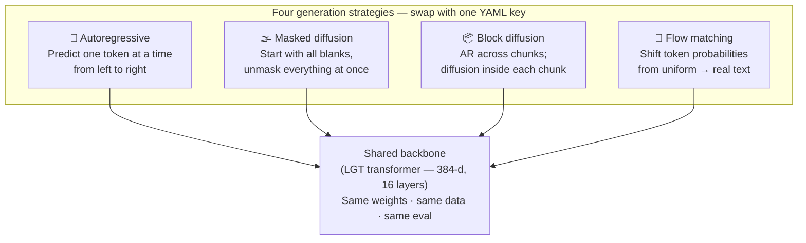

# Overview

## How it works

All four paradigms use the **same** transformer backbone, the same data (WikiText-2), and the same evaluation — only the *generation strategy* differs. This lets you measure each strategy fairly on equal footing.

> **The point:** by keeping everything else identical, any difference in quality comes only from the generation paradigm — not model size or data.

## Why this repo

The decoder is a small library: **components** (attention, FFN, layers), **transformer stacks** that run on hidden states `(B, S, D)` for a VLM or world model, and **token backbones** that map ids → logits. Masking, attention, FFN, and `arch` are config switches. Train, sample, eval, and visualize through one CLI. Details: [docs/core.md](core.md).

| Switch | Options |
|---|---|
| Variant | `autoregressive` · `diffusion` · `block_diffusion` · `flow_matching` · `block_flow_matching` · `looped` ([docs/looped.md](looped.md)) · `mtp` (stub) |
| Attention mask | `causal` · `bidirectional` · `block_causal` |
| Attention impl | `mha` · `gqa` · `mqa` |
| Backbone | `transformer` (GPT-style) · `lgt` (local/global + dual RoPE) · `dit` (AdaLN-Zero) · `looped` (weight-tied recurrent depth + ACT, [docs/looped.md](looped.md)) |
| FFN | `mlp` · `geglu` · DeepSeek-style `moe` |
| Token loss | `ce` · `focal` |

Shared core (`core/`, `dataloader/`, `training/`, `inference/`, `metrics/`) never imports a `models_*` package by name. Each paradigm lives in `src/hale_llm/models/models_<name>/` and registers with `@register_model` / `@register_loss` / `@register_sampler` / `@register_metric`.

## Variants

| Config | What it does |
|---|---|
| [`configs/autoregressive/small.yaml`](../configs/autoregressive/small.yaml) | Next-token LM (reference) |
| [`configs/diffusion/small.yaml`](../configs/diffusion/small.yaml) | Absorbing-state masked diffusion |
| [`configs/block_diffusion/small.yaml`](../configs/block_diffusion/small.yaml) | AR across blocks, diffusion inside the block |
| [`configs/flow_matching/small.yaml`](../configs/flow_matching/small.yaml) | Discrete flow matching |
| [`configs/block_flow_matching/small.yaml`](../configs/block_flow_matching/small.yaml) | AR across blocks, discrete flow matching inside the block ([docs](block_flow_matching.md)) |
| [`configs/looped/small.yaml`](../configs/looped/small.yaml) | Looped transformer: one weight-tied block iterated T times (ACT, recurrent depth, test-time loops) |
| [`configs/mtp/small.yaml`](../configs/mtp/small.yaml) | Multi-token heads (stub) |

Default small model: `d_model=384`, 16 layers, 8 heads, `d_ff=1536`, `max_length=128`, GPT-2 tokenizer, WikiText-2 with a **10-word sliding stride**. Diffusion, block diffusion, and flow matching use **LGT** (`arch: lgt`, local-global transformer). Autoregressive stays on `transformer`.
