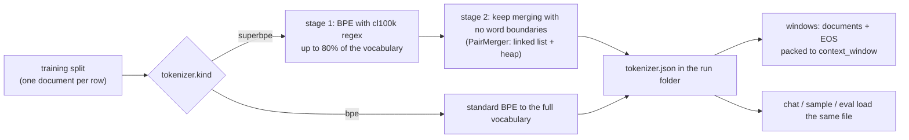

# Tokenizer

By default every training run **trains its own byte-level tokenizer on its training data**, with the
cl100k (GPT-4) pre-tokenizer regex, using **SuperBPE**, at a vocabulary size chosen from the model
size. Off-the-shelf tokenizers were fit to someone else's data; this one is fit to yours.



## How it is used

| Situation | What happens |
|---|---|
| New training run, default `tokenizer.path` | Tokenizer is trained on the training split and saved to `<run>/tokenizer/` |
| New training run, explicit `tokenizer.path` (the shared setup in `base.yaml`) | The first run trains it there; every later run loads it, so dense and MoE runs see identical tokens. Each run also keeps a copy in `<run>/tokenizer/` |
| Resume, evaluate, sample, chat | The saved tokenizer is loaded; **inference never trains one** |
| `tokenizer.source: pretrained` | Download `data.tokenizer_name` (e.g. `gpt2`) instead |
| Several processes | The tokenizer is saved atomically (staging folder, then rename), so a reader never sees a half-written one |

```yaml
tokenizer:
  source: trained            # trained | pretrained
  kind: superbpe             # superbpe | bpe  (registry: hale_llm.tokenizer.training)
  vocab_size: null           # null = chosen from the model size
  vocab_policy: by_model_size
  transition_fraction: 0.8   # SuperBPE: share learned with word boundaries (stage 1)
  stage2_max_tokens: 2000000 # SuperBPE stage 2 runs over at most this much text
  min_frequency: 2
```

## Vocabulary size follows the model

The embedding table costs `vocab x d_model` parameters; in SmolLM2-135M it is more than 28M of 135M
(about 21%). So the vocabulary is sized to the model (non-embedding parameters), by the registered
policy `by_model_size`:

| Model size | Vocabulary |
|---|---|
| under 500M | 32,768 (2^15) |
| 0.5B to 3B | 65,536 (2^16) |
| above 3B | 100,352 (about 100k) |

The 100k tier is part of the policy but only models above 3B parameters reach it. Add a policy with
`@register_vocab_policy("name")`, or pin a size with `tokenizer.vocab_size`.

## SuperBPE in one example

Standard BPE never merges across a space, so " of the" is always three tokens. SuperBPE trains in two
stages: stage 1 is ordinary BPE; stage 2 removes the pre-tokenizer and keeps merging, so frequent
phrases become single tokens. Measured on 20,000 TinyStories stories at an 8,192 vocabulary
(`hale-llm-tokenizer-ablation`): BPE 4.30 bytes per token, SuperBPE 6.67, so SuperBPE needs 64% of
the tokens for the same text. That is a small-corpus, small-vocabulary number, not a claim about
300M-parameter training.

Both kinds round-trip any text exactly (every byte is always in the vocabulary).

## The BPE versus SuperBPE ablation

The decision rule: *at the same vocabulary size and compute, if SuperBPE wins, keep it.* SuperBPE is
the default; the ablation is how you check it on your own data.

1. **Cheap half, minutes:** compression at equal vocabulary size.

   ```bash
   uv run hale-llm-tokenizer-ablation --config configs/long_context/300m_4k_to_32k.yaml --max-documents 200000
   ```

2. **Expensive half, GPU days:** two ~300M-parameter runs on 10 to 20B tokens that differ only in the tokenizer.

   ```bash
   uv run hale-llm-train --config configs/ablations/tokenizer_bpe.yaml
   uv run hale-llm-train --config configs/ablations/tokenizer_superbpe.yaml
   ```

3. **Compare per byte, not per token.** The two models predict different tokens, so their per-token
   losses are not comparable. Convert with the tokenizer's compression:
   `bits per byte = loss_per_token / ln(2) / bytes_per_token`. The lower value wins.

The 300M and 10 to 20B-token runs were **not** performed in this repository; only the harness and
the compression half were run.

## Code map

| Piece | Where |
|---|---|
| cl100k regex | `tokenizer/pretokenizer_pattern.py` |
| BPE / SuperBPE trainers (registry `tokenizer.kind`) | `tokenizer/training/` |
| Stage-2 merging (linked list, pair counts, lazy max-heap) | `tokenizer/training/pair_merger.py` |
| Vocabulary policy (registry `tokenizer.vocab_policy`) | `tokenizer/vocab/` |
| Train-or-load logic | `tokenizer/builder.py`, `tokenizer/store.py` |

SuperBPE: Liu et al., 2025. Tokenizer training uses Hugging Face `tokenizers` (Apache-2.0).

## One tokenizer for every run

`configs/base.yaml` sets `tokenizer.path: data/tokenizers/tinystories_superbpe_shared`, so every
config that inherits it uses the same tokenizer. That keeps runs comparable: dense and MoE models see
the same token ids, and `val/loss` is measured in the same units.

* The first run trains the tokenizer into that folder; later runs only load it.
* A reused tokenizer must match the config. If its `kind`, `dataset` or an explicit `vocab_size` differs
  (the saved values are in `hale_tokenizer.json`), the run stops with an error instead of silently
  using the wrong one. Pick another `tokenizer.path`, or delete the folder to retrain.
* Each run folder keeps its own copy (`<run>/tokenizer/`). `hale-llm-chat`, `-sample` and `-eval` look
  there first, so a checkpoint stays usable even if the shared tokenizer is later replaced.
* The tokenizer learns from whichever run creates it first (`data.train_size` of that run). Delete the
  folder to relearn it from a different amount of data.
* The BPE vs SuperBPE ablation configs set their own paths (`data/tokenizers/ablation_*`).
* `--dry-run` always uses a temporary tokenizer and never touches the shared one.
