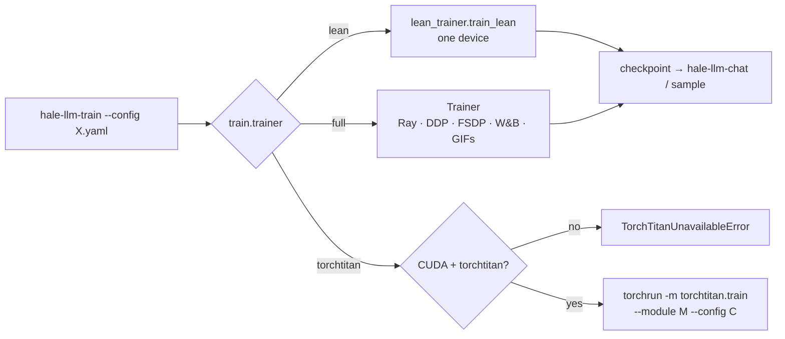

# Training backends

`hale-llm-train` runs one of three backends, chosen by `train.trainer` in the YAML (or
`--trainer` on the command line).

| `train.trainer` | What it is | Use it for |
|---|---|---|
| `lean` (default) | One readable file, `src/hale_llm/training/lean_trainer.py`, in the nanochat / modded-nanogpt style | Single-device runs: laptop, one GPU |
| `full` | The original trainer: Ray, DDP/FSDP, W&B, resume, GIF visualisation | Distributed runs and visual debugging |
| `torchtitan` | Launches [TorchTitan](https://github.com/pytorch/torchtitan) with `torchrun` | NVIDIA GPU boxes, multi-GPU/multi-node, FSDP2 / TP / PP |



Add a backend: subclass `TrainerBackend`, decorate it with `@register_trainer_backend("name")`,
import it in `hale_llm/training/backends/__init__.py`.

## The lean trainer, step by step

`train_lean(cfg)` is a plain function you can read top to bottom:

1. **Config and device.** Seed, pick the device. bf16 autocast is used on CUDA only.
2. **Data.** The same `DataModule` as the full trainer. `endless()` restarts the loader so the
   loop never has to think about epochs. Total steps come from `train.steps`, or
   `train.epochs x batches per epoch`.
3. **Model.** Built from the variant registry, so autoregressive, diffusion, block diffusion and
   flow matching all work. `lean.compile: true` wraps it in `torch.compile`; the checkpoint is
   still saved from the plain module so chat can load it.
4. **Optimizer.** From the registry (`adamw` by default, or `muon`). Each parameter group's
   learning rate is remembered as its *base* rate.
5. **Learning-rate schedule.** `lr_multiplier(step)`: linear warmup, flat, then linear warmdown to
   0 over the last `warmdown_frac` of steps. Example with 100 steps, warmup 10, warmdown 0.2:
   step 4 -> 0.5, step 50 -> 1.0, step 90 -> 0.5, step 99 -> 0.05.
6. **Gradient accumulation.** Each step runs `accum_steps` micro-batches; every loss is divided by
   `accum_steps`, so the summed gradient equals the gradient of the mean over the big batch.
   Effective batch = `batch_size x accum_steps`.
7. **Clip and update.** Global gradient norm is clipped to `train.grad_clip`, then the optimizer steps.
8. **Validate and save.** Validation loss every `eval_every` steps. The checkpoint format matches the
   full trainer, so `hale-llm-chat`, `hale-llm-sample` and `hale-llm-eval` load it.

```yaml
train:
  trainer: lean
  steps: 2000
  batch_size: 32
  lean:
    accum_steps: 2        # effective batch 64
    warmup_steps: 100
    warmdown_frac: 0.2
    eval_every: 250
    compile: false
```

The lean trainer has no resume, W&B or GIF output, and it refuses Ray / `parallel_strategy`
settings with a message pointing to `trainer: full`.

## TorchTitan (NVIDIA GPUs only)

TorchTitan describes a run as a Python *recipe*: a function that returns the whole training
configuration. The backend runs the same command as TorchTitan's `run_train.sh`:

```
torchrun --nproc_per_node=N ... -m torchtitan.train --module MODULE --config CONFIG
```

**What it does and does not use from this repo.** TorchTitan builds its own Llama-style model, data
pipeline and parallelism from the recipe. The `model` and `data` sections of your YAML are not used,
and its checkpoints are not `hale-llm-chat` checkpoints.

**Setup on a GPU machine**

```bash
git submodule update --init ext_pkgs/torchtitan
# TorchTitan needs a recent PyTorch nightly; use your CUDA build in place of cu132.
uv pip install --pre torch --index-url https://download.pytorch.org/whl/nightly/cu132
uv pip install -e ext_pkgs/torchtitan -r ext_pkgs/torchtitan/requirements.txt
# the debug recipe uses the tokenizer bundled with the repo; for real models:
python ext_pkgs/torchtitan/scripts/download_hf_assets.py --repo_id meta-llama/Llama-3.1-8B --assets tokenizer --hf_token=...
```

**Run**

```bash
uv run hale-llm-train --config configs/examples/torchtitan.yaml
# or pick it ad hoc:
uv run hale-llm-train --config configs/autoregressive/small.yaml --trainer torchtitan
```

```yaml
train:
  trainer: torchtitan
  titan:
    module: torchtitan_recipes.models.llama3   # import path of the recipe file
    config: llama3_8b                          # function inside it
    num_gpus: null                             # null = all visible GPUs
    repo_dir: ext_pkgs/torchtitan              # must contain torchtitan_recipes/
    overrides: []                              # each becomes: --override TARGET[=JSON]
```

**Failure messages.** On a Mac or CPU-only machine, `torchtitan` raises
`TorchTitanUnavailableError` before any run folder is created, with the advice to use `trainer: lean`.
The same error is raised when `torchtitan` is not installed, the recipe directory is missing, or
`num_gpus` exceeds the visible GPUs. A non-zero exit from TorchTitan raises `RuntimeError`.

**Status.** The command construction and every guard are unit-tested. The launch itself has not
been run: it needs NVIDIA GPUs and a PyTorch nightly, which the development machine (a Mac) lacks.
TorchTitan is BSD-3-Clause licensed; the other dependencies are MIT/Apache.
