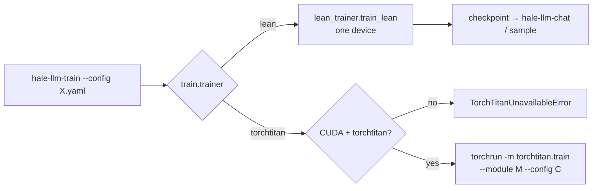
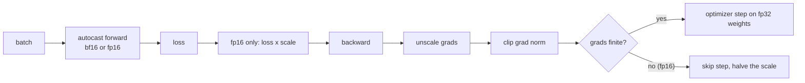
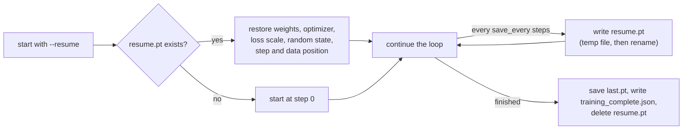

# Training backends

`hale-llm-train` runs one of two backends, chosen by `train.trainer` in the YAML (or
`--trainer` on the command line).

| `train.trainer` | What it is | Use it for |
|---|---|---|
| `lean` (default) | One readable file, `src/hale_llm/training/lean_trainer.py`, in the nanochat / modded-nanogpt style | Single-device runs: laptop, one GPU |
| `torchtitan` | Launches [TorchTitan](https://github.com/pytorch/torchtitan) with `torchrun` | NVIDIA GPU boxes, multi-GPU/multi-node, FSDP2 / TP / PP |



Add a backend: subclass `TrainerBackend`, decorate it with `@register_trainer_backend("name")`,
import it in `hale_llm/training/backends/__init__.py`.

## The lean trainer, step by step

`train_lean(cfg)` is a plain function you can read top to bottom:

1. **Config and device.** Seed, pick the device. bf16 autocast is used on CUDA only.
2. **Data.** `DataModule` builds the loaders. `endless()` restarts the loader so the
   loop never has to think about epochs. Total steps come from `train.steps`, or
   `train.epochs x batches per epoch`.
3. **Model.** Built from the variant registry (`autoregressive` or `autoregressive_moe`). `lean.compile: true` wraps it in `torch.compile`; the checkpoint is
   still saved from the plain module so chat can load it.
4. **Optimizer.** From the registry (`adamw` by default, or `muon`). Each parameter group's
   learning rate is remembered as its *base* rate.
5. **Learning-rate schedule.** `lr_multiplier(step)`: linear warmup, flat, then linear warmdown to
   0 over the last `warmdown_frac` of steps. Example with 100 steps, warmup 10, warmdown 0.2:
   step 4 -> 0.5, step 50 -> 1.0, step 90 -> 0.5, step 99 -> 0.05.
6. **Gradient accumulation.** Each step runs `accum_steps` micro-batches; every loss is divided by
   `accum_steps`, so the summed gradient equals the gradient of the mean over the big batch.
   Effective batch = `batch_size x accum_steps`.
7. **Clip and update.** Global gradient norm is clipped to `train.grad_clip`, then the optimizer steps.
8. **Validate and save.** Validation loss every `eval_every` steps. `hale-llm-chat`, `hale-llm-sample` and `hale-llm-eval` load the checkpoint.

```yaml
train:
  trainer: lean
  steps: 2000
  batch_size: 32
  lean:
    accum_steps: 2        # effective batch 64
    warmup_steps: 100
    warmdown_frac: 0.2
    eval_every: 250
    compile: false
```

The lean trainer runs on one device and can resume an interrupted run (see below). For several GPUs use `trainer: torchtitan`.

## TorchTitan (NVIDIA GPUs only)

TorchTitan describes a run as a Python *recipe*: a function that returns the whole training
configuration. The backend runs the same command as TorchTitan's `run_train.sh`:

```
torchrun --nproc_per_node=N ... -m torchtitan.train --module MODULE --config CONFIG
```

**What it does and does not use from this repo.** TorchTitan builds its own Llama-style model, data
pipeline and parallelism from the recipe. The `model` and `data` sections of your YAML are not used,
and its checkpoints are not `hale-llm-chat` checkpoints.

**Setup on a GPU machine**

```bash
git submodule update --init ext_pkgs/torchtitan
# TorchTitan needs a recent PyTorch nightly; use your CUDA build in place of cu132.
uv pip install --pre torch --index-url https://download.pytorch.org/whl/nightly/cu132
uv pip install -e ext_pkgs/torchtitan -r ext_pkgs/torchtitan/requirements.txt
# the debug recipe uses the tokenizer bundled with the repo; for real models:
python ext_pkgs/torchtitan/scripts/download_hf_assets.py --repo_id meta-llama/Llama-3.1-8B --assets tokenizer --hf_token=...
```

**Run**

```bash
uv run hale-llm-train --config configs/examples/torchtitan.yaml
# or pick it ad hoc:
uv run hale-llm-train --config configs/autoregressive/small.yaml --trainer torchtitan
```

```yaml
train:
  trainer: torchtitan
  titan:
    module: torchtitan_recipes.models.llama3   # import path of the recipe file
    config: llama3_8b                          # function inside it
    num_gpus: null                             # null = all visible GPUs
    repo_dir: ext_pkgs/torchtitan              # must contain torchtitan_recipes/
    overrides: []                              # each becomes: --override TARGET[=JSON]
```

**Failure messages.** On a Mac or CPU-only machine, `torchtitan` raises
`TorchTitanUnavailableError` before any run folder is created, with the advice to use `trainer: lean`.
The same error is raised when `torchtitan` is not installed, the recipe directory is missing, or
`num_gpus` exceeds the visible GPUs. A non-zero exit from TorchTitan raises `RuntimeError`.

**Status.** The command construction and every guard are unit-tested. The launch itself has not
been run: it needs NVIDIA GPUs and a PyTorch nightly, which the development machine (a Mac) lacks.
TorchTitan is BSD-3-Clause licensed; the other dependencies are MIT/Apache.


## Best checkpoints

Besides `checkpoints/last.pt` (the final weights plus optimizer state), the lean trainer keeps the
**N best checkpoints by validation score** in `<run>/checkpoints/best/`, named like
`step0000500_loss_1.2345.pt`. Each time validation runs (`eval_every`), the checkpoint is saved if it ranks
in the top N, and the one it pushes out is deleted.

```yaml
train:
  lean:
    keep_best: 5          # 0 disables
    best_by: loss         # loss (lower is better) | token_accuracy (higher is better)
```

Best files hold the model weights and config but not the optimizer state (smaller; they are for
picking and loading a model, not for resuming). Load one with `load_session(cfg, checkpoint_path=...)`.
Ranking uses `eval_batches` validation batches, so close scores can swap order between runs.


## Mixed precision

The lean trainer runs the forward pass in lower precision to go faster and use less GPU memory. Weights,
optimizer state and checkpoints always stay fp32, so a checkpoint loads the same way whatever precision
trained it.

```yaml
train:
  lean:
    precision: auto     # auto | fp32 | bf16 | fp16
```

| Value | What happens |
|---|---|
| `auto` (default) | bf16 on a CUDA GPU that supports it, otherwise fp32 (the behaviour before this option existed) |
| `fp32` | No autocast. The slow reference |
| `bf16` | Autocast to bfloat16. Same number range as fp32, so no loss scaling |
| `fp16` | Autocast to float16 **with loss scaling**: the loss is scaled up so small gradients survive, gradients are unscaled before clipping, and a step with overflowing gradients is skipped and the scale halved |

Override per run: `hale-llm-train --config ... --precision fp16`. Implementation: `training/mixed_precision.py`.



TensorBoard adds `train/loss_scale` and `train/step_skipped` in fp16 mode. A few skipped steps early in
training are normal while the scale settles; many skipped steps in a row mean the run is unstable, so try
`bf16`. Validation runs under the same autocast. Use `bf16` on A100, H100, H200, L4 and RTX-PRO6000;
fp16 is for GPUs without bf16 support.


## Resuming an interrupted run

A run can be interrupted at any time, for example when a spot instance is paused. The lean trainer writes a
rolling checkpoint, `<run>/checkpoints/resume.pt`, every `save_every` steps, and continues from it instead of
retraining from scratch.

```yaml
train:
  resume: true            # check for resume.pt at start and continue from it (CLI: --resume / --no-resume)
  lean:
    save_every: 2000      # steps between resume checkpoints; 0 disables
```



What makes the resumed run identical to one that never stopped:

* **Everything is restored**: model, optimizer (both groups for Muon), the fp16 loss scale, the random state (dropout and
  router noise), the step, tokens seen, and the position in the data. The best-5 leaderboard is rebuilt from the
  files in `best/`; any from after the resume point (the part that is redone) are deleted.
* **The data order is reproducible**: each epoch's shuffle depends only on `(train.seed, epoch)`, and resuming
  skips by index without loading the skipped data, so it is instant even deep into an epoch.
* **Saves are atomic**: a file is written under a temporary name and renamed into place, so an interruption
  during a save keeps the previous `resume.pt`.
* **A finished run is not redone**: with `--resume`, a folder that already holds `training_complete.json`
  exits immediately. Use `--no-resume` to train again; a fresh run also deletes any stale `resume.pt`.
* **Checked, not assumed**: a `resume.pt` from another variant or vocabulary size is refused with a clear error.
  If `epochs`/`steps` changed, the learning-rate schedule changes too, and a warning says so.

Resuming needs the same run folder: set `experiment.name`, or leave it empty and `--resume` reuses the
variant's `latest` folder. `resume.pt` holds weights plus optimizer state (about 12 bytes per parameter in
fp32), so it is written to disk in about a second for a 100M model. Only the latest one is kept.
The step, loss and best-checkpoint files continue from the resume point: the returned loss list covers only
the steps run after it, and TensorBoard hides the redone part of the earlier attempt.

## How long a run took

When training ends, the trainer logs one line, locally and on a cloud instance alike:

```
training finished: 2000 steps, 131,072,000 tokens in 1 h 02 min 05 s (3725.4 s)
```

The time is the total training time of the whole run. The seconds already trained are stored in `resume.pt`, so a run
resumed after a spot interruption adds up all its sessions (the line then ends with `; this session 12 min 03 s`), and
the resume message shows the time trained so far. Time spent waiting for a new instance is not counted. The same number
is written to `training_complete.json` (`elapsed_seconds`); `hale-llm-cloud finish` prints it after downloading the results.
