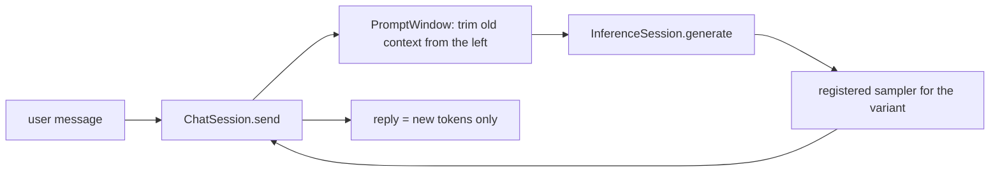

# Usage

```bash
uv sync
uv run hale-llm-train --config configs/autoregressive/small.yaml --no-resume          # dense transformer
uv run hale-llm-train --config configs/autoregressive_moe/nano.yaml --no-resume       # mixture of experts
uv run hale-llm-train --config configs/autoregressive_mtp/nano.yaml --no-resume       # multi-token prediction
uv run hale-llm-sample --config configs/autoregressive/small.yaml
uv run hale-llm-eval --config configs/autoregressive/small.yaml
tensorboard --logdir data/experiments
```

Check a config before a long run with a dry run. It trains 3 steps on a small slice in a temp
folder, writes nothing to `data/`, and prints the parameter count at the real vocabulary size,
the first loss against `ln(vocab)`, seconds per step and (on CUDA) peak memory:

```bash
uv run hale-llm-train --config configs/autoregressive_moe/nano.yaml --dry-run
```

Configs inherit with `inherits:`. Full parameter list: [config.md](config.md).

## Try a trained model: `hale-llm-infer` and `hale-llm-chat`

Both commands load the same checkpoint the other CLIs use (`latest` run of the variant, or
`--experiment NAME` / `--checkpoint PATH`) and call the sampler registered for that variant.

```bash
# one or many prompts; --json prints one JSON object per prompt
uv run hale-llm-infer --config configs/autoregressive/small.yaml --prompt "The history of"
uv run hale-llm-infer --config configs/autoregressive/small.yaml --prompt-file prompts.txt --json

# interactive terminal chat
uv run hale-llm-chat --config configs/autoregressive/small.yaml --max-new-tokens 40
```

The checkpoints are base language models trained on TinyStories, not instruction-tuned, so a
chat reply is a continuation of the conversation so far. Inside `hale-llm-chat`:
`/help`, `/reset`, `/history`, `/temp V`, `/tokens N`, `/quit`.


