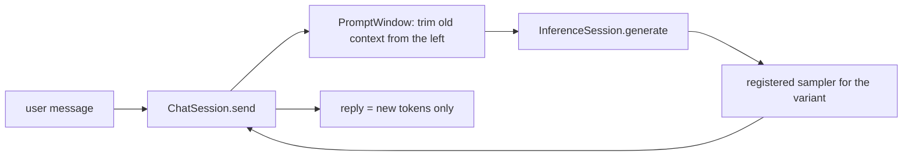

# Usage

```bash
uv sync
uv run hale-llm-train --config configs/block_diffusion/small.yaml --no-resume --viz
uv run hale-llm-sample --config configs/block_diffusion/small.yaml
uv run hale-llm-eval --config configs/block_diffusion/small.yaml
uv run hale-llm-viz --config configs/block_diffusion/small.yaml
tensorboard --logdir data/experiments
```

Configs inherit [`configs/base.yaml`](../configs/base.yaml). Full parameter list: [config.md](config.md).

## Try a trained model: `hale-llm-infer` and `hale-llm-chat`

Both commands load the same checkpoint the other CLIs use (`latest` run of the variant, or
`--experiment NAME` / `--checkpoint PATH`) and call the sampler registered for that variant.

```bash
# one or many prompts; --json prints one JSON object per prompt
uv run hale-llm-infer --config configs/block_diffusion/small.yaml --prompt "The history of"
uv run hale-llm-infer --config configs/autoregressive/small.yaml --prompt-file prompts.txt --json

# interactive terminal chat
uv run hale-llm-chat --config configs/autoregressive/small.yaml --max-new-tokens 40
```

The checkpoints are base language models trained on TinyStories, not instruction-tuned, so a
chat reply is a continuation of the conversation so far. Inside `hale-llm-chat`:
`/help`, `/reset`, `/history`, `/temp V`, `/tokens N`, `/steps N`, `/quit`.


