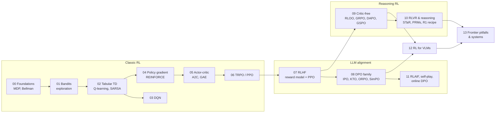

# RL for LLMs & VLMs — from zero to frontier

A notebook course that starts at "what is a reward?" and ends at the algorithms used to train today's
reasoning LLMs and VLMs (PPO-RLHF, DPO and friends, GRPO / DAPO / GSPO, RLVR, multimodal RL).
Every algorithm is written **from scratch in PyTorch / pure Python**, runs on a laptop CPU in minutes,
and is explained with diagrams, mermaid flowcharts and animated GIFs.



| # | Notebook | Algorithms |
|---|----------|------------|
| 00 | `00_rl_foundations` | agent/environment loop, MDP, return, value, Bellman, value & policy iteration, the LLM-as-policy view |
| 01 | `01_bandits_exploration` | epsilon-greedy, UCB, Thompson sampling, gradient bandit |
| 02 | `02_tabular_td_qlearning` | Monte Carlo, TD(0), SARSA, Q-learning, n-step |
| 03 | `03_dqn` | DQN, replay buffer, target network, Double & Dueling DQN |
| 04 | `04_policy_gradient_reinforce` | policy-gradient theorem, REINFORCE, baselines, a tiny GPT as a policy |
| 05 | `05_actor_critic_gae` | A2C, TD error, GAE(lambda), value heads on LMs |
| 06 | `06_trpo_ppo` | natural gradient, TRPO, PPO-clip |
| 07 | `07_rlhf_reward_model_ppo` | SFT, Bradley-Terry reward model, PPO with per-token KL (InstructGPT) |
| 08 | `08_dpo_family` | DPO, IPO, cDPO, KTO, ORPO, SimPO |
| 09 | `09_grpo_family` | REINFORCE++, RLOO, ReMax, GRPO, Dr. GRPO, DAPO, GSPO |
| 10 | `10_reasoning_rlvr` | best-of-N, rejection sampling / STaR / ReST, ORM vs PRM, R1-Zero recipe |
| 11 | `11_rlaif_selfplay_online` | RLAIF / Constitutional AI, online & iterative DPO, self-rewarding, SPIN, TTRL |
| 12 | `12_rl_for_vlms` | RLHF-V style, multimodal DPO (mDPO), GRPO for VLMs (Visual-RFT / VLM-R1) |
| 13 | `13_frontier_pitfalls_systems` | reward hacking, KL estimators, entropy collapse, off-policy/async RL, the family tree |

Companion: `01_online_rl.ipynb` (pre-existing) applies GRPO / self-reward to this repo's diffusion LLMs
through `hale_llm.rl`. The course notebooks are self-contained and teach the algorithms from first principles.

## Layout

```
notebooks/rl/
  source/NN_topic.md   notebook sources (```python = code cell, ```py = display-only, +++ = cell split)
  NN_topic.ipynb       built + executed notebooks (outputs included, readable on GitHub)
  rlkit/               shared plumbing only: plotting style + GIF Animator, TinyGPT, TinyVLM, toy tasks
  build_notebooks.py   source -> executed notebook
assets/rl/course/      generated PNGs / GIFs (also embedded inline in the notebooks)
```

The RL algorithms are never hidden in `rlkit`: each notebook implements its algorithms inline.

## Build

```bash
# from the repo root
.venv/bin/python notebooks/rl/build_notebooks.py            # build + execute all course notebooks
.venv/bin/python notebooks/rl/build_notebooks.py 07 09      # just some
```

Executing a notebook is also its test: `assert`s check that each algorithm actually learns.
