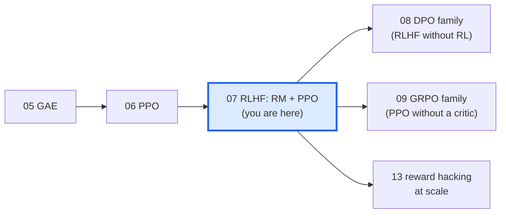
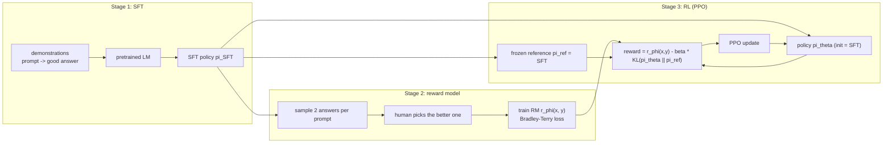
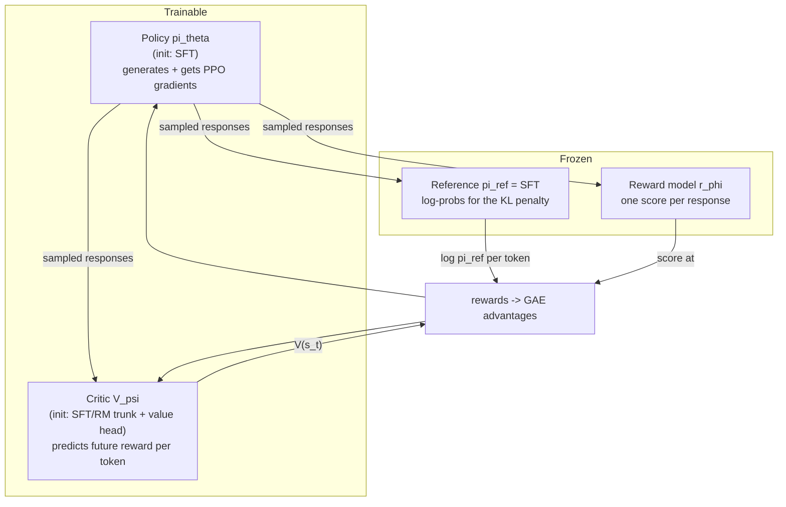

# 07 · RLHF: reward models + PPO (the InstructGPT recipe)

> **Where we are.** Notebook 06 built PPO for a cart-pole. Now we put a **language model** in the cart-pole's place and a
> **learned model of human preferences** in place of the physics reward. That is *Reinforcement Learning from Human Feedback*,
> the recipe behind InstructGPT (Ouyang et al., 2022) and ChatGPT. It builds on Christiano et al. (2017), Ziegler et al. (2019)
> and Stiennon et al. (2020).



**What you will learn**

1. The **three stages** of RLHF: supervised fine-tuning (SFT) → reward model (RM) → RL with PPO.
2. **Why we learn a reward model**: humans can *compare* answers much more reliably than they can *score* them.
3. The **Bradley-Terry** preference model and the reward-model loss, derived from scratch.
4. **PPO on tokens**: per-token KL penalty, a value head, token-level GAE, reward whitening.
5. **Reward hacking**: what happens when the policy optimises a flawed reward model with no leash (β = 0), measured against a hidden "gold" reward.
6. The **adaptive KL controller**.

+++

## The big picture



The objective of stage 3, the one everything in notebooks 07–13 is built around, is the **KL-regularised reward maximisation**

$$\max_{\pi_\theta}\;\mathbb{E}_{x\sim\mathcal{D},\,y\sim\pi_\theta(\cdot|x)}\big[r_\phi(x,y)\big] \;-\; \beta\,\mathrm{KL}\big(\pi_\theta(\cdot|x)\,\|\,\pi_\text{ref}(\cdot|x)\big).$$

The first term says "make answers the reward model likes". The second says "but stay close to the SFT model". The second term
is what stops the policy from **exploiting the reward model's blind spots**, which we will see happen live.

+++

## 0. Setup and our toy world

We use the tiny GPT from notebook 04 (`rlkit.toy_lm.TinyGPT`, ~110k parameters) on 1-digit addition: prompt `"3+4="`, answer `"7"`.

To make RLHF *interesting* we need what real RLHF has: **a gap between what labelers reward and what users really want.**
We simulate it with two hidden scoring rules. The algorithms never see these functions directly:

* **Gold reward (what users actually want):** the correct number, and no rambling. `gold = 1[number correct] − 0.25 × (# filler characters)`.
* **Labeler utility (what rushed human raters reward):** correctness, *plus* a well-documented **verbosity bias**: longer answers *look* more helpful.
  `labeler = 1[number correct] + 0.15 × (# filler characters)`.

A response is a number optionally followed by filler (e.g. `"7hmok"`, "7, hmm, ok"). This is a cartoon of a real failure:
RLHF'd models are known to become longer and more verbose than users want (e.g. Singhal et al., 2023, *"A long way to go: investigating length correlations in RLHF"*).

```python
import math, random, time, copy
import torch
import torch.nn as nn
import torch.nn.functional as F
import matplotlib.pyplot as plt
from rlkit.viz import COLORS, Animator, setup_style, smooth, save_figure, draw_box, draw_arrow
from rlkit.toy_lm import (CharTokenizer, AdditionTask, ValueHead, make_policy, sft_train, generate,
                          sequence_logprobs, masked_mean, evaluate, count_parameters)

setup_style()
torch.set_num_threads(1)
tok = CharTokenizer()
task = AdditionTask(tok, digits=1, seed=0)
PROBLEMS = task.all_problems()      # all 100 one-digit additions
P = 5                               # prompt length: <bos> a + b =
MAX_NEW = 10                        # longest response the policy may generate
FILLER = "hmok "


def parse(resp: str):
    """Split a response into (leading number, number of filler characters after it)."""
    i = 0
    while i < len(resp) and resp[i].isdigit():
        i += 1
    return resp[:i], len(resp) - i


def gold_reward(resp: str, ans: str) -> float:
    num, n_fill = parse(resp)
    return float(num == ans) - 0.25 * n_fill


def labeler_utility(resp: str, ans: str) -> float:
    num, n_fill = parse(resp)
    return float(num == ans) + 0.15 * n_fill


for r in ["7", "7hmok", "5", "5hmokhmok"]:
    print(f"3+4={r:<10} gold {gold_reward(r, '7'):+.2f}   labeler {labeler_utility(r, '7'):+.2f}")
```

The last line shows the trap: the labeler rates a **wrong** but chatty answer (`5hmokhmok`, +1.20) above the **correct** concise one (`7`, +1.00).

+++

## Stage 1 · Supervised fine-tuning (SFT)

Pretrained LMs continue text; they do not follow instructions. SFT trains on (prompt, demonstration) pairs with ordinary
next-token cross-entropy, **only on the answer tokens**:

$$\mathcal{L}_\text{SFT}(\theta) = -\sum_{t\in\text{answer}}\log \pi_\theta(y_t\mid x, y_{<t}).$$

We deliberately train only **80 steps**, so the SFT model is *mediocre* (~50% correct) and RL has room to improve it.
(300 steps would reach ~98%.)

```python
t0 = time.time()
sft = make_policy(tok, seed=0)
sft_hist = sft_train(sft, lambda: task.sft_batch(64), steps=80, prompt_len=P)
sft_acc = evaluate(sft, task, PROBLEMS)
print(f"SFT model: {count_parameters(sft):,} params, greedy accuracy {sft_acc:.0%}  ({time.time() - t0:.1f}s)")
for p, a in PROBLEMS[:60:12]:
    ids = torch.tensor([tok.encode(p)])
    out, _ = generate(sft, ids, MAX_NEW, greedy=True)
    print(f"  {p}{tok.decode(out[0, P:]):<6} (gold {a})")
```

## Stage 2 · The reward model

### Why compare instead of score?

Ask ten people to rate an answer from 1–10 and you get ten different scales. Ask them *"which of these two is better?"* and they mostly agree.
So RLHF collects **pairwise comparisons** $(x, y_w, y_l)$, where $y_w$ is the preferred (*winning*) response and $y_l$ the *losing* one.

### The Bradley-Terry model, derived

Assume every response has a hidden scalar "quality" $r(x,y)$, and that a human's choice is noisy in a specific way: the probability of preferring $y_1$
is a logistic function of the quality difference (Bradley & Terry, 1952):

$$P(y_1 \succ y_2 \mid x) = \frac{e^{r(x,y_1)}}{e^{r(x,y_1)} + e^{r(x,y_2)}} = \sigma\big(r(x,y_1) - r(x,y_2)\big).$$

Fit a neural $r_\phi$ by maximum likelihood on the observed choices. The negative log-likelihood of the dataset is the **reward-model loss**

$$\mathcal{L}_\text{RM}(\phi) = -\mathbb{E}_{(x,y_w,y_l)}\Big[\log\sigma\big(r_\phi(x,y_w) - r_\phi(x,y_l)\big)\Big].$$

It is just **binary cross-entropy on the score difference**. Two consequences:

* Only *differences* matter, so $r_\phi$ is defined **up to a constant**. This is why PPO later whitens (normalises) the rewards.
* The gradient pushes $r_\phi(y_w)$ up and $r_\phi(y_l)$ down, weighted by $\sigma(r_l - r_w)$, i.e. **by how wrong the model currently is**.

**Algorithm steps (reward model)**

1. **Collect pairs.** For each prompt, take two responses and ask a labeler which is better. *Here: random responses, labeled by our biased labeler with Bradley-Terry noise.*
2. **Architecture.** Take a transformer (InstructGPT: the 6B SFT model), remove the LM head, add a **scalar head** on the hidden state of the **last token**. *The last token has attended to the whole prompt + response.*
3. **Loss.** For a batch of pairs, score both responses and minimise $-\log\sigma(r_w - r_l)$.
4. **Validate** with pairwise accuracy on held-out pairs. *InstructGPT reports ~72% agreement; human-human agreement is about the same.*
5. **Freeze** the RM. It is now the reward function for stage 3.

```python
rng = random.Random(1)


def random_response(ans: str) -> str:
    """Candidate answers: the right or a wrong number, followed by 0-4 filler characters."""
    num = ans if rng.random() < 0.5 else str(rng.randint(0, 18))
    return num + "".join(rng.choice(FILLER) for _ in range(rng.randint(0, 4)))


pairs = []                      # (prompt, chosen, rejected)
while len(pairs) < 5000:
    p, a = rng.choice(PROBLEMS)
    y1, y2 = random_response(a), random_response(a)
    u1, u2 = labeler_utility(y1, a), labeler_utility(y2, a)
    if u1 == u2:
        continue
    p_y1_wins = torch.sigmoid(torch.tensor(8.0 * (u1 - u2))).item()   # Bradley-Terry labeler noise
    pairs.append((p, y1, y2) if rng.random() < p_y1_wins else (p, y2, y1))
train_pairs, val_pairs = pairs[:-500], pairs[-500:]
print(len(train_pairs), "train pairs, e.g.", train_pairs[:4])
```

```python
def pad_rows(rows):
    L = max(map(len, rows))
    return torch.tensor([r + [tok.PAD] * (L - len(r)) for r in rows])


def encode_pairs(batch):
    chosen = pad_rows([tok.encode(p) + tok.encode(y, bos=False) + [tok.EOS] for p, y, _ in batch])
    rejected = pad_rows([tok.encode(p) + tok.encode(y, bos=False) + [tok.EOS] for p, _, y in batch])
    return chosen, rejected


class RewardModel(nn.Module):
    """Transformer trunk + scalar head read at the last non-pad token (the <eos>)."""

    def __init__(self, base):
        super().__init__()
        self.body = copy.deepcopy(base)
        self.head = ValueHead(base.cfg.d_model)

    def forward(self, seq: torch.Tensor) -> torch.Tensor:
        _, hidden = self.body(seq)
        last = (seq != tok.PAD).long().sum(1) - 1
        return self.head(hidden)[torch.arange(len(seq)), last]


def bradley_terry_loss(r_chosen, r_rejected):
    """-log sigma(r_w - r_l): binary cross-entropy that the chosen answer wins."""
    return -F.logsigmoid(r_chosen - r_rejected).mean()


# The RM starts from a *stronger* SFT checkpoint than the policy, as in practice (it must judge correctness).
rm_base = make_policy(tok, seed=1)
sft_train(rm_base, lambda: task.sft_batch(64), steps=300, prompt_len=P)
rm = RewardModel(rm_base)
opt = torch.optim.AdamW(rm.parameters(), lr=1e-3)
rm_hist, rm_val = [], []
for step in range(800):
    c, r = encode_pairs(rng.sample(train_pairs, 64))
    loss = bradley_terry_loss(rm(c), rm(r))
    opt.zero_grad(); loss.backward(); opt.step()
    rm_hist.append(loss.item())
    if step % 50 == 49:
        with torch.no_grad():
            c, r = encode_pairs(val_pairs)
            rm_val.append((rm(c) > rm(r)).float().mean().item())
rm.eval()
for p_ in rm.parameters():
    p_.requires_grad_(False)
print(f"RM val pairwise accuracy {rm_val[-1]:.1%}   ({time.time() - t0:.1f}s so far)")
assert rm_val[-1] > 0.8
```

### What did the reward model learn?

Score every combination of (correct / wrong number) × (0–9 filler characters). The RM learned the correctness signal **and** the labelers'
verbosity bias. Lengths above 4 never appeared in its training data, so whatever it does there is pure **extrapolation**.

```python
@torch.no_grad()
def rm_score_text(prompt, resp):
    return rm(pad_rows([tok.encode(prompt) + tok.encode(resp, bos=False) + [tok.EOS]])).item()


grid = torch.zeros(2, 10)
for n in range(10):
    vals_c, vals_w = [], []
    for p, a in PROBLEMS[::7]:
        fill = (FILLER * 3)[:n]
        wrong = str((int(a) + 3) % 19)
        vals_c.append(rm_score_text(p, a + fill)); vals_w.append(rm_score_text(p, wrong + fill))
    grid[0, n], grid[1, n] = sum(vals_c) / len(vals_c), sum(vals_w) / len(vals_w)

fig, axes = plt.subplots(1, 2, figsize=(11, 3.4))
axes[0].plot(smooth(rm_hist, 25), color=COLORS["value"], lw=2, label="train loss")
ax_b = axes[0].twinx(); ax_b.plot(range(49, 800, 50), rm_val, "o-", color=COLORS["reward"], label="val accuracy")
axes[0].set(title="Reward model training", xlabel="step", ylabel="BT loss"); ax_b.set_ylabel("pairwise accuracy")
axes[1].plot(range(10), grid[0], "o-", color=COLORS["reward"], lw=2, label="correct number + filler")
axes[1].plot(range(10), grid[1], "o-", color=COLORS["penalty"], lw=2, label="wrong number + filler")
axes[1].axvspan(4.5, 9.5, color=COLORS["light"], alpha=0.6, label="never seen in RM data")
axes[1].set(title="What the RM rewards", xlabel="# filler characters", ylabel="RM score"); axes[1].legend(fontsize=8)
fig.tight_layout(); save_figure(fig, "07_reward_model.png"); plt.show()
assert grid[0, 0] > grid[1, 0], "RM prefers the correct number"
assert grid[0, 3] > grid[0, 0], "RM has absorbed the labelers' verbosity bias"
```

Notice: the RM scores a **wrong** answer with lots of filler above the **correct** short answer. A policy that maximises this RM
without restraint will learn to ramble. Keep that in mind for stage 3.

+++

## Stage 3 · PPO on a language model

### Text generation as an RL problem (recap of notebook 04)

* **State** $s_t = (x, y_{<t})$: the prompt plus the tokens generated so far.
* **Action** $a_t = y_t$: the next token. The policy is the LM's softmax.
* **Episode** ends at `<eos>` (or `MAX_NEW` tokens).
* **Reward**: InstructGPT-style **per-token** rewards,

$$r_t = \underbrace{-\beta\,\big(\log\pi_\theta(y_t|s_t) - \log\pi_\text{ref}(y_t|s_t)\big)}_{\text{KL penalty, every token}} \;+\; \underbrace{\mathbb{1}[t = T]\;\tilde r_\phi(x,y)}_{\text{RM score, last token only}}$$

  Summed over the response, the first term is a single-sample estimate of $-\beta\,\mathrm{KL}(\pi_\theta\|\pi_\text{ref})$ (the "k1" estimator; notebook 13 compares estimators).
  $\tilde r_\phi$ is the RM score **whitened** across the batch (zero mean, unit std). RM scores have an arbitrary offset and scale (Bradley-Terry only fixes differences), so whitening makes the PPO hyper-parameters transferable.

### The four models in memory



Four transformer copies is why PPO-RLHF is memory-hungry at scale, and why DPO (08) and GRPO (09) are popular.
DPO drops the RM and critic. GRPO drops the critic.

### Token-level GAE

Exactly notebook 05's GAE, run backwards over response tokens, usually with $\gamma = 1$ (the episode is short and we do not want to discount the final RM score):

$$\delta_t = r_t + \gamma V(s_{t+1}) - V(s_t),\qquad \hat A_t = \delta_t + \gamma\lambda\,\hat A_{t+1},\qquad \hat R_t = \hat A_t + V(s_t).$$

Careful with alignment: the value of the state *before* emitting token $t$ is read from the hidden state at position $t-1$, which has seen exactly $x, y_{<t}$.

```python
class Critic(nn.Module):
    """Value model: transformer trunk + per-position scalar head. V[:, t] is the value after reading token t."""

    def __init__(self, base):
        super().__init__()
        self.body = copy.deepcopy(base)
        self.head = ValueHead(base.cfg.d_model)

    def forward(self, seq):
        _, hidden = self.body(seq)
        return self.head(hidden)


def state_values(critic, seq):
    """V(s_t) for the state *before* token t = critic output at position t-1."""
    v = critic(seq)
    out = torch.zeros_like(v)
    out[:, 1:] = v[:, :-1]
    return out


def gae_tokens(rewards, values, mask, gamma=1.0, lam=0.95):
    """GAE over the response tokens of a right-padded batch. mask = 1 on response tokens."""
    B, T = rewards.shape
    adv, running = torch.zeros_like(rewards), torch.zeros(B)
    for t in reversed(range(T)):
        nxt_mask = mask[:, t + 1] if t + 1 < T else torch.zeros(B)
        nxt_v = values[:, t + 1] * nxt_mask if t + 1 < T else torch.zeros(B)
        delta = rewards[:, t] + gamma * nxt_v - values[:, t]
        running = (delta + gamma * lam * nxt_mask * running) * mask[:, t]
        adv[:, t] = running
    return adv, adv + values


def per_token_rewards(score, logp, ref_logp, mask, beta, whiten=True):
    """KL penalty on every response token + (whitened) RM score on the last one."""
    kl = (logp - ref_logp) * mask
    rewards = -beta * kl
    last = (mask * torch.arange(mask.shape[1])).argmax(1)          # index of each response's final token
    s = (score - score.mean()) / (score.std() + 1e-8) if whiten else score
    rewards[torch.arange(len(score)), last] += s
    return rewards, kl
```

### Watching one response get its rewards and advantages

Before training, here is what these functions produce for a single sampled response. Each frame adds one step of the
**backward GAE sweep**: the RM score sits on the last token, and GAE propagates credit back to earlier tokens.

```python
torch.manual_seed(3)
demo_prompt = torch.tensor([tok.encode("4+5=")])
demo_pol = copy.deepcopy(sft)
with torch.no_grad():                               # nudge a copy so the demo has non-zero KL
    for p_ in demo_pol.parameters():
        p_.add_(0.02 * torch.randn_like(p_))
while True:
    demo_seq, demo_mask = generate(demo_pol, demo_prompt, MAX_NEW, temperature=1.5)
    if demo_mask.sum() >= 4:
        break
demo_critic = Critic(sft)
with torch.no_grad():
    lp, ref_lp = sequence_logprobs(demo_pol, demo_seq), sequence_logprobs(sft, demo_seq)
    sc = rm(demo_seq)
    demo_rew, demo_kl = per_token_rewards(sc, lp, ref_lp, demo_mask, beta=0.2, whiten=False)
    demo_v = state_values(demo_critic, demo_seq) * demo_mask
idx = demo_mask[0].nonzero().flatten().tolist()
tokens = [tok.itos[i] for i in demo_seq[0, idx].tolist()]
print("response tokens:", tokens, " RM score", round(sc.item(), 2))

# replay GAE one step at a time for the animation
B, T = demo_rew.shape
steps_adv, running, adv_now = [], torch.zeros(1), torch.zeros(T)
for t in reversed(range(T)):
    nm = demo_mask[:, t + 1] if t + 1 < T else torch.zeros(1)
    nv = demo_v[:, t + 1] * nm if t + 1 < T else torch.zeros(1)
    delta = demo_rew[:, t] + nv - demo_v[:, t]
    running = (delta + 0.95 * nm * running) * demo_mask[:, t]
    adv_now = adv_now.clone(); adv_now[t] = running.item()
    if demo_mask[0, t] > 0:
        steps_adv.append((t, adv_now.clone()))


def draw_gae(fig, i):
    fig.clf()
    ax = fig.add_subplot(1, 1, 1)
    x = range(len(idx))
    kl_part = [-0.2 * demo_kl[0, j].item() for j in idx]
    rm_part = [0.0] * (len(idx) - 1) + [sc.item()]
    ax.bar([k - 0.2 for k in x], kl_part, width=0.2, color=COLORS["accent"], label="−β·KL per token")
    ax.bar([k for k in x], rm_part, width=0.2, color=COLORS["reward"], label="RM score (last token)")
    t_cur, adv = steps_adv[min(i, len(steps_adv) - 1)]
    a_vals = [adv[j].item() if j >= t_cur else 0.0 for j in idx]
    ax.bar([k + 0.2 for k in x], a_vals, width=0.2, color=COLORS["policy"], label="GAE advantage (so far)")
    ax.axvline(idx.index(t_cur), color=COLORS["value"], ls="--", lw=1.5)
    ax.set_xticks(list(x)); ax.set_xticklabels([repr(s)[1:-1] for s in tokens], fontsize=11)
    ax.axhline(0, color=COLORS["ink"], lw=0.8)
    ax.set(title=f"backward GAE sweep: computing token {idx.index(t_cur)} ('{tokens[idx.index(t_cur)]}')",
           ylabel="value", xlabel="response token")
    ax.legend(fontsize=8, loc="upper left")
    fig.tight_layout()


frames = len(steps_adv) + 3   # hold the last frame a moment
Animator(draw_gae, n_frames=frames, figsize=(7.5, 3.6), fps=1.5).save("07_token_gae.gif")
```

### The PPO-RLHF training loop

**Algorithm steps (PPO for RLHF, one iteration)**

1. **Sample prompts** $x$ and **generate** responses $y\sim\pi_\theta$ at temperature 1. *Exploration comes only from sampling.*
2. **Score** with the frozen models: $\log\pi_{\theta_\text{old}}$ (the policy itself, before updating), $\log\pi_\text{ref}$, the RM score $r_\phi(x,y)$, and the critic values $V(s_t)$.
3. **Build per-token rewards**: $-\beta\,\mathrm{KL}_t$ on every token plus the whitened RM score on the last token.
4. **Token-level GAE** → advantages $\hat A_t$ (then whitened over the batch) and value targets $\hat R_t$.
5. **PPO epochs** (here 4): recompute $\log\pi_\theta$ with one forward pass, form $r_t=\exp(\log\pi_\theta-\log\pi_{\theta_\text{old}})$, minimise the clipped loss (notebook 06). Separately regress the critic to $\hat R_t$.
6. **(Optional) adapt β** to keep the measured KL near a target (section "adaptive KL").
7. Log **proxy reward** (RM score), **KL**, **length** and, because this is a toy, the **gold reward** that real RLHF never gets to see.

```python
def ppo_rlhf(beta=0.2, iters=150, B=64, epochs=4, lr=1e-3, clip_eps=0.2, target_kl=None, seed=0, log_every=30):
    torch.manual_seed(seed); task.rng.seed(seed)
    policy, ref, critic = copy.deepcopy(sft), copy.deepcopy(sft).eval(), Critic(sft)
    for p_ in ref.parameters():
        p_.requires_grad_(False)
    opt = torch.optim.AdamW(policy.parameters(), lr=lr)
    v_opt = torch.optim.AdamW(critic.parameters(), lr=1e-3)
    H = {k: [] for k in ["proxy", "gold", "acc", "kl", "fill", "beta", "samples"]}
    for it in range(iters):
        # 1. generate
        prompts, answers = task.batch(B, PROBLEMS)
        seq, mask = generate(policy, prompts, MAX_NEW)
        # 2. score with frozen copies
        with torch.no_grad():
            old_logp, ref_logp = sequence_logprobs(policy, seq), sequence_logprobs(ref, seq)
            values = state_values(critic, seq) * mask
            score = rm(seq)
        # 3-4. rewards -> GAE -> whitened advantages
        rewards, kl = per_token_rewards(score, old_logp, ref_logp, mask, beta)
        adv, ret = gae_tokens(rewards, values, mask)
        mu = masked_mean(adv, mask)
        adv = (adv - mu) / (masked_mean((adv - mu) ** 2, mask).sqrt() + 1e-8) * mask
        # 5. PPO epochs (full batch here; real systems use minibatches)
        for _ in range(epochs):
            ratio = (sequence_logprobs(policy, seq) - old_logp).exp()
            pg_loss = -masked_mean(torch.min(ratio * adv, ratio.clamp(1 - clip_eps, 1 + clip_eps) * adv), mask)
            opt.zero_grad(); pg_loss.backward()
            nn.utils.clip_grad_norm_(policy.parameters(), 1.0); opt.step()
            v_loss = masked_mean((state_values(critic, seq) - ret) ** 2, mask)
            v_opt.zero_grad(); v_loss.backward(); v_opt.step()
        # 6. adaptive KL controller (Ziegler et al., 2019)
        kl_seq = kl.sum(1).mean().item()
        if target_kl is not None:
            error = max(min(kl_seq / target_kl - 1, 0.2), -0.2)
            beta *= 1 + 0.1 * error
        # 7. logging (gold reward is only available because this is a toy)
        resps = [tok.decode(s[P:]) for s in seq.tolist()]
        H["proxy"].append(score.mean().item()); H["kl"].append(kl_seq); H["beta"].append(beta)
        H["gold"].append(sum(gold_reward(r_, a) for r_, a in zip(resps, answers)) / B)
        H["acc"].append(sum(parse(r_)[0] == a for r_, a in zip(resps, answers)) / B)
        H["fill"].append(sum(parse(r_)[1] for r_ in resps) / B)
        H["samples"].append([tok.decode(prompts[j]) + r_ for j, r_ in enumerate(resps[:4])])
        if log_every and it % log_every == 0:
            print(f"  it {it:3d} proxy {H['proxy'][-1]:+.2f} gold {H['gold'][-1]:+.2f} KL {kl_seq:5.2f} "
                  f"filler {H['fill'][-1]:.2f} beta {beta:.3f}  e.g. {resps[:3]}")
    return policy, H
```

## Experiment: with and without the KL leash

We train two policies from the same SFT model, the same RM and the same seed. The only difference is **β**:

* **β = 0**: pure reward maximisation, no KL penalty;
* **β = 0.2**: InstructGPT-style KL leash.

```python
runs = {}
for beta in [0.0, 0.2]:
    t1 = time.time()
    print(f"beta = {beta}")
    runs[beta] = ppo_rlhf(beta=beta)
    print(f"  ({time.time() - t1:.1f}s)")
```

```python
def last(h, k="gold", n=10):
    return sum(h[k][-n:]) / n


fig, axes = plt.subplots(1, 4, figsize=(15, 3.3))
for beta, col in [(0.0, COLORS["penalty"]), (0.2, COLORS["policy"])]:
    H = runs[beta][1]
    axes[0].plot(smooth(H["proxy"], 10), color=col, lw=2, label=f"β={beta}")
    axes[1].plot(smooth(H["gold"], 10), color=col, lw=2, label=f"β={beta}")
    axes[2].plot(smooth(H["kl"], 10), color=col, lw=2, label=f"β={beta}")
    axes[3].plot(smooth(H["fill"], 10), color=col, lw=2, label=f"β={beta}")
for ax, t in zip(axes, ["proxy reward (RM score)", "GOLD reward (hidden)", "KL(π‖π_ref) per response", "filler chars / response"]):
    ax.set(title=t, xlabel="PPO iteration"); ax.legend(fontsize=8)
fig.tight_layout(); save_figure(fig, "07_beta_comparison.png"); plt.show()

g0, gS = runs[0.0][1]["gold"][:5], runs[0.2][1]["gold"][:5]
start_gold = sum(g0) / 5
print(f"gold reward: start {start_gold:+.2f} | beta=0 end {last(runs[0.0][1]):+.2f} | beta=0.2 end {last(runs[0.2][1]):+.2f}")
print(f"proxy:       beta=0 end {last(runs[0.0][1], 'proxy'):+.2f} | beta=0.2 end {last(runs[0.2][1], 'proxy'):+.2f}")
assert last(runs[0.0][1], "proxy") > runs[0.0][1]["proxy"][0] + 1.0, "beta=0 drives the proxy reward up..."
assert last(runs[0.0][1]) < start_gold, "...while the true (gold) reward goes DOWN: reward hacking"
assert last(runs[0.2][1]) > start_gold + 0.2, "with the KL leash, RLHF improves the gold reward"
```

**What happened (measured above):**

* **β = 0:** the proxy reward climbs, but the policy gets there by **adding filler**, the RM's verbosity blind spot.
  The gold reward ends **below where SFT started**. This is **reward hacking** (also called *reward over-optimisation*, Gao et al., 2022).
* **β = 0.2:** each extra filler token costs a KL penalty, because the SFT reference never rambles. The cheapest way to raise the reward is
  to get the **number right**. Accuracy and gold reward both go up.

The animation replays both runs side by side. The curves are proxy (dashed) and gold (solid) reward, and underneath are four live samples per run.

```python
def draw_hacking(fig, i):
    fig.clf()
    it = min(i * 3, len(runs[0.0][1]["gold"]) - 1)
    for j, (beta, col) in enumerate([(0.0, COLORS["penalty"]), (0.2, COLORS["policy"])]):
        H = runs[beta][1]
        ax = fig.add_subplot(2, 2, j + 1)
        ax.plot(smooth(H["proxy"], 10)[: it + 1], "--", color=COLORS["value"], lw=2, label="proxy (RM)")
        ax.plot(smooth(H["gold"], 10)[: it + 1], color=COLORS["reward"], lw=2.5, label="gold (true)")
        ax.set(xlim=(0, len(H["gold"])), ylim=(-3.5, 3.0), title=f"β = {beta}" + ("  (no KL leash)" if beta == 0 else ""),
               xlabel="PPO iteration")
        ax.legend(fontsize=7, loc="lower left")
        ax2 = fig.add_subplot(2, 2, j + 3); ax2.axis("off")
        ax2.text(0.0, 1.0, f"samples at iteration {it}:", fontsize=9, va="top", color=COLORS["ink"], weight="bold")
        for k, s in enumerate(H["samples"][it]):
            ax2.text(0.02, 0.78 - 0.2 * k, s, fontsize=10, va="top", family="monospace", color=col)
    fig.tight_layout()


Animator(draw_hacking, n_frames=50, figsize=(9, 5), fps=6).save("07_reward_hacking.gif")
```

### Gold reward vs distance from the reference

Gao et al. (2022) plotted gold reward against $\sqrt{\mathrm{KL}(\pi\|\pi_\text{ref})}$ as RL proceeds, and found that gold reward first **rises**,
then **falls**, while the proxy keeps rising. Our β = 0 run traces the same qualitative shape.

```python
H0 = runs[0.0][1]
sq_kl = [math.sqrt(max(k, 0)) for k in smooth(H0["kl"], 10)]
fig, ax = plt.subplots(figsize=(6.5, 3.6))
ax.plot(sq_kl, smooth(H0["proxy"], 10), "--", color=COLORS["value"], lw=2, label="proxy (RM score)")
ax.plot(sq_kl, smooth(H0["gold"], 10), color=COLORS["reward"], lw=2.5, label="gold reward")
ax.set(title="Over-optimisation (β = 0 run)", xlabel="√KL(π ‖ π_ref)", ylabel="reward"); ax.legend()
save_figure(fig, "07_overoptimization.png"); plt.show()
```

## The adaptive KL controller

A fixed β is hard to tune. Too small and the policy hacks, too large and it never moves.
Ziegler et al. (2019) adapt β with a proportional controller that targets a desired KL per response, $\mathrm{KL}_\text{target}$:

$$e_t = \mathrm{clip}\Big(\frac{\mathrm{KL}_t}{\mathrm{KL}_\text{target}} - 1,\; -0.2,\; 0.2\Big),\qquad \beta_{t+1} = \beta_t\,(1 + K_\beta\, e_t),\quad K_\beta = 0.1.$$

If the policy drifts further than desired, β grows; if it stays too close, β shrinks.

```python
t1 = time.time()
print("adaptive KL, target 1.0 nats/response")
runs["adaptive"] = ppo_rlhf(beta=0.2, target_kl=1.0)
print(f"  ({time.time() - t1:.1f}s)")
Ha = runs["adaptive"][1]
fig, axes = plt.subplots(1, 3, figsize=(12, 3.2))
axes[0].plot(Ha["beta"], color=COLORS["accent"], lw=2); axes[0].set(title="β (adapted)", xlabel="iteration")
axes[1].plot(smooth(Ha["kl"], 10), color=COLORS["accent"], lw=2); axes[1].axhline(1.0, ls="--", color=COLORS["reference"])
axes[1].set(title="KL per response vs target", xlabel="iteration")
axes[2].plot(smooth(Ha["gold"], 10), color=COLORS["reward"], lw=2, label="gold")
axes[2].plot(smooth(Ha["proxy"], 10), "--", color=COLORS["value"], lw=2, label="proxy")
axes[2].set(title="rewards", xlabel="iteration"); axes[2].legend(fontsize=8)
fig.tight_layout(); plt.show()
print(f"adaptive: final beta {Ha['beta'][-1]:.3f}, final KL {last(Ha, 'kl'):.2f}, final gold {last(Ha):+.2f}")
```

The controller is only as good as the target. A target KL that is too large lets β fall to almost zero, and you are back in the β = 0 regime.
In practice KL targets are chosen by watching held-out human or gold evaluations, which is exactly the signal the toy gives us for free.

+++

## Final evaluation

Greedy decoding on all 100 problems, for the SFT model and the two PPO policies.

```python
@torch.no_grad()
def greedy_eval(model):
    ids = torch.tensor([tok.encode(p) for p, _ in PROBLEMS])
    seq, _ = generate(model, ids, MAX_NEW, greedy=True)
    resps = [tok.decode(s[P:]) for s in seq.tolist()]
    return dict(acc=sum(parse(r_)[0] == a for r_, (_, a) in zip(resps, PROBLEMS)) / len(PROBLEMS),
                gold=sum(gold_reward(r_, a) for r_, (_, a) in zip(resps, PROBLEMS)) / len(PROBLEMS),
                filler=sum(parse(r_)[1] for r_ in resps) / len(PROBLEMS), example=resps[:6])


table = {"SFT": greedy_eval(sft), "PPO β=0": greedy_eval(runs[0.0][0]), "PPO β=0.2": greedy_eval(runs[0.2][0]),
         "PPO adaptive": greedy_eval(runs["adaptive"][0])}
print(f"{'model':<14}{'accuracy':>10}{'gold':>8}{'filler':>8}   first answers")
for name, m in table.items():
    print(f"{name:<14}{m['acc']:>10.0%}{m['gold']:>8.2f}{m['filler']:>8.2f}   {m['example']}")
print(f"total notebook compute time ≈ {time.time() - t0:.0f}s")
assert table["PPO β=0.2"]["gold"] > table["SFT"]["gold"]
```

## Common pitfalls

| Pitfall | What you see | Fix |
|---|---|---|
| **Reward hacking** | proxy ↑, human eval ↓, longer / weirder outputs | KL penalty, better RM data, RM ensembles, length penalties, early stopping on held-out eval |
| No reward whitening | PPO step size depends on arbitrary RM scale | whiten scores per batch (or running stats) |
| KL computed with a different tokenisation / dropout on | huge KL at step 0 | ratio must be exactly 1 at step 0; disable dropout |
| Critic not warmed up | noisy advantages early | initialise critic from RM, warm-up value steps |
| β too large | policy never leaves SFT | adaptive KL or lower β |
| Reward only at `<eos>` but truncated responses | truncated samples get no score | penalise / mask non-terminated responses |
| RM over-fits | RM val accuracy drops, PPO exploits | more pairs, early stopping, ensembles |

+++

## How this connects to LLM and VLM training today

* **InstructGPT (Ouyang et al., 2022):** 175B policy, 6B RM, per-token KL penalty with β ≈ 0.02. It also mixes in pretraining gradients ("PPO-ptx") to avoid regressions on public NLP benchmarks.
* **Why people moved on:** four models in memory, a fragile critic, and sensitivity to hyper-parameters. Notebook **08 (DPO)** shows the optimal policy of the KL-regularised objective above in closed form, so you can skip both the RM and RL. Notebook **09 (GRPO)** drops the critic.
* **Still in use:** learned RMs remain central for "fuzzy" goals (helpfulness, style, safety) where no verifier exists. Verifiable rewards (math answers, unit tests, notebook 10) are used where they do exist.
* **VLMs:** LLaVA-RLHF (Sun et al., 2023) does exactly this pipeline on a VLM. Its *Factually Augmented RLHF* gives the RM extra ground-truth image information to fight a VLM-specific hack: hallucinating plausible-sounding details (notebook 12).

+++

## Cheat sheet

| Stage | Input | Loss / objective | Output |
|---|---|---|---|
| SFT | (prompt, demo) | $-\sum\log\pi_\theta(y_t\mid x,y_{<t})$ | $\pi_\text{SFT}$ (= $\pi_\text{ref}$) |
| Reward model | (prompt, chosen, rejected) | $-\log\sigma(r_\phi(x,y_w)-r_\phi(x,y_l))$ | scalar $r_\phi(x,y)$ |
| PPO-RLHF | prompts | $\max\ \mathbb{E}[r_\phi] - \beta\,\mathrm{KL}(\pi_\theta\|\pi_\text{ref})$ via PPO-clip + GAE | aligned policy |
| Adaptive KL | measured KL | $\beta \leftarrow \beta(1+0.1\,\mathrm{clip}(\mathrm{KL}/\mathrm{KL}^\*-1,\pm0.2))$ | stable drift |

**Per-token reward:** $r_t = -\beta(\log\pi_\theta - \log\pi_\text{ref})_t + \mathbb{1}[t=T]\,\tilde r_\phi(x,y)$  **·**  **GAE:** $\gamma = 1$, $\lambda = 0.95$  **·**  **Models in memory:** policy, reference, RM, critic.

**Next:** notebook 08 derives DPO, which turns stage 2 + stage 3 into a single supervised loss.
