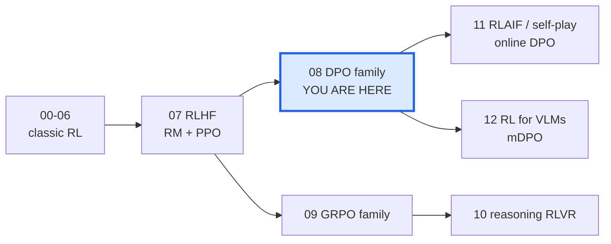
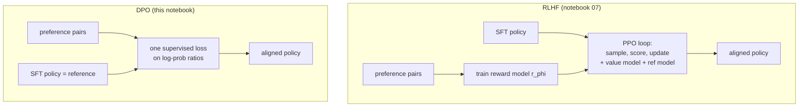

# 08 · Direct Preference Optimization and its family (DPO, IPO, cDPO, KTO, ORPO, SimPO)

> **Goal of this notebook.** In notebook 07 we aligned a model with the classic RLHF recipe:
> train a reward model, then run PPO against it. That works, but it needs *four* networks in memory,
> on-policy sampling and a lot of fiddly hyper-parameters. In 2023 Rafailov et al. showed that the
> same KL-regularised objective can be optimised **without a reward model and without RL sampling**:
> a single classification-style loss on preference pairs. This notebook derives that loss
> (**DPO**) line by line, then builds five of its most important descendants from scratch,
> trains all of them on the *same* preference data, and compares what they actually do to the model.



**What you will learn**

| Section | Algorithm | Paper |
|---|---|---|
| 2 | **DPO** - derive it from the RLHF objective | Rafailov et al., 2023 |
| 4 | **IPO** - squared loss that does not overfit deterministic preferences | Azar et al., 2023 |
| 5 | **cDPO** - DPO with label smoothing for noisy labels | Mitchell, 2023 (note) |
| 6 | **KTO** - unpaired "thumbs up / thumbs down" data, prospect theory | Ethayarajh et al., 2024 |
| 7 | **ORPO** - odds-ratio penalty added to SFT, *no reference model* | Hong et al., 2024 |
| 8 | **SimPO** - length-normalised reward + margin, *no reference model* | Meng et al., 2024 |
| 9 | Head-to-head experiment, GIFs, the "both log-probs go down" effect | |

+++

## 1 · From RLHF to DPO: why bother?

**Analogy.** RLHF is like training a food critic (the reward model) by showing them pairs of dishes
and which one people preferred, and then letting a chef (the policy) cook thousands of new dishes,
each rated by the critic, slowly improving via trial and error (PPO). DPO notices that the critic
and the chef can be *the same person*: a chef who knows how much more likely they are to cook
dish A than dish B (compared to their old self) already *implicitly* holds the critic's opinion.
So we can skip the critic and teach the chef directly from the preference pairs.



| | RLHF + PPO | DPO |
|---|---|---|
| networks in memory during training | policy, reference, reward model, value model | policy, reference (frozen) |
| sampling from the policy during training | yes (expensive, sequential) | **no** (offline pairs) |
| loss type | RL objective, clipped ratios, advantages | logistic regression on log-prob differences |
| hyper-parameters that matter | KL coef, clip, GAE lambda, lr, batch, epochs ... | mainly beta and lr |

+++

## 2 · Deriving DPO step by step

### 2.1 The objective RLHF optimises

For a prompt $x$ and a response $y$, RLHF maximises reward while staying close to a reference
policy $\pi_{\text{ref}}$ (usually the SFT model):

$$
\max_{\pi}\; \mathbb{E}_{x\sim\mathcal D,\; y\sim\pi(\cdot\mid x)}\big[r(x,y)\big]
\;-\;\beta\,\mathrm{KL}\big(\pi(\cdot\mid x)\,\|\,\pi_{\text{ref}}(\cdot\mid x)\big).
$$

$\beta$ is the "leash length": big $\beta$ keeps $\pi$ close to $\pi_{\text{ref}}$.

### 2.2 This problem has a closed-form solution

Write the objective for one prompt as a sum over responses and add the constraint
$\sum_y \pi(y\mid x)=1$:

$$
J(\pi)=\sum_y \pi(y\mid x)\Big[r(x,y)-\beta\log\frac{\pi(y\mid x)}{\pi_{\text{ref}}(y\mid x)}\Big].
$$

Take the derivative with respect to $\pi(y\mid x)$, add a Lagrange multiplier $\lambda$ and set it
to zero:

$$
r(x,y)-\beta\log\frac{\pi(y\mid x)}{\pi_{\text{ref}}(y\mid x)}-\beta+\lambda=0
\;\;\Longrightarrow\;\;
\pi^*(y\mid x)=\frac{1}{Z(x)}\,\pi_{\text{ref}}(y\mid x)\,\exp\!\Big(\tfrac{1}{\beta}r(x,y)\Big),
$$

where $Z(x)=\sum_y \pi_{\text{ref}}(y\mid x)\exp(r(x,y)/\beta)$ normalises the distribution.
**Read it as:** "take the reference distribution and tilt it towards high reward; $\beta$ controls
how hard you tilt". The catch: $Z(x)$ sums over *every possible response* - impossible to compute
for a language model. That is why RLHF uses PPO instead of this formula.

### 2.3 Turn the formula around: reward from policy

Take the log and solve for $r$:

$$
r(x,y)=\beta\log\frac{\pi^*(y\mid x)}{\pi_{\text{ref}}(y\mid x)}+\beta\log Z(x).
$$

Any policy defines an **implicit reward** $\hat r_\theta(x,y)=\beta\log\frac{\pi_\theta(y\mid x)}{\pi_{\text{ref}}(y\mid x)}$
(up to the prompt-only term $\beta\log Z(x)$).

### 2.4 Plug it into the Bradley-Terry preference model - $Z$ cancels!

Human preferences are modelled with Bradley-Terry (notebook 07): the probability that the
chosen answer $y_w$ beats the rejected answer $y_l$ is

$$
p(y_w\succ y_l\mid x)=\sigma\big(r(x,y_w)-r(x,y_l)\big).
$$

Substitute 2.3. The $\beta\log Z(x)$ term appears in both rewards and **cancels in the difference**:

$$
p(y_w\succ y_l\mid x)=\sigma\Big(\beta\log\frac{\pi_\theta(y_w\mid x)}{\pi_{\text{ref}}(y_w\mid x)}-\beta\log\frac{\pi_\theta(y_l\mid x)}{\pi_{\text{ref}}(y_l\mid x)}\Big).
$$

### 2.5 Maximum likelihood = the DPO loss

Maximising the likelihood of the observed preferences gives

$$
\boxed{\mathcal L_{\text{DPO}}=-\,\mathbb E_{(x,y_w,y_l)}\Big[\log\sigma\big(\beta\,h_\theta\big)\Big],\qquad
h_\theta=\log\frac{\pi_\theta(y_w\mid x)}{\pi_{\text{ref}}(y_w\mid x)}-\log\frac{\pi_\theta(y_l\mid x)}{\pi_{\text{ref}}(y_l\mid x)}}
$$

It is just **binary logistic regression** where the "logit" is $\beta h_\theta$, a difference of
log-probability ratios.

### 2.6 What does the gradient do?

$$
\nabla_\theta\mathcal L_{\text{DPO}}=-\beta\,\mathbb E\Big[\underbrace{\sigma\big(\hat r_\theta(x,y_l)-\hat r_\theta(x,y_w)\big)}_{\text{weight: big when the model ranks the pair wrongly}}
\big(\nabla_\theta\log\pi_\theta(y_w\mid x)-\nabla_\theta\log\pi_\theta(y_l\mid x)\big)\Big].
$$

* push **up** the log-prob of the chosen answer, push **down** the rejected one;
* each pair is weighted by how *wrong* the implicit reward currently is - pairs the model already
  ranks correctly stop contributing (the sigmoid saturates).

Important subtlety we will *see* in section 9: the loss only cares about the **difference**. Nothing
forces $\log\pi_\theta(y_w)$ to go up - both can go down, as long as the rejected one goes down faster.

> **Algorithm steps - DPO**
> 1. **Start from the SFT model.** Copy it twice: a trainable policy $\pi_\theta$ and a frozen reference $\pi_{\text{ref}}$.
> 2. **Collect preference triples** $(x, y_w, y_l)$ - offline, once. (Usually from the SFT model's own samples, labelled by humans.)
> 3. **Score both responses with both models.** Four teacher-forced forward passes give $\log\pi_\theta(y_w), \log\pi_\theta(y_l), \log\pi_{\text{ref}}(y_w), \log\pi_{\text{ref}}(y_l)$ (sum of token log-probs over the response only).
> 4. **Form the margin** $h=(\log\pi_\theta(y_w)-\log\pi_{\text{ref}}(y_w))-(\log\pi_\theta(y_l)-\log\pi_{\text{ref}}(y_l))$.
> 5. **Loss** $=-\log\sigma(\beta h)$, averaged over the batch; backprop into $\pi_\theta$ only.
> 6. **Repeat** for 1-3 epochs (more epochs overfit - see IPO).

+++

## 3 · Setup: a tiny GPT, a toy task and a preference dataset

We reuse the `TinyGPT` built from scratch in notebook 04 (imported from `rlkit`) and the
one-digit addition task `"a+b="` -> `"c"`. The hidden "human" prefers **correct** answers.

How we build preference data mirrors real practice (e.g. the Zephyr / UltraFeedback recipe):

1. a **weak SFT model** (only 100 training steps, ~60% accurate on the training prompts),
2. sample 8 answers per training prompt from it (**on-policy** samples),
3. every *wrong* sample becomes a rejected answer $y_l$, paired with the gold answer as $y_w$.

We keep 30 of the 100 problems **unseen** (no SFT, no preference data) to measure generalisation.

```python
import copy, random, time
import torch
import torch.nn.functional as F
import matplotlib.pyplot as plt
import numpy as np

from rlkit import COLORS, Animator, setup_style
from rlkit.viz import save_figure
from rlkit.toy_lm import CharTokenizer, AdditionTask, make_policy, sft_train, evaluate, sequence_logprobs, generate, count_parameters

setup_style()
torch.manual_seed(0); random.seed(0)

tok = CharTokenizer("0123456789+=")           # only the symbols this task needs
task = AdditionTask(tok, digits=1, seed=0)
problems = task.all_problems()                # all 100 (a, b) pairs
random.Random(0).shuffle(problems)
train_p, test_p = problems[:70], problems[70:]
gold = dict(problems)
P = 5                                         # prompt length: <bos> a + b =

base = make_policy(tok, seed=0)
sft_hist = sft_train(base, lambda: task.sft_batch(64, train_p), steps=100, prompt_len=P)
print(f"TinyGPT parameters: {count_parameters(base):,}")
print(f"SFT model  train acc {evaluate(base, task, train_p):.2f} | unseen acc {evaluate(base, task, test_p):.2f}")
```

Two small helpers turn `(prompt, answer)` strings into token tensors and compute the **sequence
log-probability** $\log\pi(y\mid x)=\sum_{t\in y}\log\pi(y_t\mid x,y_{<t})$ - the single quantity every
loss in this notebook is built from.

```python
def encode(prompt, answer):
    """<bos> prompt answer <eos> as a list of token ids."""
    return tok.encode(prompt) + tok.encode(answer, bos=False) + [tok.EOS]

def pad(rows):
    L = max(map(len, rows))
    return torch.tensor([r + [tok.PAD] * (L - len(r)) for r in rows])

def response_mask(seq):
    """1 on answer tokens (incl. <eos>), 0 on the prompt and padding."""
    m = (seq != tok.PAD).float()
    m[:, :P] = 0
    return m

def seq_logp(model, prompts, answers):
    """Return (sum of response log-probs, response length) for a batch of strings."""
    seq = pad([encode(p, a) for p, a in zip(prompts, answers)])
    m = response_mask(seq)
    return (sequence_logprobs(model, seq) * m).sum(-1), m.sum(-1)

# quick check: log pi(y|x) of the gold answer vs a wrong one under the SFT model
lp, n = seq_logp(base, ["2+3=", "2+3="], ["5", "9"])
print("log pi('5' | 2+3=) =", round(lp[0].item(), 2), " log pi('9' | 2+3=) =", round(lp[1].item(), 2), " lengths", n.tolist())
```

```python
# Build the preference dataset from on-policy samples of the SFT model.
@torch.no_grad()
def sample_answers(model, prompts, n, temperature=1.0):
    ids = torch.tensor([tok.encode(p) for p in prompts for _ in range(n)])
    seq, _ = generate(model, ids, max_new_tokens=3, temperature=temperature)
    outs = [tok.decode(s[P:]) for s in seq.tolist()]
    return [outs[i * n:(i + 1) * n] for i in range(len(prompts))]

torch.manual_seed(1)
pairs = []                                   # (prompt, chosen, rejected)
for (p, a), outs in zip(train_p, sample_answers(base, [p for p, _ in train_p], 8)):
    for o in outs:
        if o != a:
            pairs.append((p, a, o))
print(f"{len(pairs)} preference pairs from {len(train_p)} prompts; examples:")
for t in pairs[:8]:
    print("   prompt %-5s chosen %-3s rejected %r" % t)
```

Let us *look* at the starting point: for a few prompts, the SFT model's probability of every
possible answer 0-18. Green = gold, red = answers that appear as "rejected" in the data.

```python
CANDIDATES = [str(i) for i in range(19)]
PROBES = [p for p, _ in train_p[:4]]
rejected_of = {}
for p, _, l in pairs:
    rejected_of.setdefault(p, set()).add(l)

@torch.no_grad()
def answer_probs(model, prompt):
    lp, _ = seq_logp(model, [prompt] * len(CANDIDATES), CANDIDATES)
    return lp.exp().numpy()

def draw_answer_bars(ax, probs, prompt, title=""):
    colors = [COLORS["reward"] if c == gold[prompt] else COLORS["penalty"] if c in rejected_of.get(prompt, ()) else COLORS["light"]
              for c in CANDIDATES]
    ax.bar(range(len(CANDIDATES)), probs, color=colors, edgecolor=COLORS["ink"], lw=0.3)
    ax.set_xticks(range(0, 19, 3)); ax.set_ylim(0, 1); ax.set_title(f"{prompt}  {title}", fontsize=10)

fig, axes = plt.subplots(1, 4, figsize=(13, 2.8), sharey=True)
for ax, p in zip(axes, PROBES):
    draw_answer_bars(ax, answer_probs(base, p), p, "(SFT)")
axes[0].set_ylabel("pi(answer | prompt)")
fig.suptitle("Starting point: the SFT model spreads probability over many answers", y=1.04)
plt.tight_layout(); save_figure(fig, "08_sft_answer_distribution.png"); plt.show()
```

+++

## 4 · The six losses, one snippet each

Every loss below receives the same tensors for a batch of $B$ pairs:

* `pw, pl` - $\log\pi_\theta(y_w\mid x)$, $\log\pi_\theta(y_l\mid x)$ (sequence sums, with grad)
* `rw, rl` - $\log\pi_{\text{ref}}(y_w\mid x)$, $\log\pi_{\text{ref}}(y_l\mid x)$ (no grad)
* `nw, nl` - response lengths $|y_w|, |y_l|$ in tokens

### 4.1 DPO (Rafailov et al., 2023)

Already derived above: logistic loss on the difference of log-ratios.

```python
def dpo_loss(pw, pl, rw, rl, nw, nl, beta=0.5):
    """-log sigmoid(beta * [(pw - rw) - (pl - rl)])."""
    h = (pw - rw) - (pl - rl)              # margin of implicit rewards (divided by beta)
    return -F.logsigmoid(beta * h).mean()

# sanity check: at initialisation policy == reference so h = 0 and the loss is log 2
z = torch.zeros(4)
print("DPO loss at init:", dpo_loss(z, z, z, z, z, z).item(), "  log 2 =", np.log(2))
```

### 4.2 IPO - Identity Preference Optimisation (Azar et al., 2023)

**Problem with DPO.** If a preference is deterministic ($y_w$ *always* beats $y_l$), the
Bradley-Terry likelihood is maximised only when $h\to\infty$: the loss keeps pushing
$\pi_\theta(y_l)\to 0$ no matter how large $\beta$ is - the KL "leash" is effectively ignored and the
model overfits the preference data.

**Fix.** Azar et al. derive a general objective ($\Psi$PO) and pick $\Psi$ = identity, which turns the
problem into **regression of the margin onto a fixed target**:

$$
\mathcal L_{\text{IPO}}=\mathbb E\Big[\big(h_\theta-\tfrac{1}{2\tau}\big)^2\Big].
$$

Once the margin reaches $1/(2\tau)$ the gradient is zero; overshooting is *penalised*. $\tau$ plays
the role of $\beta$ (smaller $\tau$ = larger target margin = weaker regularisation).

> **Algorithm steps - IPO:** identical to DPO steps 1-4; step 5 becomes $(h-\frac{1}{2\tau})^2$.
> (The paper's $h$ uses per-token *average* log-probs in some implementations; we keep sums for a fair comparison.)

```python
def ipo_loss(pw, pl, rw, rl, nw, nl, tau=0.1):
    """Squared regression of the log-ratio margin onto the target 1/(2 tau)."""
    h = (pw - rw) - (pl - rl)
    return ((h - 1.0 / (2 * tau)) ** 2).mean()

print("IPO loss at init (h=0):", ipo_loss(z, z, z, z, z, z).item(), "= (1/(2*0.1))^2")
```

### 4.3 cDPO - conservative DPO / label smoothing (Mitchell, 2023)

**Problem.** Human labels are noisy - annotators disagree ~25-35% of the time on real datasets.
**Fix.** Assume each label is flipped with probability $\varepsilon$ and maximise the likelihood of
that noisy model:

$$
\mathcal L_{\text{cDPO}}=-(1-\varepsilon)\log\sigma(\beta h_\theta)-\varepsilon\log\sigma(-\beta h_\theta).
$$

The second term pulls the margin back: the optimum is now a *finite* margin
$\beta h^*=\log\frac{1-\varepsilon}{\varepsilon}$, which (like IPO) stops runaway overfitting.

```python
def cdpo_loss(pw, pl, rw, rl, nw, nl, beta=0.5, eps=0.1):
    """DPO with label smoothing: each preference is assumed wrong with probability eps."""
    h = (pw - rw) - (pl - rl)
    return (-(1 - eps) * F.logsigmoid(beta * h) - eps * F.logsigmoid(-beta * h)).mean()

print("cDPO optimum margin beta*h* = log((1-eps)/eps) =", round(np.log(0.9 / 0.1), 3))
```

### 4.4 KTO - Kahneman-Tversky Optimisation (Ethayarajh et al., 2024)

**Problem.** Paired preferences are expensive. Most real feedback is *unpaired*: a thumbs-up or
thumbs-down on a single answer.

**Idea from prospect theory.** Humans judge outcomes relative to a **reference point** and are
loss-averse. KTO defines the "value" of an answer by how its implicit reward compares to a
reference point $z_0$ - the policy's current KL from the reference (estimated on the batch):

$$
r_\theta(x,y)=\log\frac{\pi_\theta(y\mid x)}{\pi_{\text{ref}}(y\mid x)},\qquad
z_0=\max\!\big(0,\ \widehat{\mathrm{KL}}(\pi_\theta\|\pi_{\text{ref}})\big)\ \text{(no gradient)},
$$

$$
v(x,y)=\begin{cases}\lambda_D\,\sigma\big(\beta(r_\theta(x,y)-z_0)\big) & y \text{ desirable}\\[2pt]
\lambda_U\,\sigma\big(\beta(z_0-r_\theta(x,y))\big) & y \text{ undesirable}\end{cases}
\qquad \mathcal L_{\text{KTO}}=\mathbb E\big[\lambda_y-v(x,y)\big].
$$

A desirable answer only earns value by rising **above** the reference point, an undesirable one by
falling **below** it. Because $z_0$ moves with the policy, the model cannot win by simply lowering
everything. In the paper $z_0$ is estimated from *mismatched* pairs $(x_i, y_j)$ in the batch - we do the same.

> **Algorithm steps - KTO**
> 1. Split data into desirable answers $D$ and undesirable answers $U$ (no pairing needed - we shuffle them independently).
> 2. Compute $r_\theta$ for every answer (policy vs reference log-ratio).
> 3. Estimate $z_0$: log-ratio of answers attached to the *wrong* prompts (a cheap KL estimate), clamp at 0, detach.
> 4. Desirable: loss $1-\sigma(\beta(r-z_0))$; undesirable: loss $1-\sigma(\beta(z_0-r))$; weight by $\lambda_D,\lambda_U$.

```python
def kto_loss(r_des, r_und, z0, beta=0.5, lam_d=1.0, lam_u=1.0):
    """r_des / r_und: log pi/pi_ref of desirable / undesirable answers (they need not be paired)."""
    loss_d = lam_d * (1 - torch.sigmoid(beta * (r_des - z0)))
    loss_u = lam_u * (1 - torch.sigmoid(beta * (z0 - r_und)))
    return torch.cat([loss_d, loss_u]).mean()

print("KTO loss at init (all ratios 0, z0=0):", kto_loss(z, z, torch.tensor(0.)).item())
```

### 4.5 ORPO - Odds-Ratio Preference Optimisation (Hong et al., 2024)

**Idea.** Fold preference learning *into* SFT and drop the reference model entirely. Keep the
usual NLL on the chosen answer, and add a penalty that makes the **odds** of the chosen answer
larger than the odds of the rejected one. With the length-normalised likelihood
$p_\theta(y\mid x)=\exp\big(\tfrac{1}{|y|}\log\pi_\theta(y\mid x)\big)$:

$$
\mathrm{odds}_\theta(y\mid x)=\frac{p_\theta(y\mid x)}{1-p_\theta(y\mid x)},\qquad
\mathcal L_{\text{ORPO}}=\underbrace{-\tfrac{1}{|y_w|}\log\pi_\theta(y_w\mid x)}_{\mathcal L_{\text{SFT}}}
\;-\;\lambda\log\sigma\Big(\log\frac{\mathrm{odds}_\theta(y_w\mid x)}{\mathrm{odds}_\theta(y_l\mid x)}\Big).
$$

The SFT term guarantees the chosen answer's probability goes **up** - ORPO cannot suffer from the
"both go down" effect by construction.

```python
def log_odds(avg_logp):
    """log(p / (1-p)) for p = exp(avg_logp), computed stably."""
    return avg_logp - torch.log1p(-torch.exp(avg_logp).clamp(max=1 - 1e-6))

def orpo_loss(pw, pl, rw, rl, nw, nl, lam=0.5):
    """SFT on the chosen answer + odds-ratio penalty. rw / rl (reference) are ignored."""
    aw, al = pw / nw, pl / nl                  # length-normalised log-likelihoods
    sft = -aw.mean()
    ratio = -F.logsigmoid(log_odds(aw) - log_odds(al)).mean()
    return sft + lam * ratio
```

### 4.6 SimPO - Simple Preference Optimisation (Meng et al., 2024)

**Two observations.** (1) At generation time we rank answers by *average* log-prob, but DPO's
implicit reward uses the *sum*, which favours long answers. (2) The reference model costs memory
and compute. SimPO uses the length-normalised log-likelihood itself as the reward and asks for a
**target margin** $\gamma$:

$$
\mathcal L_{\text{SimPO}}=-\log\sigma\Big(\frac{\beta}{|y_w|}\log\pi_\theta(y_w\mid x)-\frac{\beta}{|y_l|}\log\pi_\theta(y_l\mid x)-\gamma\Big).
$$

The paper uses larger $\beta$ (2-10) than DPO because average log-probs live on a much smaller scale.

```python
def simpo_loss(pw, pl, rw, rl, nw, nl, beta=2.0, gamma=1.0):
    """Reference-free, length-normalised DPO-style loss with a target reward margin gamma."""
    return -F.logsigmoid(beta * pw / nw - beta * pl / nl - gamma).mean()
```

### 4.7 Bonus: DPO + NLL ("RPO")

Several groups (e.g. Pang et al., 2024, *Iterative Reasoning Preference Optimization*) add the SFT
loss on the chosen answer to DPO to stop the chosen likelihood from collapsing. We include it as a
seventh contestant because section 9 shows exactly why it is needed.

```python
def dpo_nll_loss(pw, pl, rw, rl, nw, nl, beta=0.5, alpha=1.0):
    """DPO + alpha * length-normalised NLL of the chosen answer."""
    return dpo_loss(pw, pl, rw, rl, nw, nl, beta) + alpha * (-(pw / nw)).mean()
```

+++

### 4.8 Seeing all the losses side by side

Each loss is a function of a (scaled) margin. Plotting them over the margin makes their
personalities obvious: DPO and SimPO never stop rewarding a larger margin (their loss keeps
decreasing), IPO has a **minimum** at its target, cDPO flattens out at $\log\frac{1-\varepsilon}{\varepsilon}$,
KTO is bounded (a sigmoid) so far-away examples stop mattering. The right panel shows the
**gradient magnitude**: how hard each loss pushes a pair as a function of its current margin.

```python
m = torch.linspace(-12, 12, 400, requires_grad=True)
zero = torch.zeros_like(m)
one = torch.ones_like(m)
curves = {
    "DPO (beta=0.5)":            lambda m: -F.logsigmoid(0.5 * m),
    "IPO (tau=0.1, target 5)":   lambda m: (m - 5.0) ** 2 / 25.0,          # rescaled to fit the axis
    "cDPO (eps=0.1)":            lambda m: -(0.9 * F.logsigmoid(0.5 * m) + 0.1 * F.logsigmoid(-0.5 * m)),
    "KTO desirable (z0=0)":      lambda m: 1 - torch.sigmoid(0.5 * m),
    "SimPO (gamma=1, margin in avg-logp*beta)": lambda m: -F.logsigmoid(m - 1.0),
}
palette = [COLORS["policy"], COLORS["accent"], COLORS["value"], COLORS["reward"], COLORS["penalty"]]
fig, (a1, a2) = plt.subplots(1, 2, figsize=(13, 4))
for (name, f), c in zip(curves.items(), palette):
    y = f(m)
    g, = torch.autograd.grad(y.sum(), m)
    a1.plot(m.detach(), y.detach(), label=name, color=c, lw=2)
    a2.plot(m.detach(), g.abs(), label=name, color=c, lw=2)
a1.set_ylim(0, 6); a1.set_xlabel("margin h (log-ratio chosen - log-ratio rejected)"); a1.set_ylabel("loss")
a1.set_title("Loss vs margin"); a1.legend(fontsize=8)
a2.set_ylim(0, 1.0); a2.set_xlabel("margin h"); a2.set_ylabel("|d loss / d h|")
a2.set_title("How hard each loss still pushes")
plt.tight_layout(); save_figure(fig, "08_losses_vs_margin.png"); plt.show()
```

+++

## 5 · One training harness for all seven methods

All methods share the loop below; only the loss changes. KTO is the odd one out: it receives the
desirable and undesirable answers **shuffled independently** (unpaired), plus its $z_0$ estimate.

Every 10 steps we record: greedy accuracy on train / unseen prompts, the mean
$\log\pi_\theta(y_w)$ and $\log\pi_\theta(y_l)$ on a fixed set of pairs, and the full answer
distribution of the probe prompts (for the GIFs).

> **Algorithm steps - the shared offline preference loop**
> 1. Copy the SFT model -> policy (trainable) and reference (frozen).
> 2. Sample a minibatch of pairs (with replacement).
> 3. Score chosen and rejected with policy (grad) and reference (no grad).
> 4. Compute the method's loss, backprop, AdamW step.
> 5. Every 10 steps log the diagnostics; keep the reference fixed throughout (offline!).

```python
LOSSES = {"DPO": dpo_loss, "IPO": ipo_loss, "cDPO": cdpo_loss, "KTO": None,
          "ORPO": orpo_loss, "SimPO": simpo_loss, "DPO+NLL": dpo_nll_loss}
STEPS, BATCH, LR = 150, 64, 5e-5
monitor = random.Random(123).sample(pairs, 64)          # fixed pairs used only for logging

def train_preference(method, steps=STEPS, lr=LR, seed=0, log_every=10):
    torch.manual_seed(seed)
    policy, ref = copy.deepcopy(base), copy.deepcopy(base).eval()
    opt = torch.optim.AdamW(policy.parameters(), lr=lr)
    rng = random.Random(seed)
    hist = {k: [] for k in ["step", "train_acc", "test_acc", "logp_w", "logp_l", "len", "loss"]}
    snaps = []
    for step in range(steps + 1):
        if step % log_every == 0:
            with torch.no_grad():
                pw, _ = seq_logp(policy, [p for p, _, _ in monitor], [w for _, w, _ in monitor])
                pl, _ = seq_logp(policy, [p for p, _, _ in monitor], [l for _, _, l in monitor])
                outs = sample_answers(policy, [p for p, _ in train_p], 1, temperature=1e-4)
            hist["step"].append(step)
            hist["train_acc"].append(evaluate(policy, task, train_p))
            hist["test_acc"].append(evaluate(policy, task, test_p))
            hist["logp_w"].append(pw.mean().item()); hist["logp_l"].append(pl.mean().item())
            hist["len"].append(float(np.mean([len(o[0]) for o in outs])))
            snaps.append({p: answer_probs(policy, p) for p in PROBES})
        if step == steps:
            break
        batch = [rng.choice(pairs) for _ in range(BATCH)]
        prompts = [p for p, _, _ in batch]
        if method == "KTO":
            des = [(p, w) for p, w, _ in batch]
            und = [(p, l) for p, _, l in rng.sample(pairs, BATCH)]          # unpaired!
            pd, _ = seq_logp(policy, [p for p, _ in des], [a for _, a in des])
            pu, _ = seq_logp(policy, [p for p, _ in und], [a for _, a in und])
            with torch.no_grad():
                rd, _ = seq_logp(ref, [p for p, _ in des], [a for _, a in des])
                ru, _ = seq_logp(ref, [p for p, _ in und], [a for _, a in und])
                # z0: KL estimate from mismatched (prompt_i, answer_{i+1}) pairs
                shifted = [a for _, a in des[1:] + des[:1]]
                pm, _ = seq_logp(policy, [p for p, _ in des], shifted)
                rm, _ = seq_logp(ref, [p for p, _ in des], shifted)
                z0 = (pm - rm).mean().clamp(min=0)
            loss = kto_loss(pd - rd, pu - ru, z0)
        else:
            pw, nw = seq_logp(policy, prompts, [w for _, w, _ in batch])
            pl, nl = seq_logp(policy, prompts, [l for _, _, l in batch])
            with torch.no_grad():
                rw, _ = seq_logp(ref, prompts, [w for _, w, _ in batch])
                rl, _ = seq_logp(ref, prompts, [l for _, _, l in batch])
            loss = LOSSES[method](pw, pl, rw, rl, nw, nl)
        opt.zero_grad(); loss.backward(); opt.step()
        hist["loss"].append(loss.item())
    return policy, hist, snaps

results, t0 = {}, time.time()
for name in LOSSES:
    policy, hist, snaps = train_preference(name)
    results[name] = dict(policy=policy, hist=hist, snaps=snaps)
    h = hist
    print(f"{name:8s} train acc {h['train_acc'][0]:.2f} -> {h['train_acc'][-1]:.2f} (best {max(h['train_acc']):.2f}) | "
          f"unseen {h['test_acc'][0]:.2f} -> {h['test_acc'][-1]:.2f} | "
          f"log pi(y_w) {h['logp_w'][0]:6.2f} -> {h['logp_w'][-1]:6.2f} | log pi(y_l) {h['logp_l'][0]:6.2f} -> {h['logp_l'][-1]:6.2f}")
print(f"total {time.time() - t0:.0f}s")
```

+++

## 6 · Results

### 6.1 Accuracy and log-probabilities over training

The left two panels are what we *want* (greedy accuracy). The right two show *how* each method gets
there: the chosen log-prob (solid) and rejected log-prob (dashed).

```python
method_colors = dict(zip(LOSSES, [COLORS["policy"], COLORS["accent"], COLORS["value"], COLORS["reward"],
                                  COLORS["ink"], COLORS["penalty"], "#0891b2"]))
fig, axes = plt.subplots(1, 4, figsize=(17, 3.8))
for name, r in results.items():
    h, c = r["hist"], method_colors[name]
    axes[0].plot(h["step"], h["train_acc"], color=c, lw=2, label=name)
    axes[1].plot(h["step"], h["test_acc"], color=c, lw=2)
    axes[2].plot(h["step"], h["logp_w"], color=c, lw=2)
    axes[3].plot(h["step"], h["logp_l"], color=c, lw=2, ls="--")
for ax, t in zip(axes, ["greedy accuracy - training prompts", "greedy accuracy - unseen prompts",
                        "log pi(chosen)  (higher = more likely)", "log pi(rejected)"]):
    ax.set_title(t, fontsize=10); ax.set_xlabel("step")
axes[0].legend(fontsize=8)
plt.tight_layout(); save_figure(fig, "08_results_curves.png"); plt.show()
```

```python
# summary table
print(f"{'method':8s} | {'ref model?':10s} | {'train acc':>9s} | {'unseen acc':>10s} | {'d log pi(y_w)':>13s} | {'d log pi(y_l)':>13s}")
print("-" * 80)
needs_ref = {"DPO": "yes", "IPO": "yes", "cDPO": "yes", "KTO": "yes", "ORPO": "no", "SimPO": "no", "DPO+NLL": "yes"}
for name, r in results.items():
    h = r["hist"]
    print(f"{name:8s} | {needs_ref[name]:10s} | {h['train_acc'][-1]:9.2f} | {h['test_acc'][-1]:10.2f} | "
          f"{h['logp_w'][-1] - h['logp_w'][0]:13.2f} | {h['logp_l'][-1] - h['logp_l'][0]:13.2f}")
```

**How to read these numbers** (they are measured, so re-running with another seed moves them
by a few points):

* every method drives $\log\pi(y_l)$ **down** - that is the easy part of the objective;
* the methods that contain an explicit likelihood term on the chosen answer (ORPO, DPO+NLL) also
  push $\log\pi(y_w)$ **up**, and they are the ones whose greedy accuracy climbs reliably;
* for the pure margin losses (DPO, cDPO, IPO, KTO, SimPO) look at the sign of
  $\Delta\log\pi(y_w)$ - when it is negative the probability mass that left the rejected answers did
  **not** go to the chosen one.

```python
# Tests: preference optimisation must separate chosen from rejected for every method,
# and the methods with an explicit chosen-likelihood term must improve accuracy.
for name, r in results.items():
    h = r["hist"]
    margin0, margin1 = h["logp_w"][0] - h["logp_l"][0], h["logp_w"][-1] - h["logp_l"][-1]
    assert margin1 > margin0 + 1.0, f"{name} did not separate chosen from rejected"
for name in ["ORPO", "DPO+NLL"]:
    h = results[name]["hist"]
    assert h["train_acc"][-1] > h["train_acc"][0] + 0.1, name
    assert h["logp_w"][-1] > h["logp_w"][0], name
print("all preference-learning checks passed")
```

+++

### 6.2 GIF - watching probability mass move

Each frame is one logging step. Bars are $\pi_\theta(\text{answer}\mid\text{prompt})$ for all 19
possible answers: **green** = gold answer, **red** = answers that appear as rejected in the data,
grey = answers never seen in the preference data. Top row: plain DPO. Bottom row: ORPO.
Watch where the mass that leaves the red bars goes.

```python
def make_bar_draw(names):
    def draw(fig, i):
        fig.clf()
        axes = fig.subplots(len(names), len(PROBES), sharey=True)
        for row, name in enumerate(names):
            snaps, h = results[name]["snaps"], results[name]["hist"]
            for col, p in enumerate(PROBES):
                ax = axes[row, col]
                draw_answer_bars(ax, snaps[i][p], p, "")
                if col == 0:
                    ax.set_ylabel(name, fontsize=11, fontweight="bold")
        fig.suptitle(f"step {results[names[0]]['hist']['step'][i]:3d}   green = gold, red = rejected in data, grey = unseen", fontsize=11)
        fig.tight_layout()
    return draw

n_frames = len(results["DPO"]["snaps"])
Animator(make_bar_draw(["DPO", "ORPO"]), n_frames=n_frames, figsize=(12, 5), fps=3).save("08_dpo_vs_orpo_bars.gif")
```

### 6.3 GIF - the chosen/rejected plane

Every dot is one preference pair from the monitor set, placed at
$(\log\pi_\theta(y_l),\ \log\pi_\theta(y_w))$. The dashed diagonal is "chosen as likely as rejected".
A perfect preference learner moves dots **up** (chosen more likely) and **left** (rejected less
likely). Watch DPO (blue) vs SimPO (red) vs DPO+NLL (cyan): if a cloud slides *down-left*, both
log-probs fall together - the effect discussed in section 7.

```python
@torch.no_grad()
def pair_cloud(name_steps=10):
    clouds = {}
    for name in ["DPO", "SimPO", "DPO+NLL"]:
        # re-train with snapshots of the monitor-pair log-probs (cheap: tiny model)
        torch.manual_seed(0)
        frames = []
        policy, ref = copy.deepcopy(base), copy.deepcopy(base).eval()
        opt = torch.optim.AdamW(policy.parameters(), lr=LR)
        rng = random.Random(0)
        for step in range(STEPS + 1):
            if step % name_steps == 0:
                with torch.no_grad():
                    pw, _ = seq_logp(policy, [p for p, _, _ in monitor], [w for _, w, _ in monitor])
                    pl, _ = seq_logp(policy, [p for p, _, _ in monitor], [l for _, _, l in monitor])
                frames.append((pl.numpy(), pw.numpy()))
            if step == STEPS:
                break
            with torch.enable_grad():
                batch = [rng.choice(pairs) for _ in range(BATCH)]
                prompts = [p for p, _, _ in batch]
                pw_, nw = seq_logp(policy, prompts, [w for _, w, _ in batch])
                pl_, nl = seq_logp(policy, prompts, [l for _, _, l in batch])
                rw, _ = seq_logp(ref, prompts, [w for _, w, _ in batch])
                rl, _ = seq_logp(ref, prompts, [l for _, _, l in batch])
                loss = LOSSES[name](pw_, pl_, rw.detach(), rl.detach(), nw, nl)
                opt.zero_grad(); loss.backward(); opt.step()
        clouds[name] = frames
    return clouds

clouds = pair_cloud()
cloud_colors = {"DPO": COLORS["policy"], "SimPO": COLORS["penalty"], "DPO+NLL": "#0891b2"}

def draw_cloud(fig, i):
    fig.clf(); ax = fig.add_subplot()
    ax.plot([-25, 0], [-25, 0], ls="--", color=COLORS["reference"], lw=1)
    for name, frames in clouds.items():
        x0, y0 = frames[0]
        x, y = frames[i]
        ax.scatter(x, y, s=14, alpha=0.6, color=cloud_colors[name], label=name)
        ax.scatter([x.mean()], [y.mean()], s=160, marker="*", color=cloud_colors[name], edgecolor="k")
        ax.plot([x0.mean(), x.mean()], [y0.mean(), y.mean()], color=cloud_colors[name], lw=1.5)
    ax.set_xlim(-22, 0.5); ax.set_ylim(-8, 0.5)
    ax.set_xlabel("log pi(rejected)   <- pushed away"); ax.set_ylabel("log pi(chosen)   ^ more likely")
    ax.set_title(f"preference pairs in the (rejected, chosen) plane - step {i * 10}")
    ax.legend(loc="lower left")

Animator(draw_cloud, n_frames=len(clouds["DPO"]), figsize=(7, 5), fps=3).save("08_pair_cloud.gif")
```

+++

## 7 · Pitfall deep-dive: "both log-probs go down" and over-optimisation

Many practitioners noticed that during DPO training **the log-probability of the chosen answers
decreases** too (reported e.g. by Pal et al., 2024 *Smaug/DPOP*, and analysed as "likelihood
displacement" by Razin et al., 2024). Our toy reproduces the mechanism cleanly:

1. The loss depends only on the **difference** $h$. Lowering $\log\pi(y_l)$ by 5 nats and lowering
   $\log\pi(y_w)$ by 1 nat *improves* the loss.
2. The rejected answers are only a **sample** of the wrong answers. Mass removed from them can flow
   to *other* wrong answers that never appear in the dataset (the grey bars in the GIF).
3. With many epochs over a small dataset the margin keeps growing (DPO never says "enough"), so
   the policy drifts far from the reference - exactly the overfitting IPO was designed to prevent.

Let us train plain DPO and IPO for 4x longer and track the drift from the reference
(sequence-level KL estimated on fresh samples, using the $k_3$ estimator from notebook 07) together
with accuracy.

```python
@torch.no_grad()
def kl_to_ref(policy, ref, n=8):
    """Monte-Carlo KL(pi || ref) per prompt using k3 = exp(r) - r - 1 with r = log ref - log pi."""
    prompts = [p for p, _ in train_p]
    outs = sample_answers(policy, prompts, n)
    ps = [p for p in prompts for _ in range(n)]
    ys = [o for group in outs for o in group]
    lp, _ = seq_logp(policy, ps, ys)
    lr, _ = seq_logp(ref, ps, ys)
    r = lr - lp
    return (torch.exp(r) - r - 1).mean().item()

long_runs = {}
for name in ["DPO", "IPO", "DPO+NLL"]:
    policy, ref = copy.deepcopy(base), copy.deepcopy(base).eval()
    opt = torch.optim.AdamW(policy.parameters(), lr=LR)
    rng = random.Random(0); torch.manual_seed(0)
    log = {"step": [], "acc": [], "kl": []}
    for step in range(601):
        if step % 50 == 0:
            log["step"].append(step); log["acc"].append(evaluate(policy, task, train_p)); log["kl"].append(kl_to_ref(policy, ref))
        if step == 600:
            break
        batch = [rng.choice(pairs) for _ in range(BATCH)]
        prompts = [p for p, _, _ in batch]
        pw, nw = seq_logp(policy, prompts, [w for _, w, _ in batch])
        pl, nl = seq_logp(policy, prompts, [l for _, _, l in batch])
        with torch.no_grad():
            rw, _ = seq_logp(ref, prompts, [w for _, w, _ in batch]); rl, _ = seq_logp(ref, prompts, [l for _, _, l in batch])
        loss = LOSSES[name](pw, pl, rw, rl, nw, nl)
        opt.zero_grad(); loss.backward(); opt.step()
    long_runs[name] = log
    print(f"{name:8s} acc " + " ".join(f"{a:.2f}" for a in log["acc"]) + f" | final KL to ref {log['kl'][-1]:.2f}")

fig, (a1, a2) = plt.subplots(1, 2, figsize=(11, 3.6))
for name, log in long_runs.items():
    a1.plot(log["step"], log["acc"], lw=2, color=method_colors[name], label=name)
    a2.plot(log["step"], log["kl"], lw=2, color=method_colors[name], label=name)
a1.set_title("greedy accuracy (training prompts)"); a2.set_title("KL(pi || ref) on fresh samples")
for a in (a1, a2): a.set_xlabel("step"); a.legend()
plt.tight_layout(); save_figure(fig, "08_long_training.png"); plt.show()
```

**What to take away** (compare with your printed numbers):

* plain DPO's KL to the reference keeps growing with more steps - the $\beta$ "leash" does not hold
  when preferences are deterministic and the data is re-used for many epochs;
* IPO's KL stops growing once margins hit the target $1/(2\tau)$;
* adding the NLL term keeps the chosen answers likely while still using the preference signal.

In real LLM training this is why DPO runs use **1-3 epochs, tiny learning rates (5e-7 to 1e-6)**,
and monitor the chosen log-probs and reward margins, and why many recipes mix in SFT loss.

```python
# The long DPO run must drift further from the reference than IPO (the property IPO was designed for).
assert long_runs["DPO"]["kl"][-1] > long_runs["IPO"]["kl"][-1], "expected IPO to stay closer to the reference"
print("IPO stays closer to the reference than DPO:", round(long_runs["IPO"]["kl"][-1], 2), "<", round(long_runs["DPO"]["kl"][-1], 2))
```

+++

## 8 · Common pitfalls (checklist)

| Symptom | Likely cause | Fix |
|---|---|---|
| chosen log-probs fall during training | margin-only objective, off-policy rejected samples | add SFT/NLL term (RPO, ORPO), on-policy pairs, smaller lr, fewer epochs |
| reward accuracy ~100% after an epoch but generations get worse | overfitting deterministic preferences | IPO / cDPO, early stopping on a held-out set, larger beta |
| responses get longer and longer | sum-of-log-prob reward favours length; length bias in labels | SimPO length normalisation, length-controlled eval, R-DPO style length penalty |
| loss stuck at log 2 | policy == reference and lr too small, or masks wrong (scoring prompt tokens) | check the response mask; verify policy/ref differ after a step |
| model ignores the prompt (VLMs: ignores the image) | preferences decidable from the answer text alone | add conditional pairs (mDPO, notebook 12) |
| no improvement on unseen prompts | preference data only covers training prompts | more diverse prompts, online data (notebook 11) |

## 9 · How this connects to real LLM / VLM training

* **Data.** Real DPO datasets (UltraFeedback, HH-RLHF, Nectar...) contain 10k-1M pairs; chosen /
  rejected are full multi-sentence answers, often sampled from the SFT model itself and labelled by
  humans or a strong LLM judge (notebook 11).
* **Compute.** Precompute $\log\pi_{\text{ref}}$ once for the whole dataset - then DPO costs the same
  as SFT on 2x the tokens. ORPO / SimPO skip even that.
* **Where each method shows up.** DPO trained Zephyr-7B and the Tulu 2/3 models; KTO is used where
  only thumbs-up/down logs exist; ORPO and SimPO are popular for single-stage alignment of small
  models; DPO-style losses are the default for VLM hallucination reduction (RLHF-V, mDPO - notebook 12).
* **Offline vs online.** Everything here is *offline*: the pairs never change. Notebook 11 shows how
  regenerating pairs from the current policy (online / iterative DPO) changes the picture.

## 10 · Cheat sheet

| Method | Loss (per pair) | Ref model | Paired data | Key knob | Main idea |
|---|---|---|---|---|---|
| DPO | $-\log\sigma(\beta h)$ | yes | yes | $\beta$ | RLHF's optimal policy in closed form; Z cancels |
| IPO | $(h-\frac{1}{2\tau})^2$ | yes | yes | $\tau$ | regress margin to a target, no runaway |
| cDPO | $-(1-\varepsilon)\log\sigma(\beta h)-\varepsilon\log\sigma(-\beta h)$ | yes | yes | $\varepsilon$ | label noise, finite optimal margin |
| KTO | $\lambda_y-v(x,y)$ with ref point $z_0$ | yes | **no** | $\lambda_D,\lambda_U$ | prospect theory, thumbs up/down |
| ORPO | NLL$(y_w)$ $-\lambda\log\sigma(\log\frac{\text{odds}(y_w)}{\text{odds}(y_l)})$ | **no** | yes | $\lambda$ | SFT + odds-ratio penalty in one stage |
| SimPO | $-\log\sigma(\frac{\beta}{\lvert y_w\rvert}\log\pi(y_w)-\frac{\beta}{\lvert y_l\rvert}\log\pi(y_l)-\gamma)$ | **no** | yes | $\beta,\gamma$ | length-normalised reward + margin |
| DPO+NLL | DPO + $\alpha\,$NLL$(y_w)$ | yes | yes | $\alpha$ | keeps chosen likelihood from collapsing |

with $h=\log\frac{\pi_\theta(y_w)}{\pi_{\text{ref}}(y_w)}-\log\frac{\pi_\theta(y_l)}{\pi_{\text{ref}}(y_l)}$.

**Next:** notebook 11 closes the loop - who labels the preferences (AI feedback), and what happens
when we regenerate the pairs from the current policy (online DPO, self-rewarding, SPIN, TTRL).
